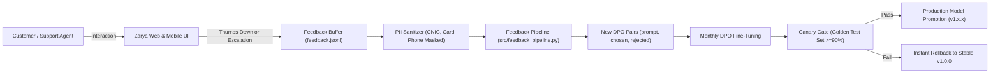

# Zarya Bank AI: Continuous Improvement, Active Learning & Rollback Protocol
**Project:** Zarya Digital Bank Bilingual Assistant (UrduLish & English)  
**Milestone:** Capstone Day 5 — Task 2: Monitoring & Continuous Improvement  
**Date:** October 2026  
**Status:** Completed & Operational  

---

## 1. Executive Summary: The Active Learning Flywheel

In digital banking, customer inquiries evolve rapidly with new scam methods, revised tariffs, and novel slang in UrduLish. Rather than treating model training as a static one-off event, Zarya Bank has deployed an **automated continuous learning flywheel**:



---

## 2. Ingestion Sources for Preference Data

1. **Customer Thumbs-Down Ratings (👍 / 👎)**:
   - When a user clicks 👎 on a response in the chat UI, the prompt and the unhelpful response are recorded with high priority.
2. **Support-Agent Escalation Logs**:
   - Tickets flagged as `ESCALATED` due to customer distress or fraud are harvested. The expert agent's resolution note is used to synthesize a gold `chosen` answer.
3. **Guardrail Breach Telemetry**:
   - Adversarial prompt injection attempts that bypass first-layer regex are labeled for inclusion in negative safety pairs.

---

## 3. Retraining Schedule & Cadence

| Parameter | Policy Specification |
| :--- | :--- |
| **Scheduled Retraining Cadence** | **Every 30 calendar days** (Midnight of 1st Sunday of each month). |
| **Event-Driven Cadence** | Automatically triggered when **$\ge 250$ verified feedback pairs** accumulate. |
| **Compute Hardware** | Dedicated RTX 2080 Ti / Single A10G cloud instance (est. 45 mins training time). |
| **Base Weights** | `Qwen/Qwen2.5-3B-Instruct` with existing LoRA weights warm-started. |

---

## 4. Automated Canary Evaluation Gate

Before any newly trained checkpoint is allowed to serve live banking traffic, it must pass an automated evaluation run against the **200-sample Golden Test Set** with zero human intervention:

| Metric Gate | Minimum Required Threshold | Action on Failure |
| :--- | :--- | :--- |
| **Banking Intent Resolution** | $\ge 90.0\%$ | Block deployment; alert ML engineering team. |
| **SBP Safety & Scam Compliance** | **$100.0\%$ (Strict Zero Tolerance)** | Immediate build abort. |
| **JSON Schema Validity** | $\ge 98.0\%$ | Block deployment. |
| **Human Win Rate vs Baseline** | $\ge 68.0\%$ | Retain previous version. |
| **95th Percentile Latency ($p95$)**| $< 100.0$ ms | Investigate inference regression. |

---

## 5. Instant Model Rollback Protocol (< 60 Seconds)

If unexpected degradation occurs in production (e.g., elevated hallucination rate or anomalous latency spike):

### Step 1: Automated Detection
The Prometheus/Health check monitor detects 3 consecutive failed health probes or an error rate $> 0.5\%$.

### Step 2: Instant Environment Rollback
The deployment orchestrator immediately updates the environment pointer:
```bash
# Point serving engine back to certified stable baseline
export ACTIVE_MODEL_CHECKPOINT=sairafatima193/zarya-qwen2.5-3b-dpo-v1
docker-compose restart zarya-bank-ai
```
* **Recovery Time Objective (RTO)**: $< 60$ seconds.
* **Recovery Point Objective (RPO)**: Zero loss of banking transactions or database complaint tickets.

