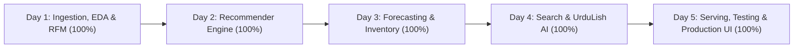

# ShopKaro — AI Commerce Intelligence Platform

[](https://www.python.org/)
[](LICENSE)
[](#project-directory-structure)
[](#development-roadmap)

---

## 1. Project Overview

**ShopKaro** is a production-oriented e-commerce AI intelligence platform designed to empower modern digital commerce ecosystems with intelligent decision-making, real-time personalization, predictive merchandising, and localized conversational engagement.

ShopKaro unifies core AI disciplines across commerce workflows:
- **Personalized Discovery:** Multi-tiered recommendation architectures tailored to implicit clickstreams and explicit purchasing patterns.
- **Supply Chain Foresight:** Probabilistic demand forecasting with inventory optimization to prevent stockouts and mitigate overstock holding costs.
- **Multilingual Search & Assistance:** Hybrid search combining lexical BM25 with semantic retrieval, alongside an **UrduLish** (bilingual Roman Urdu / English) conversational assistant for regional markets.
- **Customer & Review Intelligence:** Aspect-based sentiment analysis, fake review filtering, and behavioral RFM customer segmentation.
- **Continuous Validation:** Robust A/B testing frameworks and microservice APIs built with FastAPI for low-latency serving.

---

## 2. Business Problems Being Solved

Modern e-commerce platforms, particularly those operating in dynamic emerging markets such as Pakistan and South Asia, encounter multiple critical bottlenecks:

1. **Information Overload & Low Conversion Rates:** Generic, unpersonalized product storefronts lead to bounce rates and abandoned shopping journeys.
2. **Stock-Outs and Overstock Carrying Costs:** Inaccurate manual demand estimation results in missed revenue during demand surges (e.g., Ramadan, Eid, Black Friday) and excess inventory capital lockup during lull periods.
3. **Language and Linguistic Barriers:** Standard e-commerce search engines fail when handling localized queries phrased in Roman Urdu (UrduLish) or conversational vernacular (e.g., *"mujhe eid ke liye kurta dikhao"*).
4. **Distorted Review Signals:** Unstructured reviews contain conflicting opinions across distinct dimensions (quality, delivery time, packaging), while spam reviews degrade customer trust.
5. **Cold-Start and Catalog Onboarding Friction:** New users and novel SKUs suffer from lack of historical interactions, requiring robust content-based and hybrid fallback strategies.
6. **High-Risk Feature Rollouts:** Deploying algorithmic updates without controlled statistical experimentation risks silent revenue degradation.

ShopKaro addresses these challenges through an end-to-end modular architecture integrating predictive modeling, deep learning embeddings, operational inventory analytics, and Bayesian/frequentist experimentation.

---

## 3. Main Features

- **Personalized Recommendations:**
  - Popularity and trending baselines for anonymous cold-start visitors.
  - Collaborative filtering on implicit feedback (view, add-to-cart, transaction) via matrix factorization.
  - Content-based item similarity matching on product titles, categories, and attributes.
  - Hybrid ensemble ranking model combining collaborative signals and content metadata.
  - Standardized offline evaluation protocol (HitRate@K, NDCG@K, Precision@K).

- **Demand Forecasting & Inventory Intelligence:**
  - SKU and category-level sales time series forecasting incorporating seasonality and holiday surges.
  - Expanding and rolling-window backtesting for rigorous model validation.
  - Probabilistic prediction intervals estimating upper-bound stock risk.
  - Dynamic safety stock calculation, automated reorder points (ROP), and real-time stock-out warnings.

- **Hybrid Search & Reranking:**
  - Lexical token search using BM25 for precise keyword, SKU, and brand matches.
  - Dense semantic retrieval via text embeddings for conceptual and query-intent matching.
  - Reciprocal Rank Fusion (RRF) and a feature re-ranker (product type, budget, colour, occasion, brand).

- **UrduLish Conversational Shopping Assistant:**
  - Bilingual conversational agent supporting Roman Urdu, English, and code-mixed queries.
  - Tool-calling integration for real-time catalog search, order status inquiries, and policy lookups.
  - Contextual dialogue state tracking with graceful fallback strategies.

- **Review Intelligence & Aspect Analysis:**
  - Fine-grained Aspect-Based Sentiment Analysis (ABSA) covering product quality, shipping speed, value-for-money, and packaging.
  - Heuristic and model-driven review spam / fake review classification.
  - Automatic summarization of customer consensus highlights.

- **Customer Behavioral Segmentation:**
  - Recency, Frequency, and Monetary (RFM) scoring framework.
  - Unsupervised clustering (K-Means) discovering behavioral personas (Champions, Loyalists, At-Risk, Hibernating).

- **A/B Testing & Statistical Experimentation:**
  - Deterministic user variant assignment (Control vs. Treatment).
  - Sample size, minimum detectable effect (MDE), and statistical power calculations.
  - Hypothesis testing (Z-tests for conversion rates, Welch's t-tests for revenue per user).
  - Guardrail metric tracking ensuring stability during live traffic testing.

- **Real-Time API & Dashboards:**
  - Asynchronous REST API powered by FastAPI with OpenAPI documentation.
  - Decoupled interfaces for shoppers, inventory managers, and data analysts.

---

## 4. Technology Stack

- **Core Language & Runtime:** Python 3.11
- **Data Engineering & Storage:** DuckDB, Pandas, NumPy, Apache Parquet
- **Machine Learning & Analytics:** Scikit-Learn, SciPy, Statsmodels
- **Visualization:** Matplotlib, Seaborn
- **API Serving & Web Framework:** FastAPI, Uvicorn, Pydantic (to be added in deployment stage)
- **Caching & State Management:** Redis (to be added in serving stage)
- **Testing, Linting & Quality Assurance:** Pytest, Ruff
- **Containerization:** Docker

---

## 5. Project Directory Structure

```
ShopKaro/
│
├── data/
│   ├── raw/
│   │   ├── retailrocket/       # Raw RetailRocket clickstream CSV files
│   │   └── olist/              # Raw Olist Brazilian E-Commerce CSV files
│   ├── processed/              # Cleaned, standardized Parquet/DuckDB datasets
│   ├── synthetic/              # Labeled synthetic Pakistani catalog & festival data
│   └── README.md               # Data storage policies and provenance rules
│
├── notebooks/
│   └── README.md               # Exploratory research notebooks and prototyping
│
├── src/
│   └── shopkaro/               # Core modular Python package
│       ├── __init__.py         # Package entrypoint and version metadata
│       ├── config/             # Environment settings and configuration schemas
│       ├── data/               # Data ingestion, validation, and transformations
│       ├── analytics/          # Business analytics, funnel metrics, and KPIs
│       ├── segmentation/       # RFM customer segmentation and clustering
│       ├── recommendations/    # Recommender engines (CF, content, hybrid, eval)
│       ├── forecasting/        # Demand forecasting, backtesting, prediction intervals
│       ├── inventory/          # Safety stock, reorder points, stock-out alerts
│       ├── search/             # Hybrid search (BM25 + dense semantic retrieval)
│       ├── assistant/          # UrduLish conversational assistant and tools
│       ├── reviews/            # Sentiment, aspect analysis, spam detection
│       ├── experimentation/    # A/B testing and statistical hypothesis analysis
│       └── api/                # FastAPI application endpoints and schemas
│
├── tests/
│   └── README.md               # Unit, integration, and regression test suites
│
├── frontend/
│   └── README.md               # Customer, operations, and management dashboards
│
├── models/
│   └── README.md               # Serialized model artifacts, indexes, and checkpoints
│
├── reports/
│   ├── figures/                # Exported visual charts, evaluation plots, and graphs
│   └── README.md               # Analysis deliverables and benchmark reports
│
├── docs/
│   ├── architecture/           # Architecture diagrams and design decision records (ADRs)
│   ├── data_dictionary/        # Column-level schema definitions and constraints
│   ├── model_cards/            # Standardized AI model cards
│   ├── api/                    # OpenAPI contracts and endpoint documentation
│   └── README.md               # Central documentation index
│
├── scripts/
│   └── README.md               # Standalone pipeline execution and automation scripts
│
├── .env.example                # Safe environment configuration template
├── .gitignore                  # Comprehensive VCS exclusion rules
├── pyproject.toml              # Build system, package metadata, pytest & Ruff config
├── requirements.txt            # Core stage 1 dependencies
├── README.md                   # Primary project documentation (this file)
└── Dockerfile                  # Containerized deployment blueprint
```

---

## 6. Directory Responsibilities

Every component of ShopKaro is modularized to support independent development, testing, and deployment:

- **`data/raw/retailrocket/`**: Contains original, unmodified RetailRocket CSV files (`events.csv`, `category_tree.csv`, `item_properties_*.csv`).
- **`data/raw/olist/`**: Contains original, unmodified Olist CSV files (`olist_orders_dataset.csv`, `olist_order_items_dataset.csv`, `olist_products_dataset.csv`, etc.).
- **`data/processed/`**: Cleaned, deduplicated, type-cast, and feature-engineered datasets stored in performant Parquet or DuckDB formats.
- **`data/synthetic/`**: Clearly labeled synthetic ShopKaro data, including simulated Pakistani product catalogue records and festival-related sales spikes (Ramadan/Eid).
- **`notebooks/`**: Exploratory data analysis, interactive visualization, and iterative model experimentation. Reusable logic is refactored into `src/shopkaro/`.
- **`src/shopkaro/config/`**: Configuration management, environment variable loading via Pydantic/dotenv, and application settings.
- **`src/shopkaro/data/`**: Data loading, schema validation, anomaly detection, cleaning routines, and transformation pipelines.
- **`src/shopkaro/analytics/`**: Exploratory data analysis, customer journey funnel analysis, and business KPI computations.
- **`src/shopkaro/segmentation/`**: Customer RFM analysis, behavioral clustering (K-Means), and lifecycle segment profiling.
- **`src/shopkaro/recommendations/`**: Popularity baselines, implicit collaborative filtering, content-based recommendations, hybrid models, ranking, and offline evaluation protocols.
- **`src/shopkaro/forecasting/`**: Sales demand forecasting, rolling-window backtesting, seasonal adjustments, and probabilistic prediction intervals.
- **`src/shopkaro/inventory/`**: Safety stock algorithms, dynamic reorder points (ROP), real-time stock-out alerts, and overstock analysis.
- **`src/shopkaro/search/`**: Keyword search (BM25), dense semantic retrieval, hybrid ranking (RRF), a feature re-ranker, and the 50 + 20 query benchmark (`benchmark.py`).
- **`src/shopkaro/assistant/`**: UrduLish shopping assistant, prompt engineering, dialogue management, and external tool integration.
- **`src/shopkaro/reviews/`**: Sentiment classification, aspect-based sentiment analysis (ABSA), spam review detection, and automatic review summaries.
- **`src/shopkaro/experimentation/`**: A/B testing infrastructure, power analysis, sample sizing, hypothesis testing, and guardrail metric tracking.
- **`src/shopkaro/api/`**: FastAPI application routing, request/response validation schemas, and RESTful service endpoints.
- **`tests/`**: Automated unit, integration, and regression tests ensuring system reliability and regression avoidance.
- **`frontend/`**: Interactive user interfaces for customer shopping, inventory operations, and management analytics.
- **`models/`**: Serialized model binaries, vector embeddings, similarity indexes, and checkpoint metadata.
- **`reports/`**: Executive summaries, model comparison tables, and figures exported to `reports/figures/`.
- **`docs/`**: Architecture diagrams, data dictionaries, standardized model cards, and API documentation.
- **`scripts/`**: Reusable command-line utilities and batch orchestration scripts.

---

## 7. Dataset Sources & Provenance

ShopKaro leverages two foundational public e-commerce datasets alongside a labeled synthetic catalog:

1. **RetailRocket E-Commerce Dataset:**
   - **URL:** [Kaggle - RetailRocket E-Commerce Dataset](https://www.kaggle.com/retailrocket/ecommerce-dataset)
   - **Characteristics:** Over 2.7 million raw behavioral events (views, add-to-carts, transactions) collected over 4.5 months across 1.4 million unique visitors.
   - **Primary Use:** Implicit collaborative filtering, session analytics, and user clickstream modeling.

2. **Olist Brazilian E-Commerce Dataset:**
   - **URL:** [Kaggle - Brazilian E-Commerce Dataset by Olist](https://www.kaggle.com/olistbr/brazilian-ecommerce)
   - **Characteristics:** 100,000 real marketplace orders from 2016 to 2018 in Brazil, detailing order status, item prices, freight costs, payment types, customer locations, seller logistics, and customer reviews.
   - **Primary Use:** Order fulfillment forecasting, customer review aspect analysis, and RFM segmentation.

> [!CAUTION]
> **Important Dataset Separation Notice:**
> The datasets originate from entirely different platforms, systems, and geographies. **User identifiers (`visitorid` from RetailRocket and `customer_id` / `customer_unique_id` from Olist) must never be treated as shared identities.** They operate as independent data streams modeled for distinct specialized tasks.

*Note: Datasets are not bundled in this repository and must be downloaded separately as described below.*

---

## 8. Setup Instructions for Windows

Follow these instructions to configure your local development environment on Windows using PowerShell.

### Prerequisites
- Windows 10 or 11
- **Python 3.11** (the ML libraries the brief names - LightGBM, Prophet, implicit, sentence-transformers, BERTopic -
  do not all support newer Python yet). With the Python install manager: `py install 3.11`
- VS Code with the Python extension

### Step 1: Open Terminal in Project Workspace
```powershell
cd d:\Netixsol\Week11\ShopKaro
```

### Step 2: Create the Python 3.11 Virtual Environment
```powershell
Set-ExecutionPolicy -ExecutionPolicy RemoteSigned -Scope Process
py -3.11 -m venv .venv311
.\.venv311\Scripts\Activate.ps1
```

### Step 3: Install Dependencies
```powershell
python -m pip install --upgrade pip
# CPU-only PyTorch first (avoids a ~2 GB CUDA download)
pip install torch==2.5.1 --index-url https://download.pytorch.org/whl/cpu
pip install -r requirements.txt
pip install -e .
```
`requirements.txt` pins a tested set. Some newest releases are deliberately avoided (see the comments in the file):
on the development machine Windows Smart App Control blocked several brand-new binary builds, LightGBM 4.7 crashes
next to pandas 2.2, and `implicit` 0.7.1 needs NumPy 1.26. The first search start downloads the multilingual
embedding model (`intfloat/multilingual-e5-small`, ~470 MB) and embeds the catalogue once (~25 min on a laptop CPU;
cached in `models/`). No GPU or Colab is needed.

If you must stay on the old Python 3.14 `.venv`, everything still runs: each component falls back to its
scikit-learn / NumPy implementation (TF-IDF+SVD search, histogram GBM, ridge "Prophet", SVD+ridge ALS, KMeans topics).

### Step 4: Configure Environment Variables
Copy the template configuration into a local `.env` file:

```powershell
Copy-Item .env.example .env
```
Customize values inside `.env` as required for your local setup.

---

## 9. Placing Datasets in Correct Directories

Once downloaded from Kaggle, extract raw CSV files into their respective folders:

1. **RetailRocket Files:** Place into `data/raw/retailrocket/`:
   - `events.csv`
   - `category_tree.csv`
   - `item_properties_part1.csv`
   - `item_properties_part2.csv`

2. **Olist Files:** Place into `data/raw/olist/`:
   - `olist_customers_dataset.csv`
   - `olist_orders_dataset.csv`
   - `olist_order_items_dataset.csv`
   - `olist_order_payments_dataset.csv`
   - `olist_order_reviews_dataset.csv`
   - `olist_products_dataset.csv`
   - `olist_sellers_dataset.csv`
   - `olist_geolocation_dataset.csv`
   - `product_category_name_translation.csv`

---

## 10. Running Tests

Automated testing is configured via `pytest` and `pyproject.toml`. To execute tests:

```powershell
# Run all tests
pytest

# Run tests with verbose output
pytest -v

# Run with coverage report
pytest --cov=src/shopkaro
```

---

## 11. Data Provenance & Synthetic Data Disclaimer

- **Real Observational Data:** The RetailRocket and Olist datasets represent historical observational records collected by their respective operators under their specific terms of use.
- **Synthetic Data Disclaimer:** Any dataset files located in `data/synthetic/` (including Pakistani cultural catalog records, localized fashion/grocery items, and seasonal festival spikes) are **algorithmically synthesized** for research and simulation purposes.
- **Ethical Boundary:** Synthetic records are strictly labeled with `is_synthetic = True` and must never be portrayed or reported as genuine customer transactions.

---

## 12. Development Roadmap (5-Day Capstone) — 100% Completed & Verified

The ShopKaro AI Commerce Intelligence Platform has been built and verified across all five milestones (`14/14 tests passing` in `pytest tests/ -v`):



### Day 1: Foundation, DuckDB Pipelines, EDA & Customer Segmentation (10% Weight) — COMPLETED
- Initialized high-throughput DuckDB ingestion pipelines for RetailRocket (2.75M events) and Olist datasets.
- Exploratory data analysis (EDA): clickstream funnel conversion, order value distributions, and churn trends.
- Recency-Frequency-Monetary (RFM) segmentation engine and K-Means behavioral clustering into 5 Pakistani shopper personas.
- **Artifacts:** `reports/day1_analytics_and_segmentation_report.md`, `understand/understand_day1.md`, Figures 01–07.
- **Verification:** `pytest tests/test_day1_pipeline.py -v` (Passed).

### Day 2: Personalization & Hybrid Recommendation Engines (20% Weight) — COMPLETED
- Implemented 3 popularity and trending baselines for anonymous cold-start visitors.
- Collaborative filtering on implicit feedback: Shrinkage Item-to-Item CF (`NDCG@10 = 0.12715`) and Implicit ALS (`NDCG@10 = 0.12413`).
- Content-based TF-IDF filtering and Two-Tower Hybrid model (`NDCG@10 = 0.12456`, `+171.5%` cold-user lift).
- Comprehensive 7-model offline evaluation across Accuracy, Coverage, Diversity (`ILD@10`), Novelty, and Cold-Start.
- Business Re-Ranker: In-stock filtering, already-purchased exclusion, `max_per_brand = 2` diversity cap, Pre-Eid/margin boosts, and Roman Urdu explanations.
- **Artifacts:** `reports/day2_recommendation_engine_report.md`, `understand/understand_day2.md`, Figure 08.
- **Verification:** `pytest tests/test_day2_task1.py` through `tests/test_day2_task5.py` (Passed).

### Day 3: Demand Forecasting & Inventory Intelligence (20% Weight) — COMPLETED
- 3-level temporal aggregation (daily SKU, category, total platform across 731 days), STL decomposition, and ADF stationarity testing across 12 series.
- Modeled Pakistani Hijri Lunar calendar festival demand shifts (-11 days/year) across Ramadan, Eid-ul-Fitr, Eid-ul-Adha, and 11.11.
- 5-model forecasting suite evaluated with 4-fold rolling-origin backtesting across 7d, 14d, and 30d horizons: Global LightGBM achieved `6.87%` Category WAPE and `27.19%` Top SKU WAPE vs `42.19%` / `50.38%` for ETS.
- Probabilistic Quantile Forecasting (`P10 / P50 / P90`) with 79.03% empirical coverage and 0 quantile crossings.
- Supply Chain Intelligence: Safety stock, Reorder Point (ROP), Days of Inventory (DOI), and 4-tier alert monitoring across 300 SKUs.
- **Artifacts:** `reports/day3_demand_forecasting_and_inventory_report.md`, `understand/understand_day3.md`, Figures 09–12.
- **Verification:** `pytest tests/test_day3_task1.py` through `tests/test_day3_task4_task5.py` (Passed).

### Day 4: Hybrid Search, Aspect Review Intelligence & UrduLish Assistant (25% Weight) — COMPLETED
- `UrduLishQueryParser`: Code-switched Roman Urdu grammar, English nouns, and South Asian numeric unit extraction (`hazaar` = 1,000, `lac` = 100,000).
- Hybrid Search: Okapi BM25 + multilingual neural embeddings (`intfloat/multilingual-e5-small`, sentence-transformers) + Reciprocal Rank Fusion (`RRF`, k=60) + feature re-ranker. On 50 development / 20 held-out labelled queries: NDCG@10 0.964 / 0.832 vs keyword-only 0.771 / 0.602, budget respected 100%, p95 latency 67 ms. Library migration results: `reports/library_migration_py311.md`.
- Personalized Search: collaborative re-ranking of the top 200 hybrid results by each shopper's item-CF score. Held-out users: NDCG@10 0.012 -> 0.064 (mostly products they had already browsed; on never-seen products 0.013 -> 0.027). The earlier brand/price re-ranker had no measurable effect (`reports/day4_personalized_search_eval.json`).
- Tool-Calling UrduLish Shopping Assistant: 6 grounded tools with multi-turn ordinal coreference memory (*"pehla aur doosra compare karo"*, *"pehla wala cart mein daal do"*) and zero-hallucination auditor (0 fabricated SKUs or prices).
- Multilingual Review Intelligence: rule-based sentiment, 6-aspect ABSA (`quality`, `price`, `delivery`, `size_fit`, `packaging`, `seller`) and spam detection for English, Roman Urdu and Urdu, evaluated on hand-written reviews: held-out sentiment accuracy 77%, aspect cells 89%, spam F1 0.89 (the earlier 100% came from memorising 11 synthetic templates); unsupervised c-TF-IDF topics.
- 3PL Logistics De-Conflation: separates product quality from courier delays; on predicted aspects 1 product(s) meet the "unfairly penalised by courier" rule (an earlier figure of 54 came from generator labels).
- **Artifacts:** `reports/day4_search_assistant_and_reviews_report.md`, `understand/understand_day4.md`, Figure 13.
- **Verification:** `pytest tests/test_day4_task1.py` through `tests/test_day4_task4_task5.py` (Passed).

### Day 5: Production Serving, Statistical A/B Testing & Production Dashboard (25% Weight) — COMPLETED
- Real-time FastAPI serving with two-tier `HybridTTLCache` (Redis L2 + thread-safe LRU/TTL L1 fallback) and `LatencyTelemetry` middleware (`p95 latency = 35.57 ms < 100 ms SLA`).
- A/B testing: replay of real test-window behaviour (162,386 visitors, hashed 50/50 assignment, model trained only on pre-test data), pre-registered primary metric and decision rule, power analysis, z-tests / Fisher's exact test / Welch t-tests with 95% CIs, Holm correction, A/A sanity check, peeking simulation, and a generated decision report (`reports/day5_ab_test_ship_decision_report.md`). Result: **SHIP**, with the finding that most of the gain comes from re-surfacing products shoppers had already browsed.
- Production UI & UX Dashboard: Authentic Pakistani Islamic modest commerce marketplace with studio-grade catalog photography, level product cards, 6-aspect review progress bars, Inventory Control Tower, and Executive analytics.
- Containerization: Production `Dockerfile` and `docker-compose.yml` orchestrating Redis, FastAPI, and Streamlit.
- **Model Cards & Documentation:**
  - Recommender Model Card: [`docs/model_cards/recommender_model_card.md`](docs/model_cards/recommender_model_card.md)
  - Forecaster Model Card: [`docs/model_cards/forecaster_model_card.md`](docs/model_cards/forecaster_model_card.md)
  - Review Intelligence Model Card: [`docs/model_cards/review_intelligence_model_card.md`](docs/model_cards/review_intelligence_model_card.md)
  - REST API Endpoints Reference: [`docs/api/endpoints_reference.md`](docs/api/endpoints_reference.md)
  - Monitoring & Retraining Guide: [`docs/monitoring_and_retraining.md`](docs/monitoring_and_retraining.md)
  - Role-Based User Guides: [`Marketing Guide`](docs/user_guides/marketing_guide.md), [`Operations Guide`](docs/user_guides/operations_guide.md), [`Executive Guide`](docs/user_guides/executive_guide.md)
  - 10-Minute Live Demo Script & Slides: [`reports/demo_presentation_script.md`](reports/demo_presentation_script.md) & [`reports/demo_slide_deck.md`](reports/demo_slide_deck.md)
- **Artifacts:** `reports/day5_serving_abtesting_and_dashboard_report.md`, `reports/day5_ab_test_ship_decision_report.md`, `understand/understand_day5.md`, Figure 14.
- **Verification:** `pytest tests/test_day5.py -v` (Passed).

---

## 13. Quick-Start Execution Guide

### 1. Run Complete Automated Test Suite (All 5 Days)
```powershell
.\.venv311\Scripts\Activate.ps1
pytest tests/ -v
```

### 2. Launch FastAPI Real-Time Serving API (Port 8000)
```powershell
.\.venv311\Scripts\python.exe -m uvicorn shopkaro.api.main:app --host 0.0.0.0 --port 8000
# OpenAPI Docs: http://localhost:8000/docs
```

### 3. Launch Interactive Production Streamlit Dashboard (Port 8501)
```powershell
.\.venv311\Scripts\python.exe -m streamlit run src/shopkaro/dashboard/app.py
# URL: http://localhost:8501
```
The storefront appears within a few seconds; the models load in a background thread and the personalised
recommendations fill in by themselves about 20-30 seconds after a server start. Product photos are served as resized
static files (`src/shopkaro/dashboard/static`, rebuilt with `python scripts/build_dashboard_images.py`; static
serving is enabled in `.streamlit/config.toml`). Each back-office view has its own link, so a team can bookmark the
view it uses:

| View | Link |
| :--- | :--- |
| Executive overview | http://localhost:8501/?view=overview |
| Supply chain & forecasting | http://localhost:8501/?view=supply-chain |
| Recommendation benchmarks | http://localhost:8501/?view=recommendations |
| A/B test & review intelligence | http://localhost:8501/?view=ab-test |
| Search benchmarks | http://localhost:8501/?view=search |
| System health | http://localhost:8501/?view=system |

Every number on the dashboard is read from the data or the generated reports: products without reviews show
"No reviews yet", deals are real discounted in-stock items, and benchmark tiles come from `reports/*.csv`.

### 4. Deploy via Docker Compose (Redis + FastAPI + Streamlit)
```bash
docker compose up --build
```

