# ShopKaro — Entity-Relationship (ER) Data Model

This document defines the relational and analytical schema stored in DuckDB (`data/processed/shopkaro.duckdb`) and Parquet feature stores (`data/processed/` & `data/synthetic/`).

---

## 1. Entity-Relationship Diagram (Mermaid)

```mermaid
erDiagram
    PRODUCT_CATALOGUE ||--o{ INTERACTIONS_CLEAN : "browsed_or_purchased_in"
    PRODUCT_CATALOGUE ||--o{ DAILY_SALES : "aggregates_daily_demand"
    PRODUCT_CATALOGUE ||--o{ REVIEWS : "receives_feedback"
    PRODUCT_CATALOGUE ||--|| ITEM_FEATURES : "enriched_with_embeddings"
    PRODUCT_CATALOGUE ||--|| ITEM_ID_MAP : "indexed_by"

    USER_ID_MAP ||--o{ INTERACTIONS_CLEAN : "generates_events"
    USER_ID_MAP ||--o{ SESSIONS : "groups_into_30min"
    USER_ID_MAP ||--o| CUSTOMER_SEGMENTS : "assigned_rfm_persona"
    USER_ID_MAP ||--o| USER_FEATURES : "summarizes_train_behavior"

    SESSIONS ||--|{ INTERACTIONS_CLEAN : "contains_clickstream"
    FESTIVAL_CALENDAR ||--o{ INTERACTIONS_CLEAN : "contextualizes_event_date"
    FESTIVAL_CALENDAR ||--o{ DAILY_SALES : "drives_seasonal_uplift"

    PRODUCT_CATALOGUE {
        varchar product_id PK "SK-00001..SK-25000"
        bigint raw_itemid UK "RetailRocket itemid"
        varchar olist_product_id "Mapped Olist product_id"
        varchar title "English + Roman Urdu Title"
        varchar description "Full description & UrduLish search tags"
        varchar category "Pakistani marketplace category"
        varchar sub_category "Granular sub-category"
        varchar brand "Local/Global brand (Khaadi, Sapphire, Samsung...)"
        varchar color "Product color"
        varchar occasion "Eid, Shaadi/Wedding, School/Office, Winter..."
        double price_pkr "Price in Pakistani Rupees (PKR)"
        varchar price_band "Budget, Mid-Range, Premium, Luxury"
        boolean on_sale "Active promotional discount flag"
        double discount_pct "Promotional discount %"
        double margin_pct "Gross profit margin (0.10 - 0.60)"
        integer stock_qty "Current warehouse inventory units"
        boolean in_stock "Availability flag (stock_qty > 0)"
        integer lead_time_days "Supplier replenishment lead time"
        boolean is_synthetic "Provenance flag"
    }

    INTERACTIONS_CLEAN {
        varchar session_id FK "30-min inactivity session ID"
        varchar user_id FK "USR-<visitor_id>"
        bigint visitor_id "Raw RetailRocket visitorid"
        varchar product_id FK "SK-xxxxx"
        varchar event_type "view | addtocart | transaction"
        double implicit_weight "view=1.0, addtocart=3.0, transaction=6.0"
        bigint transaction_id "Nullable purchase ID"
        timestamp event_timestamp "Cleaned & aligned timestamp"
        date event_date "Calendar date"
        varchar category "Product category"
        varchar brand "Product brand"
        double price_pkr "Item price in PKR"
        varchar festival_name "Active Pakistani festival or Regular_Day"
        boolean is_festival_period "True if within festival window"
    }

    SESSIONS {
        varchar session_id PK "SES-<visitor_id>-<seq>"
        varchar user_id FK "USR-<visitor_id>"
        timestamp session_start "First click in session"
        timestamp session_end "Last click in session"
        integer session_duration_sec "Duration in seconds"
        integer total_events "Total clicks (< 1,000 bot filter)"
        integer view_count "Views in session"
        integer cart_count "Add-to-carts in session"
        integer purchase_count "Transactions in session"
        double session_revenue_pkr "Total PKR spent in session"
        boolean is_festival_session "Occurred during festival window"
    }

    CUSTOMER_SEGMENTS {
        varchar user_id PK "USR-<visitor_id>"
        integer recency_days "Days since last activity"
        integer frequency_sessions "Total active sessions"
        double monetary_intent_pkr "Realized + weighted intent value (PKR)"
        integer r_score "Recency quintile (1-5)"
        integer f_score "Frequency quintile (1-5)"
        integer m_score "Monetary quintile (1-5)"
        integer cluster_id "K-Means cluster ID (0-4)"
        varchar segment_name "Pakistani persona name"
        varchar recommended_marketing_action "Targeted retention/upsell action"
    }

    DAILY_SALES {
        date sale_date PK "2024-01-01 to 2025-12-31 (731 days)"
        varchar product_id PK "SK-xxxxx (Top 300 products)"
        varchar category "Product category"
        varchar brand "Product brand"
        varchar velocity_tier "Fast_Mover | Steady_Mover | Slow_Intermittent"
        integer units_sold "Daily units sold"
        double unit_price_pkr "Unit price in PKR"
        double revenue_pkr "Daily GMV in PKR"
        varchar festival_name "Ramadan, Eid ul Fitr, 11.11, etc."
        boolean is_festival_day "Festival indicator"
    }

    REVIEWS {
        varchar review_id PK "REV-00001..REV-08000"
        varchar order_id "Olist order_id reference"
        varchar product_id FK "SK-xxxxx"
        varchar seller_id "Marketplace seller ID"
        integer rating "1 to 5 stars"
        varchar sentiment_label "Positive | Neutral | Negative"
        varchar language "Roman_Urdu | English | Urdu"
        varchar review_title "Review headline"
        varchar review_text "Full customer review body"
        integer delivery_delay_days "Days delivered after estimate"
        integer aspect_quality "-1, 0, +1 sentiment"
        integer aspect_price "-1, 0, +1 sentiment"
        integer aspect_delivery "-1, 0, +1 sentiment"
        integer aspect_size_fit "-1, 0, +1 sentiment"
        integer aspect_packaging "-1, 0, +1 sentiment"
        integer aspect_seller "-1, 0, +1 sentiment"
        boolean is_fake_spam "Flagged duplicate/burst/promo spam"
    }

    FESTIVAL_CALENDAR {
        integer festival_id PK "1..17"
        varchar festival_name "Ramadan, Eid ul Fitr, Eid ul Adha, 11.11..."
        varchar festival_type "Islamic_Moving | Commercial_Fixed | Seasonal_Fixed"
        date start_date "Festival start date"
        date end_date "Festival end date"
        varchar boost_categories "Comma-separated high-surge categories"
        double demand_multiplier "Historical demand surge factor"
    }
```

---

## 2. Entity Isolation & Data Governance Rules

1. **Strict Identity Separation:** RetailRocket `visitorid` (`USR-*`) and Olist `customer_id` are never merged as a single human identity. Olist order/review structures provide marketplace fulfillment, seller logistics, and review score dynamics, whereas RetailRocket provides granular session clickstreams (`view` $\to$ `addtocart` $\to$ `transaction`).
2. **Chronological Partitioning (`train_interactions`, `val_interactions`, `test_interactions`, `cold_start_test`):** All user and item behavioral aggregates (`user_features`, `item_features`) are computed strictly on `train_interactions` to guarantee zero future data leakage.

