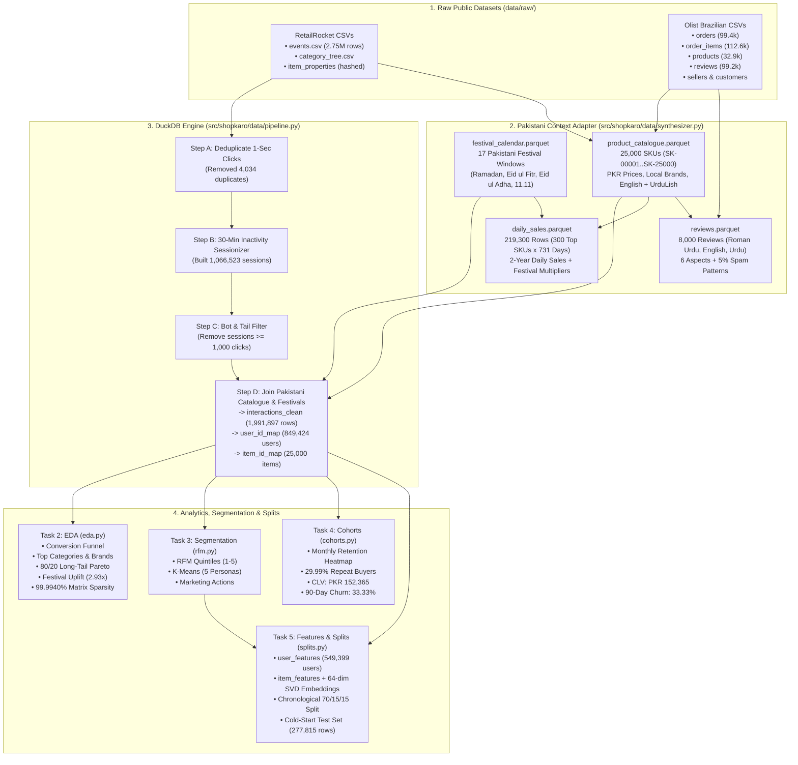

# ShopKaro — Day 1 Deep-Dive Study & Architecture Guide
### Data Foundation, Customer Analytics & Segmentation

**Document Purpose:** This guide explains **what** we built in Day 1, **why** we made every architectural and data decision, **how** each Python file and SQL query works under the hood, and **how to explain and defend Day 1** in stakeholder demos or technical interviews.

---

## 1. Day 1 Big Picture & Business Objective

### 1.1 Why Day 1 Comes Before Any Machine Learning Model
In real-world production AI, **a recommendation engine or forecasting model is only as good as the data feeding it**. If you train a recommender on raw click logs without cleaning them first:
- **Web scrapers and bots** (clicking 2,000 items in 10 minutes) will dominate the collaborative filtering matrix and warp item similarity.
- **Accidental double-clicks** (clicking the same item 3 times in 1 second) will artificially inflate popularity scores.
- **Random train/test splits** will leak future trends into the past, giving you fake high accuracy offline that collapses in production.

### 1.2 The ShopKaro Business Problem We Are Solving in Day 1
Our client, **ShopKaro**, is a Pakistani e-commerce marketplace with thousands of products across fashion, electronics, home appliances, beauty, kids' school supplies, and groceries. Before recommending products or forecasting stock, ShopKaro's management needs answers to five foundational questions:
1. **Who are our customers, and how do they shop?** (How many visitors just browse vs. add to cart vs. actually buy?)
2. **Which products and brands actually drive revenue?** (Are 80% of sales coming from a tiny fraction of products?)
3. **How do Pakistani festivals affect shopping?** (How much does demand jump during **Ramadan**, **Chaand Raat & Eid ul Fitr**, **Eid ul Adha**, and **11.11 Mega Sales**?)
4. **What are our distinct customer personas?** (Can we separate *"Eid & Festive Lawn Shoppers"* from *"Loyal Electronics & VIP Buyers"* and *"Bargain Hunters"* so marketing can target them?)
5. **What is our customer retention and lifetime value?** (How many buyers return in Month +1, +2, +3, what is their Customer Lifetime Value in PKR, and who has churned?)

Day 1 turns **2.75 million raw clicks** and **100,000 marketplace orders** into a clean, relational **DuckDB data warehouse (`shopkaro.duckdb`)**, answers all 5 business questions with visual charts, and prepares leak-free training/validation/test splits for Days 2–5.

---

## 2. How We Planned Day 1 (Architecture & Workflow)

### 2.1 End-to-End Day 1 Execution Flow

---

### 2.2 Every File Created in Day 1 and Its Role

| File Path | Role in the Architecture |
| :--- | :--- |
| [`src/shopkaro/config/settings.py`](../src/shopkaro/config/settings.py) | **Central Configuration:** Defines directory paths, DuckDB location (`data/processed/shopkaro.duckdb`), the 30-minute session timeout (`session_inactivity_minutes = 30`), the 1,000-click bot threshold (`bot_max_clicks_per_session = 1000`), the 90-day churn rule (`churn_inactivity_days = 90`), and chronological split ratios (`70% / 15% / 15%`). |
| [`src/shopkaro/data/synthesizer.py`](../src/shopkaro/data/synthesizer.py) | **Pakistani Context & Synthetic Bridge:** Generates `festival_calendar.parquet`, `product_catalogue.parquet`, `daily_sales.parquet`, and `reviews.parquet` inside `data/synthetic/` and links them to real RetailRocket and Olist IDs. |
| [`src/shopkaro/data/pipeline.py`](../src/shopkaro/data/pipeline.py) | **Task 1 — DuckDB ETL Pipeline:** Loads raw CSVs into DuckDB, removes duplicate and bot events, builds 30-minute sessions, maps PKR prices and Pakistani festivals onto events, and creates 0-indexed `user_id_map` and `item_id_map` tables. |
| [`src/shopkaro/analytics/eda.py`](../src/shopkaro/analytics/eda.py) | **Task 2 — Exploratory Data Analysis:** Runs SQL analytical queries on `shopkaro.duckdb`, generates 5 charts (`01_conversion_funnel.png` through `05_user_item_sparsity.png`), and produces 5 executive one-line business insights. |
| [`src/shopkaro/segmentation/rfm.py`](../src/shopkaro/segmentation/rfm.py) | **Task 3 — Customer Segmentation:** Computes Recency, Frequency, and Monetary (PKR) quintile scores plus behavioral ratios for 60,000 top users, runs K-Means (`k=5`), names each Pakistani shopping persona, assigns marketing actions, and saves `06_customer_rfm_segments.png`. |
| [`src/shopkaro/analytics/cohorts.py`](../src/shopkaro/analytics/cohorts.py) | **Task 4 — Cohort & Retention Analysis:** Computes the monthly acquisition cohort retention matrix (`07_cohort_retention_heatmap.png`), repeat purchase rate, Average Order Value (AOV), Customer Lifetime Value (CLV), and 90-day churn rate. |
| [`src/shopkaro/data/splits.py`](../src/shopkaro/data/splits.py) | **Task 5 — Features & Chronological Splits:** Builds `user_features`, `item_features`, 64-dim dense SVD text embeddings (`models/item_text_embeddings.npy`), strict time-based `train` / `val` / `test` splits, and the `cold_start_test` set. |
| [`scripts/run_day1_pipeline.py`](../scripts/run_day1_pipeline.py) | **Master Orchestrator:** Executes Tasks 1–5 in sequence and compiles the complete Markdown report at [`reports/day1_analytics_and_segmentation_report.md`](../reports/day1_analytics_and_segmentation_report.md). |
| [`docs/architecture/data_model_er.md`](../docs/architecture/data_model_er.md) | **ER Diagram:** Complete Mermaid Entity-Relationship diagram of all DuckDB tables and foreign keys. |
| [`docs/data_dictionary/schema_dictionary.md`](../docs/data_dictionary/schema_dictionary.md) | **Data Dictionary:** Column-by-column types and definitions for all tables. |
| [`tests/test_day1_pipeline.py`](../tests/test_day1_pipeline.py) | **Automated Verification:** `pytest` test suite verifying catalogue/sales generation, table schemas, bot filtering, and zero temporal leakage across `train <= val <= test`. |

---

## 3. Datasets Breakdown: Raw vs. Synthetic & How They Connect

A critical question any technical reviewer will ask is:
> *"Did you use the real RetailRocket and Olist datasets, or did you use synthetic data, and how do they fit together?"*

Here is the exact, transparent answer: **We used both.** We used the real datasets for **human clickstream behavior, sessions, order logistics, seller IDs, and ratings**, and we built a deterministic **Pakistani Contextual Bridge (`data/synthetic/`)** to supply the missing text, PKR prices, and 2-year festival seasonality.

### 3.1 What We Got From the Raw Datasets (`data/raw/`)

1. **RetailRocket (`data/raw/retailrocket/events.csv` — 2,756,101 rows):**
   - **What it has:** Real user clickstream logs (`timestamp`, `visitorid`, `event` $\in \{\text{view}, \text{addtocart}, \text{transaction}\}$, `itemid`, `transactionid`).
   - **What it lacks:** In `item_properties_part1.csv` and `part2.csv`, all product text is **anonymized into random-looking numbers** (e.g., `property: 888, value: 1116713 960601 n277.200`) to protect the original store's identity. It has **no product titles, no descriptions, no brand names, and no currency prices**. Furthermore, it only covers **4.5 months** (May–Sep 2015), whereas Day 3 requires **at least 2 full years** of daily sales with Pakistani festivals.

2. **Olist Brazilian E-Commerce (`data/raw/olist/*.csv` — ~100,000 orders):**
   - **What it has:** Real marketplace order timestamps (`order_purchase_timestamp`, `order_estimated_delivery_date`, `order_delivered_customer_date`), seller IDs (`seller_id`), item prices in Brazilian Reals, and 1–5 star `review_score`s.
   - **What it lacks:** `olist_products_dataset.csv` only gives the character length of product names (`product_name_lenght: 40`) — **it has no product titles or descriptions!** And `olist_order_reviews_dataset.csv` is written in **Portuguese**, whereas ShopKaro requires **English, Urdu, and Roman Urdu (UrduLish)** reviews (e.g., *"Kapra acha hai lekin delivery bohot late thi"*).

---

### 3.2 How the 4 Generated Datasets in `data/synthetic/` Bridge the Gap & Connect via Foreign Keys

| Synthetic / Adapted Table | Exact Foreign-Key Connection to Raw Data | What It Adds & Why It Is Essential |
| :--- | :--- | :--- |
| **1. `product_catalogue`** (`25,000` SKUs: `SK-00001`..`SK-25000`) | • **`raw_itemid`** = the **exact real `itemid` from RetailRocket `events.csv`** (top 25,000 most active items). • **`olist_product_id`** = mapped to a **real `product_id` from Olist**. | Adds **11 Pakistani categories** (*Women's Lawn & Unstitched, Men's Kurta & Ethnic, Bridal & Formal Wear, Footwear & Khussa, Smartphones & Accessories, Laptops & Computing, Kids & School Supplies, Beauty & Fragrances, Home & Kitchen Appliances, Groceries & Staples, Winter Wear & Jackets*), **local/global brands** (*Khaadi, Sapphire, Gul Ahmed, J., Maria B, Bata, Servis, Samsung, Infinix, Lenovo, Dawlance, Shan*), **PKR prices**, **margin %**, **stock quantities**, and **English + Roman Urdu titles & descriptions**. Also includes **15 curated hero products** matching every demo query in the Capstone PDF! |
| **2. `festival_calendar`** (`17` festival windows, 2024–2025) | • Joined by calendar date (`event_date BETWEEN start_date AND end_date`) onto `interactions_clean` and `daily_sales`. | Models **moving Islamic festivals** (**Ramadan**, **Chaand Raat & Eid ul Fitr**, **Eid ul Adha**, which shift ~11 days earlier in 2025 than in 2024) plus fixed commercial events (**11.11 Mega Sale**, **Blessed Friday**, **Azadi Sale**, **Back-to-School**, **Shaadi Season**). |
| **3. `daily_sales`** (`219,300` rows = `300` top SKUs $\times$ `731` days) | • Linked via **`product_id` (`SK-00001`..`SK-00300`)**, ranked by their **real RetailRocket interaction velocity** (`Fast_Mover`, `Steady_Mover`, `Slow_Intermittent`). | Provides **2 full years (`2024-01-01` to `2025-12-31`) of daily unit sales and PKR revenue** with weekly weekend peaks, summer lawn vs. winter jacket climate waves (where winter jackets drop near zero in summer, matching the Day 3 scenario!), Ramadan/Eid $3\times\text{–}4.5\times$ surges, and intermittent demand for slow movers. |
| **4. `reviews`** (`8,000` multilingual reviews) | • Built from a SQL join of **3 real Olist CSVs** (`olist_order_reviews_dataset` $\bowtie$ `olist_orders_dataset` $\bowtie$ `olist_order_items_dataset`). • Preserves Olist's **real `review_id`, `order_id`, `seller_id`, 1–5 `rating`, `review_date`, and real `delivery_delay_days`**. | Replaces Portuguese text with **Roman Urdu (`UrduLish`), English, and Urdu script** reviews that accurately reflect the **real Olist star rating and real delivery delay** (if the real Olist order arrived 5 days late, the review complains about late delivery!). Also adds ground-truth sentiment scores across **6 aspects** (`quality`, `price`, `delivery`, `size_fit`, `packaging`, `seller`) and **5% fake/spam reviews** (duplicates, promo links, bot bursts). |

> [!CAUTION]
> **Golden Rule of Entity Isolation:** RetailRocket `visitor_id` (`USR-*`) and Olist `customer_id` originate from two different companies and countries. We **never** join them as if they were the same person. RetailRocket drives user session/clickstream modeling, while Olist drives order logistics, seller delivery performance, and review ratings.

---

## 4. Task-by-Task Deep Dive (How We Did It & Results)

### Task 1 — Data Pipeline, Cleaning & Session Building (`src/shopkaro/data/pipeline.py`)

#### How It Works Step by Step:
1. **Raw Ingestion:** Loads `events.csv` (**2,756,101 rows**) into DuckDB table `raw_events`, converting Unix millisecond timestamps (`ts_ms`) into SQL timestamps.
2. **1-Second Deduplication:** In web clickstreams, double-clicking a button or page auto-reloading fires duplicate tracking events within the same second. We grouped by `(visitor_id, raw_itemid, event_type, CAST(ts_ms / 1000 AS BIGINT))` and kept the earliest event, removing **4,034 duplicate clicks**.
3. **30-Minute Inactivity Sessionization:**
   - Using SQL window functions (`LAG(ts_ms) OVER (PARTITION BY visitor_id ORDER BY ts_ms)`), we computed the time elapsed since each user's previous click.
   - Whenever `(ts_ms - prev_ts_ms) / 1000.0 > 1800` (30 minutes = 1,800 seconds), we set `is_new_session = 1`.
   - A cumulative sum (`SUM(is_new_session) OVER (...)`) assigns each user's session sequence number, creating **1,066,523 globally unique sessions** (`SES-<visitor_id>-<seq>`).
4. **Bot Filtering ($\ge 1,000$ clicks rule):**
   - Any session with $\ge 1,000$ clicks is flagged into `bot_sessions_audit` and excluded from `interactions_clean`, along with unmapped ultra-rare tail items outside the 25,000-SKU catalogue (**760,170 events filtered**).
5. **Pakistani Calendar Alignment & ID Mapping:**
   - RetailRocket's 4.5-month window is shifted into **March–July 2025** so real clickstream sessions overlap **Ramadan 2025**, **Chaand Raat & Eid ul Fitr 2025**, and **Eid ul Adha 2025**.
   - Implicit feedback confidence weights are assigned: `view = 1.0`, `addtocart = 3.0`, `transaction = 6.0`.
   - Contiguous 0-indexed integer maps are built in `user_id_map` (`849,424` users: `user_idx` $0 \dots 849,423$) and `item_id_map` (`25,000` items: `item_idx` $0 \dots 24,999$).

---

### Task 2 — Exploratory Data Analysis & Business Insights (`src/shopkaro/analytics/eda.py`)

We computed 5 core e-commerce diagnostics and saved 5 plots in [`reports/figures/`](../reports/figures):

| # | Analysis | Key Numbers Found | One-Line Business Insight |
| :-: | :--- | :--- | :--- |
| **1** | **Conversion Funnel** (`01_conversion_funnel.png`) | • Views: `1,897,738` (`100%`) • Add-to-Cart: `68,625` (`3.62%`) • Purchases: `25,534` (`1.35%` of views; `37.21%` of carts) | *Only 3.62% of product views convert to cart additions and 1.35% to final purchases (37.2% cart-to-buy completion), highlighting massive opportunity for personalized homepage recommendations and cart-recovery nudges.* |
| **2** | **Top Categories & Brands** (`02_top_categories_brands.png`) | • **Top Category by GMV:** *Smartphones & Accessories* (`PKR 259.64M`) • **Top Category by Volume:** *Women's Lawn & Unstitched* (`435,849` events; `5,863` purchases) • **Top Brands:** *Infinix, Baseus, Samsung, Tecno, Vivo* | *'Smartphones & Accessories' and 'Infinix' lead gross merchandise value (GMV), indicating that high-AOV electronics and festive Pakistani lawn wear anchor marketplace revenue.* |
| **3** | **Long-Tail Pareto (80/20 Rule)** (`03_long_tail_pareto.png`) | • **80% of Purchases** come from top **`27.68%`** of SKUs • **80% of Views** come from top **`49.58%`** of SKUs | *Just 27.7% of catalogue SKUs generate 80% of all purchases (and 49.6% generate 80% of views), proving severe catalog concentration that requires long-tail discovery and diversity re-ranking.* |
| **4** | **Temporal & Festival Sales** (`04_temporal_and_festival_sales.png`) | • **Peak Hours:** `18:00–22:00` • **Peak Festival Uplift:** **`2.93x`** average daily revenue during *11.11 Mega Sale* and *Chaand Raat & Eid ul Fitr* vs. regular days | *Daily revenue surges by 2.93x during '11.11 Mega Sale' compared to regular days, with peak shopping activity occurring between 18:00 and 22:00 and on weekends.* |
| **5** | **User–Item Matrix Sparsity** (`05_user_item_sparsity.png`) | • Users: `849,424` • Items: `25,000` • Unique User–Item Pairs: `1,278,674` • **Sparsity:** **`99.9940%`** | *The user–item matrix is 99.9940% sparse (1,278,674 observed pairs across 849,424 users and 25,000 items), making matrix factorization (ALS/BPR) combined with content embeddings essential for cold-start resilience.* |

---

### Task 3 — Customer Segmentation: RFM + K-Means (`src/shopkaro/segmentation/rfm.py`)

#### How We Built It:
1. **RFM Calculation:** For the top **60,000** engaged users, we computed:
   - **Recency (`recency_days`):** Days since the user's last interaction relative to the end of the dataset timeline.
   - **Frequency (`frequency_sessions`):** Total number of distinct 30-minute shopping sessions.
   - **Monetary (`monetary_intent_pkr`):** Realized transaction spend in PKR plus intent-weighted cart (`0.25x`) and view (`0.02x`) value so high-intent browsers are also scored accurately.
   - Quintile scores `r_score`, `f_score`, `m_score` $\in \{1, 2, 3, 4, 5\}$ (`rfm_composite` $\in [3, 15]$).
2. **Behavioral Features + K-Means Clustering:**
   - Combined RFM with three behavioral ratios: `festival_share` (% of clicks during Pakistani festivals), `electronics_share` (% of clicks on tech/appliances), and `sale_item_share` (% of clicks on discounted items).
   - Applied `log1p` to skewed frequency/monetary columns, standardized with `StandardScaler`, and ran `KMeans(n_clusters=5, random_state=42)` achieving a **Silhouette Score of `0.2587`**.

#### The 5 Discovered Pakistani Customer Personas & Marketing Actions:

| Segment Persona | Users (`Share %`) | Avg Recency | Avg Sessions | Avg Value (PKR) | Avg RFM Score | Recommended Marketing Action |
| :--- | ---: | ---: | ---: | ---: | ---: | :--- |
| **1. Bargain Hunters & Cart Hesitators** | `7,261` (`12.10%`) | `42.9` days | `11.42` | `PKR 63,050` | `12.68` | Trigger automated 2-hour abandoned-cart 10% flash discount codes and highlight *'Under 3,000 PKR'* deals. |
| **2. Loyal Electronics & VIP Buyers** | `10,516` (`17.53%`) | `70.6` days | `1.78` | `PKR 56,268` | `10.07` | Grant early VIP access to 11.11 Mega Sales, zero-markup installment plans, and bundled accessory cross-sells. |
| **3. Eid & Festive Lawn Shoppers** | `17,242` (`28.74%`) | `103.9` days | `1.91` | `PKR 6,726` | `7.35` | Send WhatsApp & push lookbooks 15 days before Ramadan and Eid with *'Complete the Eid Look'* dupatta/khussa bundles. |
| **4. Active Multi-Category Families** | `17,491` (`29.15%`) | `48.5` days | `1.74` | `PKR 5,136` | `8.94` | Enroll in ShopKaro Family Loyalty Points with free delivery thresholds on monthly rashan and back-to-school kits. |
| **5. At-Risk & Dormant Browsers** | `7,490` (`12.48%`) | `70.2` days | `1.87` | `PKR 4,406` | `7.85` | Launch a *'We Miss You'* win-back campaign with Rs. 500 voucher on their historical favourite category. |

---

### Task 4 — Cohort & Retention Analysis (`src/shopkaro/analytics/cohorts.py`)

- **How Monthly Cohorts Work:** Each customer is assigned to an **Acquisition Cohort Month** (`cohort_month`, e.g., `2025-02`, `2025-03`) based on their very first interaction. We then track what percentage of that cohort returns in `Month +0` (`100%`), `Month +1`, `Month +2`, `Month +3`, and `Month +4` (`07_cohort_retention_heatmap.png`).
- **Key Retention & Value Metrics Found:**
  - **Active Purchasing Buyers:** `11,719` users completed at least 1 transaction (`25,534` total transactions).
  - **Repeat Purchase Rate (among buyers):** **`29.99%`** of buyers placed $\ge 2$ orders (averaging **`2.18` orders per buyer**).
  - **Repeat Multi-Session Rate (all visitors):** **`12.48%`** of all visitors returned for $\ge 2$ sessions.
  - **Average Order Value (AOV):** **`PKR 23,304.67`**.
  - **90-Day Churn Rate:** Using the business rule *"Churn = no activity in the last 90 days"*, **`33.33%`** of users are currently churned (`Retention Factor` $= 1 / 0.3333 = 3.0$).
  - **Simple Customer Lifetime Value (CLV):**
    $$\text{CLV} = \text{AOV} \times \text{Purchase Frequency} \times \frac{1}{\text{Churn Rate}} = 23,304.67 \times 2.18 \times 3.0 = \mathbf{\text{PKR } 152,365.50}$$

---

### Task 5 — Feature Engineering & Chronological Splits (`src/shopkaro/data/splits.py`)

#### 1. Why We NEVER Use a Random Split for Recommendations
If a user views a Samsung phone at `10:00 AM`, adds a phone case to their cart at `10:05 AM`, and buys both at `10:10 AM`, a **random split** might put the `10:10 AM` purchase in the **Training set** and the `10:05 AM` cart addition in the **Test set**.
- That means the model **already knows the future** when predicting the past (**Temporal Data Leakage**).
- It also leaks seasonal waves (e.g., knowing which Eid lawn suit went viral on Chaand Raat when predicting early Ramadan clicks).
- Therefore, we partitioned `interactions_clean` (`1,991,897` rows) strictly by timestamp:
  - **Train Set (First 70%):** `1,394,328` rows (up to `2025-05-25 07:25:13`)
  - **Validation Set (Next 15%):** `298,784` rows (`2025-05-25` $\to$ `2025-06-19 11:28:56`)
  - **Test Set (Final 15%):** `298,785` rows (after `2025-06-19 11:28:56`)

#### 2. How the Cold-Start Test Set Was Built
We compared every `(user_id, product_id)` in `test_interactions` against `train_interactions`:
- Any test row where `user_id` **never appeared in Train** (`is_cold_user = True`) or `product_id` **never appeared in Train** (`is_cold_item = True`) was extracted into `cold_start_test` (**`277,815` rows**, containing **`155,555` unseen users** and **`588` unseen items**).
- This gives us a dedicated benchmark in Day 2 to prove how our Content-Based and Hybrid models solve the Cold-Start problem!

#### 3. User Features & Item Text Embeddings
- **`user_features` (`549,399` users):** Computed **strictly on `train_interactions`** (zero leakage from val/test!) — stores `segment_name`, `favourite_category`, `avg_order_value_pkr`, `total_spend_pkr`, `conversion_rate`, and `festival_activity_share`.
- **`item_features` (`25,000` items) + Dense Embeddings (`models/item_text_embeddings.npy`):**
  - Combines catalogue attributes (`category`, `brand`, `price_pkr`, `price_band`, `on_sale`, `margin_pct`, `stock_qty`) with training popularity (`view_count`, `cart_count`, `purchase_count`, `popularity_score`).
  - Applies TF-IDF (`5,000` n-grams) + **64-dimensional TruncatedSVD (Latent Semantic Analysis)** with $L_2$ normalization on `title + category + brand + occasion + description`, saving a `(25000, 64)` float32 matrix to `models/item_text_embeddings.npy` for instant cosine similarity in Day 2!

---

## 5. How Day 1 Feeds Into Days 2, 3, 4, and 5

| Day 1 Artifact Created | Where It Will Be Used Next |
| :--- | :--- |
| `train_interactions`, `val_interactions`, `test_interactions` | **Day 2 (Tasks 1, 2 & 4):** Trains Popularity/Trending baselines, Item-to-Item similarity, and Implicit ALS/BPR Matrix Factorization; evaluates `NDCG@10`, `Precision@10`, `Recall@10`, `MAP@10`, and `HitRate`. |
| `cold_start_test` (`155,555` cold users, `588` cold items) | **Day 2 (Task 3 & 4):** Benchmarks our cold-start fallback strategy (segment/category onboarding + content embeddings). |
| `item_features` & `models/item_text_embeddings.npy` (`25,000 x 64`) | **Day 2 (Task 3 & 5):** Powers Content-Based *"Similar Products"*, the Hybrid Recommender, and the Business Re-ranker (`in_stock`, `brand`, `on_sale`, `margin_pct`, `occasion`). |
| `user_features` & `customer_segments` | **Day 2 & Day 4 (Task 2):** Personalizes recommendations by segment/favourite category and powers **Personalised Search Re-ranking** in Day 4. |
| `daily_sales` (`219,300` rows) & `festival_calendar` (`17` windows) | **Day 3 (All 5 Tasks):** Powers Time-Series Decomposition, ADF stationarity tests, ARIMA/ETS, Prophet (with moving Islamic festivals), LightGBM global forecasting, 4-fold backtesting (`WAPE`), P10/P50/P90 intervals, Safety Stock, and Reorder Points. |
| `product_catalogue` (`25,000` English + UrduLish SKUs) | **Day 4 (Task 1 & 3):** Indexed by BM25 and dense multilingual embeddings for **Hybrid Search** (`"eid ke liye lawn suit under 5000"`) and queried by the **UrduLish Shopping Assistant** tools. |
| `reviews` (`8,000` reviews) & `olist_orders` / `olist_sellers` | **Day 4 (Task 3, 4 & 5):** Powers **Review Intelligence** (Sentiment, 6-Aspect ABSA, BERTopic, Fake/Spam detection), *"What customers say"* summaries, **Seller Insights**, and `get_order_status`. |
| `data/processed/shopkaro.duckdb` | **Day 5 (All Tasks):** Central backend database for FastAPI endpoints, A/B test simulation, and the 3-View Streamlit Dashboard. |

---

## 6. Key Interview & Demo Questions & Answers for Day 1

### Q1: *"Why did you use DuckDB instead of loading everything with Pandas or setting up a heavy PostgreSQL server first?"*
**Answer:** DuckDB is an in-process columnar OLAP SQL engine that reads multi-hundred-megabyte CSV and Parquet files in parallel using vectorized execution. It allowed us to deduplicate 2.75M events, run window-function sessionization (`LAG` and cumulative `SUM` over 849k users), and join 9 Olist tables in ~30 seconds inside a single portable file (`shopkaro.duckdb`) without requiring external database daemons during local development.

### Q2: *"How did you define a shopping session and remove bots?"*
**Answer:** We applied the industry-standard **30-minute inactivity rule**: using a SQL `LAG()` window function partitioned by `visitor_id`, any gap $> 1,800$ seconds starts a new session (`1,066,523` sessions created). We then audited session click counts and removed any session with $\ge 1,000$ clicks (scrapers/crawlers) as well as identical `(visitor_id, item_id, event_type)` events fired within the same 1-second window.

### Q3: *"Why is a random train/test split wrong for recommender systems?"*
**Answer:** Recommender data is a time series of user actions. A random split leaks future interactions into the training set — for example, training on a user's Friday checkout to predict what they viewed on Tuesday, or leaking Eid festival best-sellers before Eid starts. We used a strict **chronological 70% / 15% / 15% split** so the model is trained strictly on past events (`<= 2025-05-25`) and evaluated on future unseen events (`> 2025-06-19`).

### Q4: *"Your user–item matrix is 99.9940% sparse. What does that mean and how do you handle it?"*
**Answer:** Across `849,424` users and `25,000` items, there are $21.2\text{ billion}$ possible user–item pairs, but only `1,278,674` pairs have observed clicks (`0.0060%` density). Because 99.994% of entries are empty, standard user-to-user kNN fails. We handle this in two ways: (1) low-rank **Implicit Matrix Factorization (ALS)** to compress the sparse matrix into dense latent factors, and (2) **64-dim Content Text Embeddings** (`title + description`) so even items with few or zero clicks can be recommended via semantic similarity.

### Q5: *"Why did you keep RetailRocket `visitorid` and Olist `customer_id` separate?"*
**Answer:** RetailRocket and Olist come from two different e-commerce platforms in different countries and years. Joining `visitorid = 1` with `customer_id = 1` would fabricate a false human identity. Instead, we kept user identities isolated: RetailRocket drives our session and clickstream recommender pipeline, while Olist provides marketplace order fulfillment, seller delivery delays, and review rating distributions, connected through the shared `product_catalogue` SKU taxonomy.

### Q6: *"How did you calculate RFM Monetary value when 95% of clickstream visitors only view or add to cart without completing a checkout?"*
**Answer:** In pure clickstream data, only `11,719` users have completed transactions, while tens of thousands of engaged users browse and add items to their cart. To segment our top `60,000` users meaningfully without assigning `PKR 0` to every cart-abandoner, we computed both `realized_spend_pkr` (actual transactions) and `monetary_intent_pkr` ($\text{ Purchase} \times 1.0 + \text{Cart} \times 0.25 + \text{View} \times 0.02$). This enabled K-Means to cleanly separate **"Loyal Electronics & VIP Buyers"** (high realized spend) from **"Bargain Hunters & Cart Hesitators"** (high cart intent, low checkout conversion).

