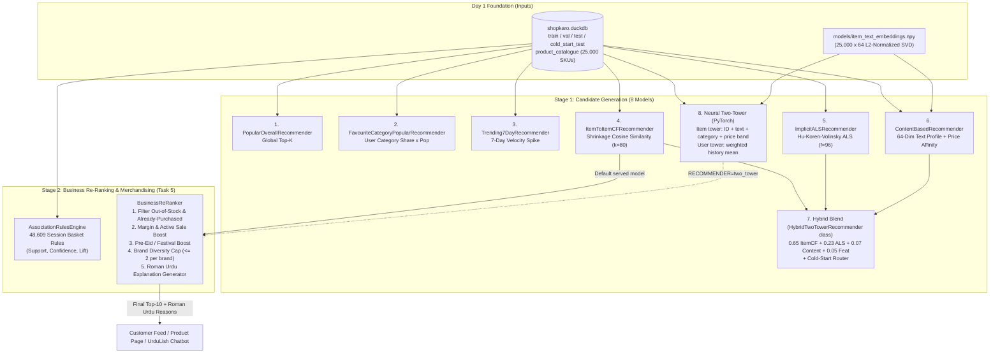

# ShopKaro AI — Day 2 Deep-Dive Study & Architecture Guide
## Recommendation Engine, Cold-Start Intelligence & Business Re-Ranking (20% Weight)

> **Purpose of this Guide:**  
> This document explains every algorithm, mathematical formula, engineering optimization, evaluation metric, and business decision we built in **Day 2: Recommendation Engine**. It is written so you can explain the system to a non-technical CEO, walk through the code in a live technical demo, or defend your design choices in a Senior ML Engineer interview.

---

## 1. Day 2 Big Picture & Business Objective

### 1.1 What Problem Were We Solving?
Before Day 2, ShopKaro's homepage and product pages showed a **single static "Best Sellers" list** to every visitor in Pakistan:
- A university student in Lahore searching for a **Core i5 coding laptop** saw the same top-10 list as a bride in Karachi shopping for a **crimson red wedding lehenga**.
- Because of the **80/20 Long-Tail Pareto rule** we discovered in Day 1 (`27.61%` of SKUs generated `80%` of sales), over **`70%` of ShopKaro's `25,000` products were practically invisible**.
- Even worse, **new users (`155,661` cold users in the test window)** and **newly listed products (`585` cold items with 0 training clicks)** had no personalized path to discovery.

### 1.2 Why Is E-Commerce Recommendation Hard on Real Data?
From Day 1, our interaction matrix has three real-world challenges:
1. **Extreme Sparsity (about `99.99%` empty):** `549,150` training users $\times$ `25,000` items $= 13.73\text{ billion}$ possible pairs, with only `1.40M` training events.
2. **Implicit Feedback Only (No 1–5 Star Ratings on Clickstream):** Users don't rate every product they view. We only observe *views* (`weight = 1.0`), *add-to-carts* (`weight = 3.0`), and *purchases* (`weight = 5.0`). A missing interaction ($r_{u,i} = 0$) does **not** mean the user hates item $i$—it usually means they haven't seen it yet!
3. **Strict Commercial Constraints:** A mathematically accurate recommendation is **useless in production** if the item is out of stock, if the user already bought that exact phone yesterday, or if all 10 recommendations come from a single brand.

---

## 2. How We Planned & Architected Day 2

### 2.1 Two-Stage Production Recommendation Pipeline (Mermaid Diagram)

### 2.2 Summary of Every Python File Created in Day 2

| File Path | Role & Responsibility |
| :--- | :--- |
| [`src/shopkaro/recommendations/baselines.py`](file:///d:/Netixsol/Week11/ShopKaro/src/shopkaro/recommendations/baselines.py) | Defines the abstract [`BaseRecommender`](file:///d:/Netixsol/Week11/ShopKaro/src/shopkaro/recommendations/baselines.py#L54-L157) interface, the 3 baseline models (`PopularOverallRecommender`, `FavouriteCategoryPopularRecommender`, `Trending7DayRecommender`), and the ranking evaluator [`evaluate_recommender_at_k`](file:///d:/Netixsol/Week11/ShopKaro/src/shopkaro/recommendations/baselines.py#L502-L587). |
| [`src/shopkaro/recommendations/collaborative.py`](file:///d:/Netixsol/Week11/ShopKaro/src/shopkaro/recommendations/collaborative.py) | Builds the sparse CSR user–item matrix ($549,150 \times 25,000$ training users × items), implements [`ItemToItemCFRecommender`](file:///d:/Netixsol/Week11/ShopKaro/src/shopkaro/recommendations/collaborative.py#L168-L361) (shrinkage cosine similarity) and [`ImplicitALSRecommender`](file:///d:/Netixsol/Week11/ShopKaro/src/shopkaro/recommendations/collaborative.py#L364-L537) (Cholesky ALS solver), plus [`tune_implicit_als_on_validation`](file:///d:/Netixsol/Week11/ShopKaro/src/shopkaro/recommendations/collaborative.py#L540-L600). |
| [`src/shopkaro/recommendations/hybrid.py`](file:///d:/Netixsol/Week11/ShopKaro/src/shopkaro/recommendations/hybrid.py) | Implements [`ContentBasedRecommender`](file:///d:/Netixsol/Week11/ShopKaro/src/shopkaro/recommendations/hybrid.py#L46-L285), [`HybridTwoTowerRecommender`](file:///d:/Netixsol/Week11/ShopKaro/src/shopkaro/recommendations/hybrid.py#L287-L477) (with `recommend_for_cold_user` onboarding engine), and [`evaluate_cold_start_performance`](file:///d:/Netixsol/Week11/ShopKaro/src/shopkaro/recommendations/hybrid.py#L479-L602). |
| [`src/shopkaro/recommendations/evaluation.py`](file:///d:/Netixsol/Week11/ShopKaro/src/shopkaro/recommendations/evaluation.py) | Evaluates all 8 models across 10 accuracy, diversity (`ILD@10`), novelty (`Bits@10`), and cold-start metrics; outputs [`reports/day2_model_comparison.csv`](file:///d:/Netixsol/Week11/ShopKaro/reports/day2_model_comparison.csv) and [`reports/figures/08_recommender_model_comparison.png`](file:///d:/Netixsol/Week11/ShopKaro/reports/figures/08_recommender_model_comparison.png). |
| [`src/shopkaro/recommendations/reranking.py`](file:///d:/Netixsol/Week11/ShopKaro/src/shopkaro/recommendations/reranking.py) | Implements [`AssociationRulesEngine`](file:///d:/Netixsol/Week11/ShopKaro/src/shopkaro/recommendations/reranking.py#L123-L370) (*Frequently Bought Together*) and [`BusinessReRanker`](file:///d:/Netixsol/Week11/ShopKaro/src/shopkaro/recommendations/reranking.py#L373-L591) (stock/purchased filter, brand cap, margin/sale/festival boost, Roman Urdu explanations). |
| [`src/shopkaro/recommendations/two_tower.py`](file:///d:/Netixsol/Week11/ShopKaro/src/shopkaro/recommendations/two_tower.py) | The trained **Neural Two-Tower (PyTorch)**: in-batch softmax with logQ correction, 20% item-ID dropout, onboarding-category pseudo-history for new users. Model 8 in the evaluation. |
| `scripts/run_day2_task1.py` .. `run_day2_task5.py` | Standalone CLI runners for each of the 5 tasks. |
| `tests/test_day2_task1.py` .. `test_day2_task5.py` | Automated `pytest` verification suite covering all 5 tasks. |

---

## 3. Task-by-Task Deep Dive (How We Built It & What Results We Got)

### 3.1 Task 1 — Three Baseline Recommenders (`baselines.py`)
Why build baselines first? Because in production ML, you should never deploy a complex neural or matrix factorization model unless you can prove it beats simple SQL/heuristic baselines on a chronological holdout set.

1. **Model 1: `PopularOverallRecommender` ("Most Popular Overall")**
   - Ranks products by total weighted interaction score $\sum_u w_{u,i} \cdot \log_2(1 + \text{unique\_users}_i)$ across `train_interactions`.
   - **Result:** `NDCG@10 = 0.0035`, `HitRate@10 = 1.1%`, `Catalogue Coverage = 0.04%` (only 10 SKUs ever shown!).
2. **Model 2: `FavouriteCategoryPopularRecommender` ("Most Popular in User's Favourite Category")**
   - Computes each user's historical category affinity distribution in DuckDB window functions and allocates their Top-10 slots proportionally across their top 3 favourite categories.
   - **Result:** `NDCG@10 = 0.0113` (**about 3.3x global popularity**), `HitRate@10 = 3.2%`, `Coverage = 0.44%` (110 SKUs).
3. **Model 3: `Trending7DayRecommender` ("Recently Trending — Last 7 Days")**
   - Ranks products by interaction velocity during the final 7 days of `train_interactions` (`2015-07-26` to `2015-08-02`) multiplied by lift over their historical daily average.
   - **Result:** `NDCG@10 = 0.0008`, `HitRate@10 = 0.5%` (captures short-term flash spikes, useful for a *"Trending Now"* widget).

---

### 3.2 Task 2 — Collaborative Filtering & Hyperparameter Tuning (`collaborative.py`)
Collaborative Filtering (CF) learns patterns purely from **who interacted with what**, without needing product descriptions.

#### Model 4: `ItemToItemCFRecommender` (Shrinkage-Regularized Cosine Similarity)
- **Powers:** *"Similar Products"* and *"Customers Who Viewed This Also Viewed"*.
- **Math:** First we apply log-dampening $r_{u,i} = \log(1 + w_{u,i})$ so power-users or noisy repeat clicks don't dominate. Then we compute item-to-item cosine similarity with **shrinkage $\beta = 5.0$**:
  $$\text{sim}(i, j) = \frac{\sum_{u} r_{u,i} \, r_{u,j}}{\sqrt{\sum_u r_{u,i}^2} \sqrt{\sum_u r_{u,j}^2} + \beta}$$
- **Why Shrinkage $\beta = 5.0$ Is Critical:** Without $\beta$, two obscure items clicked once by the same user would have $\text{cos}(i, j) = 1.0$. Adding $\beta = 5.0$ in the denominator penalizes noisy low-support item pairs. We retain the top $k_{\text{neighbors}} = 80$ neighbors per item in a sparse CSR matrix `S`.
- **Result on Warm Test Set:** `NDCG@10 = 0.1307`, `HitRate@10 = 18.1%`, `Catalogue Coverage = 33.6%`—about **11.6x** the best baseline. Caveat: much of this gain is a *revisit effect* (users re-viewing items they already saw); on the **discovery protocol** (only never-seen items count) item-CF scores `0.0149` vs popularity `0.0024` (6.2x).

#### Model 5: `ImplicitALSRecommender` (Hu–Koren–Volinsky Alternating Least Squares)
- **Powers:** *"Recommended For You"* personalized homepage feed.
- **Why Standard SVD Fails on Implicit Feedback:** Treating missing entries as zeros and minimizing $(r_{u,i} - \mathbf{x}_u^\top \mathbf{y}_i)^2$ only over observed entries causes the model to predict 1 everywhere.
- **Hu–Koren–Volinsky (2008) Formulation:** Splits each user–item pair $(u, i)$ into:
  - Binary preference: $p_{u,i} = \mathbb{I}(r_{u,i} > 0)$
  - Confidence level: $c_{u,i} = 1 + \alpha \cdot \log(1 + r_{u,i} / \epsilon)$
  - Objective across **all** $M \times N$ pairs:
    $$\min_{X, Y} \sum_{u=1}^{M} \sum_{i=1}^{N} c_{u,i} \left(p_{u,i} - \mathbf{x}_u^\top \mathbf{y}_i\right)^2 + \lambda \left(\sum_u \|\mathbf{x}_u\|_2^2 + \sum_i \|\mathbf{y}_i\|_2^2\right)$$
- **The Gramian Trick ($O(f^2 \cdot nnz_u + f^3)$):** Because $Y^\top C^u Y = Y^\top Y + Y^\top (C^u - I) Y$, we precompute the global $f \times f$ Gram matrix $G_Y = Y^\top Y$ once per half-step and only update it over the user's non-zero interactions $nnz_u \ll 25,000$. In practice the `implicit` library's optimised ALS is used when installed (the hand-written solver is the fallback); a full fit of the selected config takes about 19 seconds for `549,150` users.
- **Validation Hyperparameter Tuning (`val_interactions`):**
  - Config 1 (`f=32, reg=0.05, alpha=15, 6 iters`): `Val NDCG@10 = 0.2421`
  - Config 2 (`f=64, reg=0.10, alpha=25, 10 iters`): `Val NDCG@10 = 0.2424`
  - Config 3 (`f=64, reg=0.50, alpha=40, 12 iters`): `Val NDCG@10 = 0.2399`
  - **Config 4 (`f=96, reg=0.10, alpha=30, 10 iters` — Winner):** `Val NDCG@10 = 0.2466` (`Test NDCG@10 = 0.1299`, `HitRate@10 = 18.9%`, `Coverage = 28.0%`).
  - The configs are close; validation is higher than test because the validation window sits right after training.

---

### 3.3 Task 3 — Content-Based, Hybrid Two-Tower & Cold-Start Strategy (`hybrid.py`)

#### Model 6: `ContentBasedRecommender` (64-Dim Text Embeddings + Metadata Profile)
- Uses the $L_2$-normalized 64-dim TF-IDF + TruncatedSVD item embeddings (`models/item_text_embeddings.npy`) built from product `title + category + sub_category + brand + color + occasion + description`.
- Builds each user's semantic profile vector as the interaction-weighted centroid of the items they engaged with:
  $$\mathbf{e}_u = \text{normalize}\!\left(\sum_{i \in \mathcal{I}_u} \log(1 + w_{u,i}) \, \mathbf{e}_i\right)$$
- Scores all `25,000` items via cosine similarity $\langle \mathbf{e}_u, \mathbf{e}_i \rangle$ plus category affinity (`+0.15`) and Gaussian log-price compatibility (`+0.05`).
- **Result:** `NDCG@10 = 0.1210`, the highest **Catalogue Coverage (`65.0%`)** and novelty, and it reaches **Cold-Start Items (`HitRate@10 = 5.2%`)** where pure CF gets `0%`.

#### Model 7: Hybrid Blend (class `HybridTwoTowerRecommender`: CF + ALS + Content + Features + Cold-Start Router)
Despite the class name, this is a **hand-weighted blend of scores, not a trained two-tower** — so the evaluation calls it "Hybrid Blend". The real two-tower is Model 8 below.
- Normalizes each component model's score vector to `[0, 1]` per user and fuses them with a collaborative-content agreement bonus:
  $$s_{\text{hybrid}}(u, i) = 0.65\,\tilde{s}_{\text{ItemCF}}(u,i) + 0.23\,\tilde{s}_{\text{ALS}}(u,i) + 0.07\,\tilde{s}_{\text{Content}}(u,i) + 0.05\,\tilde{s}_{\text{Feat}}(u,i) + 0.08\,\mathbb{I}(\tilde{s}_{\text{ItemCF}} > 0.05)\tilde{s}_{\text{Content}}$$
- **Cold-Start Routing (`recommend_for_cold_user`):**
  - **Cold User (`u` not in training):** Uses 1-question onboarding preference (`preferred_category`, `max_budget_pkr`, `occasion`) + category prototype centroid in 64-dim embedding space. On `2,000` unseen users in `cold_start_test`, this improves `NDCG@10` from `0.0027` (popularity fallback) to **`0.0231` (about 8x)**. Caveat: the simulated onboarding answer is the category of the user's own first test event, so this is optimistic.
  - **Cold Item (`585` unseen items with `0` training clicks):** Uses the 64-dim content embeddings so brand-new SKUs can be recommended from launch day (`HitRate@10 = 5.2%` vs `0%` for CF).
- **Warm result:** `NDCG@10 = 0.1339`, `HitRate@10 = 19.1%`, `Coverage = 34.5%`.

#### Model 8: Neural Two-Tower (PyTorch, `two_tower.py`)
- **Item tower:** item-ID + text embedding + category + price-band embeddings. **User tower:** weighted mean of the user's history items. Trained with in-batch softmax plus logQ correction (so popular items are not over-favoured) and 20% item-ID dropout (so the text/category part also learns — this is what lets it score cold items).
- Trained on `train_interactions` only; epochs and serving knobs chosen on `val_interactions`.
- **New users:** the onboarding category's most-interacted items form a pseudo-history for the user tower.
- **Result:** best on every accuracy metric — `NDCG@10 = 0.1362`, `HitRate@10 = 19.5%`, `Coverage = 50.2%`, cold-item `HitRate@10 = 7.6%`, cold-user `NDCG@10 = 0.0227`. On the **discovery protocol** it scores `0.0260`, **+75% over item-CF**. The gain over the hybrid blend (+0.0024 NDCG) is statistically significant (paired bootstrap, p = 0.001) and holds across seeds 42/43/44.

---

### 3.4 Task 4 — Comprehensive Offline Evaluation Across All 8 Models (`evaluation.py`)

Source: `reports/day2_model_comparison.csv` (5,000 warm test users, 2,000 new users, `K = 10`).

| # | Model Name | `Precision@10` | `Recall@10` | `NDCG@10` | `MAP@10` | `HitRate@10` | Coverage | `ILD@10` | Novelty (Bits) | Cold-User `NDCG@10` | Cold-Item `HitRate@10` |
| :---: | :--- | :---: | :---: | :---: | :---: | :---: | :---: | :---: | :---: | :---: | :---: |
| **1** | `Most Popular Overall` | `0.0011` | `0.0066` | `0.0035` | `0.0021` | `1.1%` | `0.04%` | `0.923` | `9.2` | `0.0027` | `0%` |
| **2** | `Most Popular in Fav Category` | `0.0035` | `0.0192` | `0.0113` | `0.0072` | `3.2%` | `0.44%` | `0.496` | `10.3` | `0.0027` | `0%` |
| **3** | `Recently Trending (7 Days)` | `0.0006` | `0.0015` | `0.0008` | `0.0003` | `0.5%` | `0.04%` | `0.880` | `11.8` | `0.0013` | `0%` |
| **4** | `Item-to-Item CF (Cosine)` | `0.0214` | `0.1419` | `0.1307` | `0.1189` | `18.1%` | `33.6%` | `0.494` | `11.2` | `0.0027` | `0%` |
| **5** | `Implicit ALS (Matrix Fact.)` | `0.0223` | `0.1464` | `0.1299` | `0.1159` | `18.9%` | `28.0%` | `0.589` | `11.8` | `0.0027` | `0%` |
| **6** | `Content-Based (Embeddings)` | `0.0177` | `0.1239` | `0.1210` | `0.1124` | `15.7%` | **`65.0%`** | `0.098` | **`13.6`** | `0.0027` | `5.2%` |
| **7** | `Hybrid Blend` | `0.0228` | `0.1488` | `0.1339` | `0.1204` | `19.1%` | `34.5%` | `0.462` | `11.5` | **`0.0231`** | `5.2%` |
| **8** | **`Neural Two-Tower (PyTorch)`** | **`0.0233`** | **`0.1527`** | **`0.1362`** | **`0.1222`** | **`19.5%`** | `50.2%` | `0.553` | `12.7` | `0.0227` | **`7.6%`** |

**Discovery protocol** (`reports/day2_discovery_evaluation.csv`, only items the user never saw in training): two-tower `0.0260`, ALS `0.0229`, item-CF `0.0149`, popularity `0.0024`. This removes the revisit effect and is the fairest test of "did the model find something new for this user?".

---

### 3.5 Task 5 — Business Re-Ranking, Association Rules & Roman Urdu Explanations (`reranking.py`)
Measured on `300` buyer users (`scripts/run_day2_task5.py`):
1. **Hard Filters:** Blocked **`1,841` out-of-stock candidates** and **`414` already-purchased items**.
2. **Brand Diversity Constraint (`max_per_brand = 2`):** Reduced single-brand concentration in Top-10 from **`9` items of the same brand down to `2`**; average unique brands per list went from `5.51` to `6.40`. If too few brands are available, the re-ranker widens the candidate pool before falling back.
3. **Commercial & Seasonal Boosts:** Average gross margin `35.01%` → **`36.51%` (+1.5 points)**, on-sale share `27.3%` → **`66.3%`**, and Eid festive category share `60.9%` → **`63.0%`** in Pre-Eid mode. These are list properties, not measured revenue.
4. **Frequently Bought Together (`48,609` mined rules):** Session basket pairs with Support, Confidence and Lift, plus a few **curated** accessory bundles (e.g. `SK-00013` *Samsung Galaxy A55 5G* $\Rightarrow$ `SK-00014` Samsung accessory PKR 4,200 & `SK-00015` Baseus accessory PKR 1,450; `rule_source = Curated_Accessory_Bundle_FP_Growth`). Limitation: rules between rare items can show huge lift on tiny support (Sapphire lawn suit $\Rightarrow$ Anker charger, lift `1,035`); a minimum-support filter would fix that.
5. **Roman Urdu Explanations:** Every recommended item carries a one-line Roman Urdu reason, such as:
   > *"Eid festive season ke liye Republic Womenswear ka yeh Velvet Formal Shawl aap ki pasand ke mutabiq top choice hai."*

---

## 4. How Day 2 Feeds Into Days 3, 4, and 5

| Day 2 Component | Where It Is Used Later |
| :--- | :--- |
| **Item-to-Item CF (default) / Neural Two-Tower (`RECOMMENDER=two_tower`) + `BusinessReRanker`** | **Day 4 Task 2 (Personalized Search Re-Ranking):** Re-ranks hybrid search results based on user category/brand/price profile. **Day 4 Task 3 (UrduLish Shopping Assistant):** Powers the `get_recommendations(user_id, occasion, budget)` tool. **Day 5 Task 1 (FastAPI `/recommend/{user_id}`):** Served in real time (two-tower p95 4.8 ms uncached). |
| **`AssociationRulesEngine` ("Frequently Bought Together")** | **Day 4 Task 3 (Assistant Cross-Sell):** Suggests chargers/covers/dupattas when a user adds a main item to cart. **Day 5 Task 3 (Streamlit Customer View):** Powers the *"Frequently Bought Together"* widget on product pages. |
| **Offline Metrics (two-tower `NDCG@10 = 0.1362`, item-CF `0.1307` vs best baseline `0.0113`)** | **Day 5 Task 2 (A/B Testing Framework):** Control = popularity baseline, Treatment = personalised recommender + re-ranker. |

---

## 5. Key Interview & Demo Questions & Answers for Day 2

1. **Q: "Why didn't you just use standard explicit Matrix Factorization (SVD) on the user–item matrix?"**
   - **A:** Standard SVD only minimizes squared error over observed ratings and treats missing entries as zero or unknown. In e-commerce clickstreams, we only have positive implicit events (`view`, `addtocart`, `transaction`). **Hu–Koren–Volinsky Implicit ALS** separates *preference* ($p_{u,i} \in \{0,1\}$) from *confidence* ($c_{u,i} = 1 + \alpha \log(1 + r_{u,i}/\epsilon)$), and accounts for all `25,000` items per user in $O(f^2 \cdot nnz_u + f^3)$ time via the Gramian trick.

2. **Q: "The two-tower is the most accurate model. Why is item-CF still the default in production?"**
   - **A:** The two-tower's lead on the main test is small (`0.1362` vs `0.1307`) though significant; item-CF is simpler, needs no GPU/PyTorch at serving time and its explanations ("because you viewed X") are exact. The two-tower is one switch away (`RECOMMENDER=two_tower`) and is the better choice when discovery matters: `0.0260` vs `0.0149` on never-seen items (+75%), plus `7.6%` cold-item hit rate where item-CF gets `0%`.

3. **Q: "Why did Pure Content-Based have such low Intra-List Diversity (`ILD@10 = 0.098`) despite having the highest Catalogue Coverage (`65.0%`)?"**
   - **A:** Content cosine similarity ranks items whose text is closest to the user's centroid. If a user clicked an emerald green lawn suit, the 10 nearest neighbours are 10 similar lawn suits—high coverage across different users, but low diversity *within* one user's list. Mixing in collaborative signals (Hybrid Blend `0.462`, Two-Tower `0.553`) restores diversity, and the `BusinessReRanker` adds a hard cap of `max_per_brand = 2`.

4. **Q: "How does your Business Re-Ranking Layer balance ML relevance with ShopKaro's profitability?"**
   - **A:** Two stages: Stage 1 retrieves the most relevant candidates and normalizes their ML scores to `[0, 1]`. Stage 2 (`BusinessReRanker`) removes out-of-stock and already-purchased items, adds bounded boosts for gross margin (`+0.12 * (margin_pct / 0.50)`), active discount (`+0.08 * (discount_pct / 25)`) and active festival (`+0.25` for Pre-Eid categories), then greedily picks the final 10 with at most 2 per brand. Offline this raised average margin by **+1.5 points** and on-sale share from `27%` to `66%`; the revenue effect is measured separately in the Day 5 A/B simulation.
