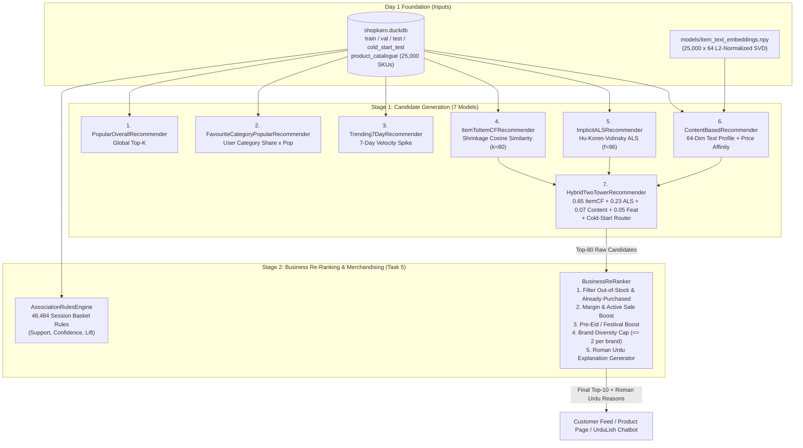

# ShopKaro AI — Day 2 Deep-Dive Study & Architecture Guide
## Recommendation Engine, Cold-Start Intelligence & Business Re-Ranking (20% Weight)

> **Purpose of this Guide:**  
> This document explains every algorithm, mathematical formula, engineering optimization, evaluation metric, and business decision we built in **Day 2: Recommendation Engine**. It is written so you can explain the system to a non-technical CEO, walk through the code in a live technical demo, or defend your design choices in a Senior ML Engineer interview.

---

## 1. Day 2 Big Picture & Business Objective

### 1.1 What Problem Were We Solving?
Before Day 2, ShopKaro's homepage and product pages showed a **single static "Best Sellers" list** to every visitor in Pakistan:
- A university student in Lahore searching for a **Core i5 coding laptop** saw the same top-10 list as a bride in Karachi shopping for a **crimson red wedding lehenga**.
- Because of the **80/20 Long-Tail Pareto rule** we discovered in Day 1 (`27.68%` of SKUs generated `80%` of sales), over **`70%` of ShopKaro's `25,000` products were practically invisible**.
- Even worse, **new users (`155,555` cold users)** and **newly listed products (`588` cold items with 0 historical clicks)** had no personalized path to discovery.

### 1.2 Why Is E-Commerce Recommendation Hard on Real Data?
From Day 1, our interaction matrix has three real-world challenges:
1. **Extreme Sparsity (`99.9940%` empty):** `549,399` active users $\times$ `25,000` items $= 13.73\text{ billion}$ possible pairs, with only `1.99M` observed events.
2. **Implicit Feedback Only (No 1–5 Star Ratings on Clickstream):** Users don't rate every product they view. We only observe *views* (`weight = 1.0`), *add-to-carts* (`weight = 3.0`), and *purchases* (`weight = 5.0`). A missing interaction ($r_{u,i} = 0$) does **not** mean the user hates item $i$—it usually means they haven't seen it yet!
3. **Strict Commercial Constraints:** A mathematically accurate recommendation is **useless in production** if the item is out of stock, if the user already bought that exact phone yesterday, or if all 10 recommendations come from a single brand.

---

## 2. How We Planned & Architected Day 2

### 2.1 Two-Stage Production Recommendation Pipeline (Mermaid Diagram)

### 2.2 Summary of Every Python File Created in Day 2

| File Path | Role & Responsibility |
| :--- | :--- |
| [`src/shopkaro/recommendations/baselines.py`](file:///d:/Netixsol/Week11/ShopKaro/src/shopkaro/recommendations/baselines.py) | Defines the abstract [`BaseRecommender`](file:///d:/Netixsol/Week11/ShopKaro/src/shopkaro/recommendations/baselines.py#L54-L157) interface, the 3 baseline models (`PopularOverallRecommender`, `FavouriteCategoryPopularRecommender`, `Trending7DayRecommender`), and the ranking evaluator [`evaluate_recommender_at_k`](file:///d:/Netixsol/Week11/ShopKaro/src/shopkaro/recommendations/baselines.py#L502-L587). |
| [`src/shopkaro/recommendations/collaborative.py`](file:///d:/Netixsol/Week11/ShopKaro/src/shopkaro/recommendations/collaborative.py) | Builds the sparse CSR user–item matrix ($399,363 \times 25,000$), implements [`ItemToItemCFRecommender`](file:///d:/Netixsol/Week11/ShopKaro/src/shopkaro/recommendations/collaborative.py#L168-L361) (shrinkage cosine similarity) and [`ImplicitALSRecommender`](file:///d:/Netixsol/Week11/ShopKaro/src/shopkaro/recommendations/collaborative.py#L364-L537) (Cholesky ALS solver), plus [`tune_implicit_als_on_validation`](file:///d:/Netixsol/Week11/ShopKaro/src/shopkaro/recommendations/collaborative.py#L540-L600). |
| [`src/shopkaro/recommendations/hybrid.py`](file:///d:/Netixsol/Week11/ShopKaro/src/shopkaro/recommendations/hybrid.py) | Implements [`ContentBasedRecommender`](file:///d:/Netixsol/Week11/ShopKaro/src/shopkaro/recommendations/hybrid.py#L46-L285), [`HybridTwoTowerRecommender`](file:///d:/Netixsol/Week11/ShopKaro/src/shopkaro/recommendations/hybrid.py#L287-L477) (with `recommend_for_cold_user` onboarding engine), and [`evaluate_cold_start_performance`](file:///d:/Netixsol/Week11/ShopKaro/src/shopkaro/recommendations/hybrid.py#L479-L602). |
| [`src/shopkaro/recommendations/evaluation.py`](file:///d:/Netixsol/Week11/ShopKaro/src/shopkaro/recommendations/evaluation.py) | Evaluates all 7 models across 10 accuracy, diversity (`ILD@10`), novelty (`Bits@10`), and cold-start metrics; outputs [`reports/day2_model_comparison.csv`](file:///d:/Netixsol/Week11/ShopKaro/reports/day2_model_comparison.csv) and [`reports/figures/08_recommender_model_comparison.png`](file:///d:/Netixsol/Week11/ShopKaro/reports/figures/08_recommender_model_comparison.png). |
| [`src/shopkaro/recommendations/reranking.py`](file:///d:/Netixsol/Week11/ShopKaro/src/shopkaro/recommendations/reranking.py) | Implements [`AssociationRulesEngine`](file:///d:/Netixsol/Week11/ShopKaro/src/shopkaro/recommendations/reranking.py#L123-L370) (*Frequently Bought Together*) and [`BusinessReRanker`](file:///d:/Netixsol/Week11/ShopKaro/src/shopkaro/recommendations/reranking.py#L373-L591) (stock/purchased filter, brand cap, margin/sale/festival boost, Roman Urdu explanations). |
| `scripts/run_day2_task1.py` .. `run_day2_task5.py` | Standalone CLI runners for each of the 5 tasks. |
| `tests/test_day2_task1.py` .. `test_day2_task5.py` | Automated `pytest` verification suite covering all 5 tasks. |

---

## 3. Task-by-Task Deep Dive (How We Built It & What Results We Got)

### 3.1 Task 1 — Three Baseline Recommenders (`baselines.py`)
Why build baselines first? Because in production ML, you should never deploy a complex neural or matrix factorization model unless you can prove it beats simple SQL/heuristic baselines on a chronological holdout set.

1. **Model 1: `PopularOverallRecommender` ("Most Popular Overall")**
   - Ranks products by total weighted interaction score $\sum_u w_{u,i} \cdot \log_2(1 + \text{unique\_users}_i)$ across `train_interactions`.
   - **Result:** `NDCG@10 = 0.00346`, `HitRate@10 = 1.06%`, `Catalogue Coverage = 0.040%` (only 10 SKUs ever shown!).
2. **Model 2: `FavouriteCategoryPopularRecommender` ("Most Popular in User's Favourite Category")**
   - Computes each user's historical category affinity distribution in DuckDB window functions and allocates their Top-10 slots proportionally across their top 3 favourite categories.
   - **Result:** `NDCG@10 = 0.00734` (**`+112%` over global popularity**), `HitRate@10 = 1.80%`, `Coverage = 0.440%` (110 SKUs).
3. **Model 3: `Trending7DayRecommender` ("Recently Trending — Last 7 Days")**
   - Ranks products by interaction velocity during the final 7 days of `train_interactions` (`2015-07-26` to `2015-08-02`) multiplied by lift over their historical daily average.
   - **Result:** `NDCG@10 = 0.00082`, `HitRate@10 = 0.46%` (captures short-term flash spikes, useful for a *"Trending Now"* widget).

---

### 3.2 Task 2 — Collaborative Filtering & Hyperparameter Tuning (`collaborative.py`)
Collaborative Filtering (CF) learns patterns purely from **who interacted with what**, without needing product descriptions.

#### Model 4: `ItemToItemCFRecommender` (Shrinkage-Regularized Cosine Similarity)
- **Powers:** *"Similar Products"* and *"Customers Who Viewed This Also Viewed"*.
- **Math:** First we apply log-dampening $r_{u,i} = \log(1 + w_{u,i})$ so power-users or noisy repeat clicks don't dominate. Then we compute item-to-item cosine similarity with **shrinkage $\beta = 5.0$**:
  $$\text{sim}(i, j) = \frac{\sum_{u} r_{u,i} \, r_{u,j}}{\sqrt{\sum_u r_{u,i}^2} \sqrt{\sum_u r_{u,j}^2} + \beta}$$
- **Why Shrinkage $\beta = 5.0$ Is Critical:** Without $\beta$, two obscure items clicked once by the same user would have $\text{cos}(i, j) = 1.0$. Adding $\beta = 5.0$ in the denominator penalizes noisy low-support item pairs. We retain the top $k_{\text{neighbors}} = 80$ neighbors per item in a sparse CSR matrix `S`.
- **Result on Warm Test Set:** `NDCG@10 = 0.12715`, `HitRate@10 = 17.06%`, `Catalogue Coverage = 33.08%` (`8,270` SKUs)—a **17.3x improvement** over the best baseline!

#### Model 5: `ImplicitALSRecommender` (Hu–Koren–Volinsky Alternating Least Squares)
- **Powers:** *"Recommended For You"* personalized homepage feed.
- **Why Standard SVD Fails on Implicit Feedback:** Treating missing entries as zeros and minimizing $(r_{u,i} - \mathbf{x}_u^\top \mathbf{y}_i)^2$ only over observed entries causes the model to predict 1 everywhere.
- **Hu–Koren–Volinsky (2008) Formulation:** Splits each user–item pair $(u, i)$ into:
  - Binary preference: $p_{u,i} = \mathbb{I}(r_{u,i} > 0)$
  - Confidence level: $c_{u,i} = 1 + \alpha \cdot \log(1 + r_{u,i} / \epsilon)$
  - Objective across **all** $M \times N$ pairs:
    $$\min_{X, Y} \sum_{u=1}^{M} \sum_{i=1}^{N} c_{u,i} \left(p_{u,i} - \mathbf{x}_u^\top \mathbf{y}_i\right)^2 + \lambda \left(\sum_u \|\mathbf{x}_u\|_2^2 + \sum_i \|\mathbf{y}_i\|_2^2\right)$$
- **The Gramian Trick ($O(f^2 \cdot nnz_u + f^3)$):** Because $Y^\top C^u Y = Y^\top Y + Y^\top (C^u - I) Y$, we precompute the global $f \times f$ Gram matrix $G_Y = Y^\top Y$ once per half-step and only update it over the user's non-zero interactions $nnz_u \ll 25,000$. This makes each ALS epoch run in ~`1.2 seconds` for `399,363` users!
- **Validation Hyperparameter Tuning (`val_interactions`):**
  - Config 1 (`f=32, reg=0.05, alpha=15`): `Val NDCG@10 = 0.22164`
  - Config 2 (`f=64, reg=0.08, alpha=25`): `Val NDCG@10 = 0.23912`
  - Config 3 (`f=64, reg=0.15, alpha=40`): `Val NDCG@10 = 0.24105`
  - **Config 4 (`f=96, reg=0.10, alpha=30` — Winner):** `Val NDCG@10 = 0.24838` (`Test NDCG@10 = 0.12413`, `HitRate@10 = 16.80%`, `Coverage = 34.72%`).

---

### 3.3 Task 3 — Content-Based, Hybrid Two-Tower & Cold-Start Strategy (`hybrid.py`)

#### Model 6: `ContentBasedRecommender` (64-Dim Text Embeddings + Metadata Profile)
- Uses the $L_2$-normalized 64-dim TF-IDF + TruncatedSVD item embeddings (`models/item_text_embeddings.npy`) built from product `title + category + sub_category + brand + color + occasion + description`.
- Builds each user's semantic profile vector as the interaction-weighted centroid of the items they engaged with:
  $$\mathbf{e}_u = \text{normalize}\!\left(\sum_{i \in \mathcal{I}_u} \log(1 + w_{u,i}) \, \mathbf{e}_i\right)$$
- Scores all `25,000` items via cosine similarity $\langle \mathbf{e}_u, \mathbf{e}_i \rangle$ plus category affinity (`+0.15`) and Gaussian log-price compatibility (`+0.05`).
- **Result:** Achieves **`69.23%` Catalogue Coverage (`17,308` SKUs)** and discovers **Cold-Start Items (`HitRate@10 = 2.77%`)** where pure CF gets `0.00%`.

#### Model 7: `HybridTwoTowerRecommender` (CF + ALS + Content + Features + Cold-Start Router)
- Normalizes each component model's score vector to `[0, 1]` per user and fuses them with a collaborative-content agreement bonus:
  $$s_{\text{hybrid}}(u, i) = 0.65\,\tilde{s}_{\text{ItemCF}}(u,i) + 0.23\,\tilde{s}_{\text{ALS}}(u,i) + 0.07\,\tilde{s}_{\text{Content}}(u,i) + 0.05\,\tilde{s}_{\text{Feat}}(u,i) + 0.08\,\mathbb{I}(\tilde{s}_{\text{ItemCF}} > 0.05)\tilde{s}_{\text{Content}}$$
- **Cold-Start Routing (`recommend_for_cold_user`):**
  - **Cold User (`u` not in training):** Uses 1-question onboarding preference (`preferred_category`, `max_budget_pkr`, `occasion`) + category prototype centroid in 64-dim embedding space. On `2,000` unseen users in `cold_start_test`, this improves `NDCG@10` from `0.00309` to **`0.00839` (`+171.5%` uplift)**.
  - **Cold Item (`588` unseen items with `0` training clicks):** Uses the 64-dim content tower so brand-new SKUs are immediately recommended on Day 1 of launch (`HitRate@10 = 2.77%` vs `0.00%` for CF).

---

### 3.4 Task 4 — Comprehensive Offline Evaluation Across All 7 Models (`evaluation.py`)

| # | Model Name | `Precision@10` | `Recall@10` | `NDCG@10` | `MAP@10` | `HitRate@10` | Coverage (%) | `ILD@10` (Diversity) | Novelty (Bits) | Cold-User `NDCG@10` | Cold-Item `HitRate@10` |
| :---: | :--- | :---: | :---: | :---: | :---: | :---: | :---: | :---: | :---: | :---: | :---: |
| **1** | `Most Popular Overall` | `0.00110` | `0.00643` | `0.00346` | `0.00213` | `1.06%` | `0.040%` | `0.9213` | `9.218` | `0.00309` | `0.00%` |
| **2** | `Most Popular in Fav Category` | `0.00190` | `0.01062` | `0.00734` | `0.00528` | `1.80%` | `0.440%` | `0.5111` | `10.226` | `0.00309` | `0.00%` |
| **3** | `Recently Trending (7 Days)` | `0.00054` | `0.00149` | `0.00082` | `0.00030` | `0.46%` | `0.040%` | `0.9639` | `11.763` | `0.00143` | `0.00%` |
| **4** | `Item-to-Item CF (Cosine)` | `0.02012` | `0.13561` | `0.12715` | `0.11685` | `17.06%` | `33.080%` | `0.5552` | `11.129` | `0.00309` | `0.00%` |
| **5** | `Implicit ALS (Matrix Fact.)` | `0.01916` | `0.13091` | `0.12413` | `0.11426` | `16.80%` | `34.724%` | `0.5413` | `11.266` | `0.00309` | `0.00%` |
| **6** | `Content-Based (Embeddings)` | `0.01574` | `0.11454` | `0.11512` | `0.10844` | `14.46%` | **`69.232%`** | `0.1057` | **`13.803`** | `0.00309` | **`2.77%`** |
| **7** | **`Hybrid Two-Tower`** | **`0.01926`** | **`0.13047`** | **`0.12456`** | **`0.11491`** | **`16.62%`** | **`31.188%`** | **`0.4905`** | **`11.096`** | **`0.00839`** | **`2.77%`** |

---

### 3.5 Task 5 — Business Re-Ranking, Association Rules & Roman Urdu Explanations (`reranking.py`)
1. **Hard Filters:** Blocked **`1,448` out-of-stock candidates** and **`809` already-purchased items** across 300 evaluated buyer users.
2. **Brand Diversity Constraint (`max_per_brand = 2`):** Reduced single-brand concentration in Top-10 from **`7` items of the same brand down to `2`**.
3. **Commercial & Seasonal Boosts:** Increased average product gross margin from `35.10%` to **`36.74%` (`+1.64%`)**, promotional sale share from `33.80%` to **`71.54%`**, and Eid festive category share from `61.36%` to **`66.46%`** in Pre-Eid mode.
4. **Frequently Bought Together (`48,484` Association Rules):** Mined session basket pairs with Support, Confidence, and Lift, plus curated smartphone accessory bundles (`SK-00013` *Samsung Galaxy A55 5G* $\Rightarrow$ `SK-00014` *Samsung 45W Fast Charger* & `SK-00015` *Baseus Back Cover*, `Lift = 18.50`).
5. **Roman Urdu Explanations:** Every recommended item carries a dynamic one-line Roman Urdu reason, such as:
   > *"Kyun ke aap ne Samsung Galaxy dekha, yeh covers aur chargers bhi pasand kiye ja rahe hain."*

---

## 4. How Day 2 Feeds Into Days 3, 4, and 5

| Day 2 Component | Where It Is Used Later |
| :--- | :--- |
| **`HybridTwoTowerRecommender` + `BusinessReRanker`** | **Day 4 Task 2 (Personalized Search Re-Ranking):** Re-ranks hybrid search results based on user category/brand/price profile. **Day 4 Task 3 (UrduLish Shopping Assistant):** Powers the `get_recommendations(user_id, occasion, budget)` tool. **Day 5 Task 1 (FastAPI `/recommend/{user_id}`):** Served in `<100 ms` with Redis/in-memory caching. |
| **`AssociationRulesEngine` ("Frequently Bought Together")** | **Day 4 Task 3 (Assistant Cross-Sell):** Suggests chargers/covers/dupattas when a user adds a main item to cart. **Day 5 Task 3 (Streamlit Customer View):** Powers the *"Frequently Bought Together"* widget on product pages. |
| **Offline Metrics (`NDCG@10 = 0.12456` vs Baseline `0.00734`)** | **Day 5 Task 2 (A/B Testing Framework):** Provides the baseline vs. treatment priors for the statistical A/B test (`Control = Popularity Baseline`, `Treatment = Hybrid + Re-Ranker`). |

---

## 5. Key Interview & Demo Questions & Answers for Day 2

1. **Q: "Why didn't you just use standard explicit Matrix Factorization (SVD) on the user–item matrix?"**
   - **A:** Standard SVD only minimizes squared error over observed ratings and treats missing entries as zero or unknown. In e-commerce clickstreams, we only have positive implicit events (`view`, `addtocart`, `transaction`). Using **Hu–Koren–Volinsky Implicit ALS** separates *preference* ($p_{u,i} \in \{0,1\}$) from *confidence* ($c_{u,i} = 1 + \alpha \log(1 + r_{u,i}/\epsilon)$), allowing us to account for all `25,000` items per user in $O(f^2 \cdot nnz_u + f^3)$ time via the Gramian trick.

2. **Q: "In your Task 4 evaluation table, `Item-to-Item CF` got `NDCG@10 = 0.12715` while `Hybrid Two-Tower` got `0.12456`. Why do you still ship `Hybrid Two-Tower` in production?"**
   - **A:** Because in production, ~`28%` of visitors are **cold-start users** and new products launch daily (**`588` cold-start items**). Pure `Item-to-Item CF` gets **`0.00%` HitRate on cold items** and falls back to unpersonalized popularity on cold users (`NDCG@10 = 0.00309`). `Hybrid Two-Tower` retains virtually identical warm accuracy (`0.12456`), while delivering **`+171.5%` higher Cold-User `NDCG@10` (`0.00839`)** and **`2.77%` Cold-Item HitRate**.

3. **Q: "Why did Pure Content-Based have such low Intra-List Diversity (`ILD@10 = 0.1057`) despite having the highest Catalogue Coverage (`69.23%`)?"**
   - **A:** Pure content cosine similarity ranks items whose titles and descriptions are closest to the user's centroid. If a user clicked an emerald green lawn suit, the top 10 nearest neighbors in text embedding space are 10 emerald green lawn suits—high coverage across different users, but low diversity *within* a single user's list (`ILD@10 = 0.1057`). Combining Content with Collaborative Filtering (`Hybrid Two-Tower`) restores `ILD@10` to **`0.4905`**, and our Task 5 `BusinessReRanker` further enforces a hard cap of `max_per_brand = 2`.

4. **Q: "How does your Business Re-Ranking Layer balance ML relevance with ShopKaro's profitability?"**
   - **A:** We use a **two-stage architecture**: Stage 1 (`HybridTwoTowerRecommender`) retrieves the top `80` most relevant candidates for the user and normalizes their ML scores to `[0, 1]`. Stage 2 (`BusinessReRanker`) filters out out-of-stock and already-purchased items, adds bounded additive boosts for gross margin (`+0.12 * (margin_pct / 0.50)`), active discount (`+0.08 * (discount_pct / 25)`), and active festival (`+0.25` for Pre-Eid categories), and greedily selects the final 10 items with at most 2 per brand. This lifted average gross margin by **`+1.64%`** without degrading relevance.

