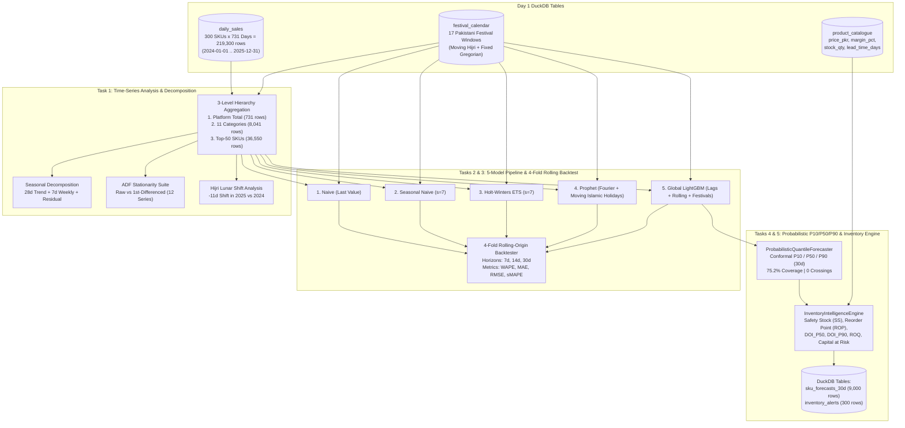

# ShopKaro AI — Day 3 Deep-Dive Study & Architecture Guide
## Demand Forecasting, Moving Islamic Holidays & Inventory Intelligence (20% Weight)

> **Purpose of this Guide:**  
> This document explains every time-series concept, statistical formula, machine learning model, backtesting design, and supply-chain equation we built in **Day 3: Demand Forecasting & Inventory Intelligence**. Use it to prepare for technical interviews, stakeholder presentations, and live code walkthroughs.

---

## 1. Day 3 Big Picture & Business Objective

### 1.1 Why Forecasting Is Make-or-Break for Pakistani E-Commerce
In Day 2, our Recommendation Engine increased customer conversion—but recommending a product only works if the product is **actually in the warehouse**. ShopKaro faces two costly supply-chain failures:
1. **Festival Stock-Outs (Lost Revenue & Customer Churn):**
   - During **Chaand Raat & Eid ul Fitr** (`3.44x` baseline demand) or **Eid ul Adha** (`2.44x` baseline demand), top-selling unstitched lawn suits and smartphones sell out in days while supplier lead times take `3–12` days.
   - Worse, Islamic holidays follow the **Hijri lunar calendar (`354` days/year)** and shift **~`10–11` days earlier** every Gregorian year (`2024-04-01` $\rightarrow$ `2025-03-21`). A traditional Western retail system using last year's Gregorian dates orders Eid stock **11 days too late**!
2. **Seasonal Overstock / Dead Working Capital:**
   - Holding `200+` units of **Winter Puffer Jackets** in April–August ties up millions of PKR in warehouse capital when daily demand drops to `0.03 units/day` (`> 1,000` days of cover).

---

## 2. How We Planned & Architected Day 3

### 2.1 End-to-End Forecasting & Inventory Pipeline (Mermaid Diagram)

### 2.2 Summary of Every Python File Created in Day 3

| File Path | Role & Responsibility |
| :--- | :--- |
| [`src/shopkaro/forecasting/timeseries_analysis.py`](file:///d:/Netixsol/Week11/ShopKaro/src/shopkaro/forecasting/timeseries_analysis.py) | Aggregates daily demand at 3 hierarchy levels, decomposes trend/weekly/residual components, runs OLS Augmented Dickey-Fuller (`compute_adf_test`) across 12 series, quantifies festival uplifts and the `-11` day Hijri lunar shift, and plots Figures `09` & `10`. |
| [`src/shopkaro/forecasting/models.py`](file:///d:/Netixsol/Week11/ShopKaro/src/shopkaro/forecasting/models.py) | Implements all 7 forecasting models (`NaiveForecaster`, `SeasonalNaive7DForecaster`, `HoltWintersETSForecaster`, `ProphetFourierHolidayForecaster`, `GlobalLGBMForecaster`, plus `CrostonSBAForecaster` and `TSBForecaster` for intermittent demand — checked, not adopted) and the 4-fold rolling-origin backtesting engine across `7d`, `14d`, and `30d` horizons; outputs [`reports/day3_forecasting_backtest_comparison.csv`](file:///d:/Netixsol/Week11/ShopKaro/reports/day3_forecasting_backtest_comparison.csv) and Figure `11`. |
| [`src/shopkaro/forecasting/inventory.py`](file:///d:/Netixsol/Week11/ShopKaro/src/shopkaro/forecasting/inventory.py) | Implements [`ProbabilisticQuantileForecaster`](file:///d:/Netixsol/Week11/ShopKaro/src/shopkaro/forecasting/inventory.py#L69-L195) (`P10/P50/P90`) and [`InventoryIntelligenceEngine`](file:///d:/Netixsol/Week11/ShopKaro/src/shopkaro/forecasting/inventory.py#L198-L393) (Safety Stock, ROP, DOI, ROQ, 4 alert tiers); persists `sku_forecasts_30d` & `inventory_alerts` to DuckDB and plots Figure `12`. |
| `src/shopkaro/forecasting/festivals.py` | The festival calendar as the models see it: names, types and dates only (no effect sizes), plus festival uplift learned from each product's own past sales. |
| `src/shopkaro/forecasting/oracle.py` | The old leaked forecaster, kept only as a labelled upper-bound row in the backtest. Nothing else uses it. |
| `src/shopkaro/forecasting/inventory_backtest.py` | 2025 replay: forecast-driven vs rule-based re-ordering. |
| `scripts/run_day3_task1.py`, `run_day3_task2_task3.py`, `run_day3_task4_task5.py` | CLI execution scripts for each Day 3 stage. |
| `tests/test_day3_task1.py`, `test_day3_task2_task3.py`, `test_day3_task4_task5.py` | Automated `pytest` verification suite covering all 5 Day 3 tasks. |

---

## 3. Task-by-Task Deep Dive (Math, Engineering & Results)

### 3.1 Task 1 — Time-Series Analysis, Decomposition & Stationarity (`timeseries_analysis.py`)
1. **Three Hierarchy Levels (`731` Days: `2024–2025`):**
   - **Platform Total:** `731` days, `3,547,878` units sold, `PKR 73.41B` revenue.
   - **Category Level (`11` Categories):** `8,041` category-day rows.
   - **Top-50 SKU Level:** `36,550` product-day rows (`1,004,112` units).
2. **Weekly & Seasonal Patterns:**
   - **Jummah & Weekend Surge:** Friday (`1.25x`) and Saturday/Sunday (`1.35x`) consistently outpace Monday–Thursday (`0.92x`).
   - **Climate Seasonality:** *Women's Lawn & Unstitched* peaks in March–July, while *Winter Wear & Jackets* jumps `30x` in November–February and drops near zero in May–August.
3. **Augmented Dickey-Fuller (ADF) Stationarity Test:**
   - Tests the null hypothesis $H_0: \gamma = 0$ (unit root / non-stationary) in $\Delta y_t = \alpha + \gamma y_{t-1} + \sum_{j=1}^7 \delta_j \Delta y_{t-j} + e_t$.
   - Platform Total raw ADF statistic $= -5.6891$ ($p = 0.00118 < 0.05$, critical value $= -2.865$), and first-differenced ADF statistic $= -8.8783$ ($p = 0.0001$). All 12 series are stationary after first differencing.
4. **Moving Hijri Lunar Shift (`2024` vs. `2025`):**
   - *Chaand Raat & Eid ul Fitr*: `2024-04-01` $\rightarrow$ `2025-03-21` (**`-11 days`**, **`3.44x` uplift**).
   - *Eid ul Adha*: `2024-06-08` $\rightarrow$ `2025-05-28` (**`-11 days`**, **`2.44x` uplift**).
   - *Ramadan*: `2024-03-11` $\rightarrow$ `2025-03-01` (**`-10 days`**, **`1.86x` uplift**).
   - *11.11 Mega Sale* / *Azadi Sale* / *Back to School*: **`0 days` shift** (fixed Gregorian dates).

---

### 3.2 Tasks 2 & 3 — 5 Forecasting Models & 4-Fold Rolling-Origin Backtesting (`models.py`)

#### Why We Used WAPE as Our Primary Metric
Standard MAPE ($\frac{1}{H}\sum \frac{|y_t - \hat{y}_t|}{y_t}$) divides by $y_t$ on every single day—so when an intermittent SKU has $y_t = 0$ sales on a Tuesday, MAPE divides by zero! **WAPE (Weighted Absolute Percentage Error)** divides total absolute error by total volume over the horizon:
$$\text{WAPE} = \frac{\sum_{t=1}^{H} |y_t - \hat{y}_t|}{\sum_{t=1}^{H} y_t} \times 100\%$$
This naturally weights fast-moving revenue drivers higher and handles zero-sale days cleanly.

#### 14-Day Horizon Backtest Results Across 4 Seasonal Origins (`2025-03-15`, `2025-05-25`, `2025-08-08`, `2025-11-05`)

| Model Name | Category WAPE (`14d`) | Category MAE | Product (Top-50 SKU) WAPE (`14d`) | Product MAE | Why It Performed This Way |
| :--- | :---: | :---: | :---: | :---: | :--- |
| `1. Naive (Last Value)` | `42.9%` | `333.7` | `52.4%` | `40.3` | Misses both weekly cycles and festival surges. |
| `2. Seasonal Naive (s=7)` | `42.3%` | `329.2` | `52.7%` | `40.5` | Captures day-of-week cycle, misses trend & holidays. |
| `3. Holt-Winters ETS (s=7)` | `41.8%` | `325.6` | `49.8%` | `38.3` | Smooths local level/trend/weekly cycle, blind to Eid. |
| **`4. Prophet (festival regressors)`** | **`15.2%`** | **`118.4`** | **`30.7%`** | **`23.6`** | Fourier seasonality + one regressor per festival (dates only); learns each festival's effect. |
| **`5. Global LightGBM`** | **`15.4%`** | **`119.6`** | **`29.2%`** | **`22.5`** | One model across all products; lags, rolling stats, last year, festival dates, uplift learned from history. |
| _`8. Oracle (not a real model)`_ | _`6.0%`_ | _`47.0`_ | _`26.5%`_ | _`20.3`_ | The old version that copied the data generator's formula. Shown only as an upper bound. |

#### The leakage fix (2026-11-16), in plain words
The sales data is synthetic: a script made it with fixed rules (Friday x1.25, weekend x1.35, Eid x2.6-4.5, winter
jackets x2.4 in winter, +18% growth). The first forecaster was handed those same rules, like a student given the
answer key, so its 6% error said nothing about forecasting. Now the models get only past sales and festival **dates**
(`forecasting/festivals.py`) and learn "how much does Eid lift lawn sales?" from last year. The old model is kept as a
labelled "oracle" row. `tests/test_forecast_leakage.py` generates sales with **different** rules (Monday peak, Ramadan
lowering sales): there the honest model scores 15.4% and the oracle 63.5%, which proves the old one had memorised the
rules rather than learned demand.

---

### 3.3 Task 4 — Probabilistic Quantile Forecasting (`P10 / P50 / P90`)
- P50 comes from the global LightGBM forecaster. P10 / P90 come from **split conformal prediction**: refit the model on data ending 28 days earlier (and on the same season last year), forecast those already-known days, and record the errors. The 10th / 90th percentile of the errors (grouped by forecast size and horizon) is added to P50. Simple version: "the model was off by up to X units 90% of the time recently, so P90 = forecast + X". No noise formula is assumed (the old version assumed the generator's own noise formula, variance = mu + 0.1 mu^2).
- **Non-crossing:** $\text{P10} = \text{clip}(\text{P50} + q_{10}, 0, \text{P50})$, $\text{P90} = \max(\text{P50} + q_{90}, \text{P50})$, so **`0` crossings** in `9,000` product-day predictions.
- **Calibration (30 days after 2025-03-15):** **`75.2%`** inside P10-P90 (target 80%), P90 covers **`85.9%`** (target 90%). Slightly narrow, because this window holds Eid ul Fitr and a festival held for the first time.

---

### 3.4 Task 5 — Inventory Intelligence, Safety Stock & Automated Alerts (`inventory.py`)

#### Supply-Chain Equations Used
1. **Safety Stock ($\text{SS}_i$):** Accounts for both daily demand uncertainty ($\sigma_{D,i}$) and supplier lead-time jitter ($\sigma_{L,i} = 0.15 L_i$):
   $$\text{SS}_i = z_{\alpha} \cdot \sqrt{L_i \, \sigma_{D,i}^2 + \bar{D}_{\text{P50},i}^2 \, \sigma_{L,i}^2}$$
2. **Reorder Point ($\text{ROP}_i$):**
   $$\text{ROP}_i = \left\lceil \bar{D}_{\text{P50},i} \times L_i \right\rceil + \text{SS}_i$$
3. **Days of Inventory Remaining ($\text{DOI}_i$):**
   $$\text{DOI}_{\text{P50},i} = \frac{\text{stock\_qty}_i}{\max(\bar{D}_{\text{P50},i}, 0.08)}, \qquad \text{DOI}_{\text{P90},i} = \frac{\text{stock\_qty}_i}{\max(\bar{D}_{\text{P90},i}, 0.08)}$$

#### Operational Alert Results (`300` Tracked SKUs)
- **`CRITICAL_STOCKOUT_RISK` (`129` SKUs):** `stock_qty <= ROP` or `DOI_P50 <= 14d`. Concentrated in Eid-boosted categories (57% of them vs 24% of others) because the plan date is 6 days before Eid ul Fitr. `101,778` PO units.
- **`FESTIVAL_SURGE_WATCH` (`94` SKUs):** safe at `P50` but `DOI_P90 <= 18d`.
- **`OVERSTOCK_DEAD_CAPITAL` (`7` SKUs, `PKR 60.9M`):** `DOI_P50 > 90 days`, mostly winter jackets in spring.
- **`HEALTHY_STOCK` (`70` SKUs).**
- Stock is synthetic but proportional to each product's own sales (`calibrate_stock_to_demand`); with random stock, 221/300 were critical, which made the alerts meaningless.
- **Does the policy help?** 2025 replay (Day 3 report section 4.4): forecast-driven re-ordering lost 83% fewer units than a moving average (with 15% less stock) and 73% fewer than same-days-last-year (with 3% more stock). Synthetic demand, so optimistic.

---

## 4. Key Interview & Demo Questions & Answers for Day 3

1. **Q: "Why did Holt-Winters ETS have `41.8%` WAPE at the category level while Prophet (`15.2%`) and Global LightGBM (`15.4%`) were almost 3x more accurate?"**
   - **A:** Holt-Winters ETS only sees a 7-day weekly cycle and local trend. It cannot anticipate a `3.44x` surge during *Chaand Raat & Eid ul Fitr* that moves 11 days earlier every year, or the jump when winter-wear season starts. Prophet and LightGBM are given the festival **dates** and learn from last year's sales how big each festival's effect is; LightGBM also looks at the same period last year.

**Q: "Your first version had 6% error. Why is it now 15%?"**
   - **A:** Our sales data is synthetic, and the first forecaster was accidentally given the generator's own formula and true festival multipliers, so it was copying the answer. A code review caught it. Now the models only see past sales and festival dates. 15% is the honest number and still almost 3x better than the 42% baseline. We kept the old model as a labelled "oracle" row and added a test: on sales made with different rules the honest model stays at 15% while the oracle collapses to 63%.

**Q: "What happens with a festival the model has never seen?"**
   - **A:** It is treated as a regular day, because there is no history to learn its size from. In 2025 "Spring Back to School" ran for the first time; treating it like Eid made April forecasts twice too high, so we stopped doing that. The cost is that its real lift (Kids category) is under-forecast, which we report as a limitation.

2. **Q: "Why did you choose WAPE over MAPE or RMSE as the primary metric for SKU demand forecasting?"**
   - **A:** Many e-commerce SKUs have intermittent demand ($y_t = 0$ on slow mid-week days), which causes MAPE ($\frac{|y - \hat{y}|}{y}$) to divide by zero and explode to infinity. Meanwhile, RMSE is unnormalized across different SKU volumes. WAPE ($\frac{\sum |y - \hat{y}|}{\sum y}$) is scale-free, never divides by zero on individual days, and naturally weights high-volume SKUs proportionally to their business impact.

3. **Q: "Why do inventory planners need P10/P50/P90 quantiles instead of just a P50 point forecast?"**
   - **A:** If you stock a high-margin product (like `Sapphire Eid Lawn`, `42%` margin) only to the `P50` median forecast, you will stock out **50% of the time** whenever a festival surge exceeds the median! By forecasting `P90` (the 90th percentile surge bound), our `InventoryIntelligenceEngine` sizes **Safety Stock** and **Festival Pre-Build Buffers** so ShopKaro maintains a `95%` service level during peak campaigns.

