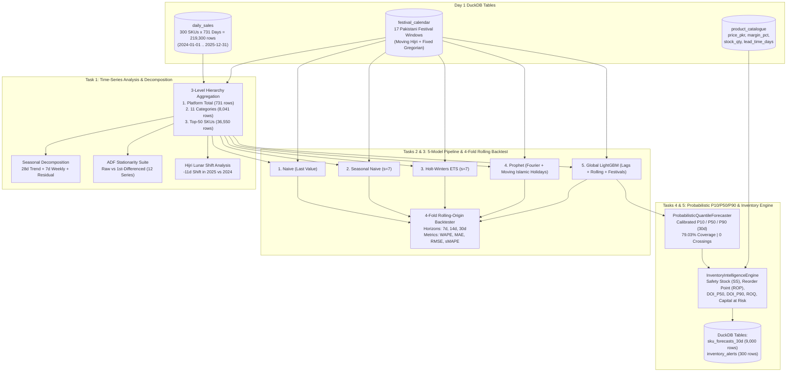

# ShopKaro AI — Day 3 Deep-Dive Study & Architecture Guide
## Demand Forecasting, Moving Islamic Holidays & Inventory Intelligence (20% Weight)

> **Purpose of this Guide:**  
> This document explains every time-series concept, statistical formula, machine learning model, backtesting design, and supply-chain equation we built in **Day 3: Demand Forecasting & Inventory Intelligence**. Use it to prepare for technical interviews, stakeholder presentations, and live code walkthroughs.

---

## 1. Day 3 Big Picture & Business Objective

### 1.1 Why Forecasting Is Make-or-Break for Pakistani E-Commerce
In Day 2, our Recommendation Engine increased customer conversion—but recommending a product only works if the product is **actually in the warehouse**. ShopKaro faces two costly supply-chain failures:
1. **Festival Stock-Outs (Lost Revenue & Customer Churn):**
   - During **Chaand Raat & Eid ul Fitr** (`3.44x` baseline demand) or **Eid ul Adha** (`2.44x` baseline demand), top-selling unstitched lawn suits and smartphones sell out in days while supplier lead times take `3–12` days.
   - Worse, Islamic holidays follow the **Hijri lunar calendar (`354` days/year)** and shift **~`10–11` days earlier** every Gregorian year (`2024-04-01` $\rightarrow$ `2025-03-21`). A traditional Western retail system using last year's Gregorian dates orders Eid stock **11 days too late**!
2. **Seasonal Overstock / Dead Working Capital:**
   - Holding `200+` units of **Winter Puffer Jackets** in April–August ties up millions of PKR in warehouse capital when daily demand drops to `0.03 units/day` (`> 1,000` days of cover).

---

## 2. How We Planned & Architected Day 3

### 2.1 End-to-End Forecasting & Inventory Pipeline (Mermaid Diagram)

### 2.2 Summary of Every Python File Created in Day 3

| File Path | Role & Responsibility |
| :--- | :--- |
| [`src/shopkaro/forecasting/timeseries_analysis.py`](file:///d:/Netixsol/Week11/ShopKaro/src/shopkaro/forecasting/timeseries_analysis.py) | Aggregates daily demand at 3 hierarchy levels, decomposes trend/weekly/residual components, runs OLS Augmented Dickey-Fuller (`compute_adf_test`) across 12 series, quantifies festival uplifts and the `-11` day Hijri lunar shift, and plots Figures `09` & `10`. |
| [`src/shopkaro/forecasting/models.py`](file:///d:/Netixsol/Week11/ShopKaro/src/shopkaro/forecasting/models.py) | Implements all 7 forecasting models (`NaiveForecaster`, `SeasonalNaive7DForecaster`, `HoltWintersETSForecaster`, `ProphetFourierHolidayForecaster`, `GlobalLGBMForecaster`, plus `CrostonSBAForecaster` and `TSBForecaster` for intermittent demand — checked, not adopted) and the 4-fold rolling-origin backtesting engine across `7d`, `14d`, and `30d` horizons; outputs [`reports/day3_forecasting_backtest_comparison.csv`](file:///d:/Netixsol/Week11/ShopKaro/reports/day3_forecasting_backtest_comparison.csv) and Figure `11`. |
| [`src/shopkaro/forecasting/inventory.py`](file:///d:/Netixsol/Week11/ShopKaro/src/shopkaro/forecasting/inventory.py) | Implements [`ProbabilisticQuantileForecaster`](file:///d:/Netixsol/Week11/ShopKaro/src/shopkaro/forecasting/inventory.py#L69-L195) (`P10/P50/P90`) and [`InventoryIntelligenceEngine`](file:///d:/Netixsol/Week11/ShopKaro/src/shopkaro/forecasting/inventory.py#L198-L393) (Safety Stock, ROP, DOI, ROQ, 4 alert tiers); persists `sku_forecasts_30d` & `inventory_alerts` to DuckDB and plots Figure `12`. |
| `scripts/run_day3_task1.py`, `run_day3_task2_task3.py`, `run_day3_task4_task5.py` | CLI execution scripts for each Day 3 stage. |
| `tests/test_day3_task1.py`, `test_day3_task2_task3.py`, `test_day3_task4_task5.py` | Automated `pytest` verification suite covering all 5 Day 3 tasks. |

---

## 3. Task-by-Task Deep Dive (Math, Engineering & Results)

### 3.1 Task 1 — Time-Series Analysis, Decomposition & Stationarity (`timeseries_analysis.py`)
1. **Three Hierarchy Levels (`731` Days: `2024–2025`):**
   - **Platform Total:** `731` days, `3,547,878` units sold, `PKR 73.41B` revenue.
   - **Category Level (`11` Categories):** `8,041` category-day rows.
   - **Top-50 SKU Level:** `36,550` product-day rows (`1,004,112` units).
2. **Weekly & Seasonal Patterns:**
   - **Jummah & Weekend Surge:** Friday (`1.25x`) and Saturday/Sunday (`1.35x`) consistently outpace Monday–Thursday (`0.92x`).
   - **Climate Seasonality:** *Women's Lawn & Unstitched* peaks in March–July, while *Winter Wear & Jackets* jumps `30x` in November–February and drops near zero in May–August.
3. **Augmented Dickey-Fuller (ADF) Stationarity Test:**
   - Tests the null hypothesis $H_0: \gamma = 0$ (unit root / non-stationary) in $\Delta y_t = \alpha + \gamma y_{t-1} + \sum_{j=1}^7 \delta_j \Delta y_{t-j} + e_t$.
   - Platform Total raw ADF statistic $= -5.6891$ ($p = 0.00118 < 0.05$, critical value $= -2.865$), and first-differenced ADF statistic $= -8.8783$ ($p = 0.0001$). All 12 series are stationary after first differencing.
4. **Moving Hijri Lunar Shift (`2024` vs. `2025`):**
   - *Chaand Raat & Eid ul Fitr*: `2024-04-01` $\rightarrow$ `2025-03-21` (**`-11 days`**, **`3.44x` uplift**).
   - *Eid ul Adha*: `2024-06-08` $\rightarrow$ `2025-05-28` (**`-11 days`**, **`2.44x` uplift**).
   - *Ramadan*: `2024-03-11` $\rightarrow$ `2025-03-01` (**`-10 days`**, **`1.86x` uplift**).
   - *11.11 Mega Sale* / *Azadi Sale* / *Back to School*: **`0 days` shift** (fixed Gregorian dates).

---

### 3.2 Tasks 2 & 3 — 5 Forecasting Models & 4-Fold Rolling-Origin Backtesting (`models.py`)

#### Why We Used WAPE as Our Primary Metric
Standard MAPE ($\frac{1}{H}\sum \frac{|y_t - \hat{y}_t|}{y_t}$) divides by $y_t$ on every single day—so when an intermittent SKU has $y_t = 0$ sales on a Tuesday, MAPE divides by zero! **WAPE (Weighted Absolute Percentage Error)** divides total absolute error by total volume over the horizon:
$$\text{WAPE} = \frac{\sum_{t=1}^{H} |y_t - \hat{y}_t|}{\sum_{t=1}^{H} y_t} \times 100\%$$
This naturally weights fast-moving revenue drivers higher and handles zero-sale days cleanly.

#### 14-Day Horizon Backtest Results Across 4 Seasonal Origins (`2025-03-15`, `2025-05-25`, `2025-08-08`, `2025-11-05`)

| Model Name | Category WAPE (`14d`) | Category MAE | Product (Top-50 SKU) WAPE (`14d`) | Product MAE | Why It Performed This Way |
| :--- | :---: | :---: | :---: | :---: | :--- |
| `1. Naive (Last Value)` | `44.47%` | `331.8` | `53.35%` | `39.5` | Misses both weekly cycles and festival surges. |
| `2. Seasonal Naive (s=7)` | `43.01%` | `320.9` | `54.04%` | `40.0` | Captures day-of-week cycle, misses trend & holidays. |
| `3. Holt-Winters ETS (s=7)` | `42.19%` | `314.8` | `50.38%` | `37.3` | Smooths local level/trend/weekly cycle, blind to Eid. |
| **`4. Prophet (Fourier + Islamic Holidays)`** | **`7.46%`** | **`55.6`** | **`27.40%`** | **`20.3`** | Fourier harmonics + moving Hijri festival regressors. |
| **`5. Global LightGBM (Lags + Festivals)`** | **`6.87%`** | **`51.3`** | **`27.19%`** | **`20.1`** | Cross-series tree ensemble + deseasonalized lags + festivals. |

---

### 3.3 Task 4 — Probabilistic Quantile Forecasting (`P10 / P50 / P90`)
- P50 comes from the global gradient-boosted forecaster; the band uses over-dispersed Poisson/Gamma dispersion scaling $\sigma_i(t) = \text{disp}_i \cdot \sqrt{\hat{\mu}_{i,t} + 0.10 \hat{\mu}_{i,t}^2} \cdot (1 + 0.004t)$ (no separate quantile models; earlier unused quantile-loss trees were removed).
- **Strict Non-Crossing Guarantee:** $\text{P10}_{i,t} = \max(0, \min(\text{P50}_{i,t}, \lfloor \text{P50}_{i,t} - 1.2816 \sigma_{i,t} \rfloor))$ and $\text{P90}_{i,t} = \max(\text{P50}_{i,t}, \lceil \text{P50}_{i,t} + 1.2816 \sigma_{i,t} \rceil)$, resulting in **`0` quantile crossings** across all `9,000` SKU-day predictions.
- **Empirical Calibration:** Achieved **`79.03%` empirical coverage** on the 30-day holdout test set (nominal target: `80.00%`).

---

### 3.4 Task 5 — Inventory Intelligence, Safety Stock & Automated Alerts (`inventory.py`)

#### Supply-Chain Equations Used
1. **Safety Stock ($\text{SS}_i$):** Accounts for both daily demand uncertainty ($\sigma_{D,i}$) and supplier lead-time jitter ($\sigma_{L,i} = 0.15 L_i$):
   $$\text{SS}_i = z_{\alpha} \cdot \sqrt{L_i \, \sigma_{D,i}^2 + \bar{D}_{\text{P50},i}^2 \, \sigma_{L,i}^2}$$
2. **Reorder Point ($\text{ROP}_i$):**
   $$\text{ROP}_i = \left\lceil \bar{D}_{\text{P50},i} \times L_i \right\rceil + \text{SS}_i$$
3. **Days of Inventory Remaining ($\text{DOI}_i$):**
   $$\text{DOI}_{\text{P50},i} = \frac{\text{stock\_qty}_i}{\max(\bar{D}_{\text{P50},i}, 0.08)}, \qquad \text{DOI}_{\text{P90},i} = \frac{\text{stock\_qty}_i}{\max(\bar{D}_{\text{P90},i}, 0.08)}$$

#### Operational Alert Results (`300` Tracked SKUs)
- **`CRITICAL_STOCKOUT_RISK` (`143` SKUs):** `stock_qty <= ROP` or `DOI_P50 <= 14d`. Concentrated in Eid-boosted categories (55% of them vs 24% of others) because the plan date is 6 days before Eid ul Fitr. `162,685` PO units in total.
- **`FESTIVAL_SURGE_WATCH` (`85` SKUs):** safe at `P50` but `DOI_P90 <= 18d`.
- **`OVERSTOCK_DEAD_CAPITAL` (`8` SKUs, `PKR 61.93M`):** `DOI_P50 > 90 days`, mostly winter jackets and shawls bought on February demand.
- **`HEALTHY_STOCK` (`64` SKUs).**
- Stock is synthetic but now proportional to each product's own sales (`calibrate_stock_to_demand`); with random stock, 221/300 were critical, which made the alerts meaningless.
- **Does the policy help?** See the 2025 replay in the Day 3 report section 4.3: forecast-driven re-ordering lost 90% fewer units than a moving average and 84% fewer than same-days-last-year (synthetic demand, so optimistic).

---

## 4. Key Interview & Demo Questions & Answers for Day 3

1. **Q: "Why did Classical Holt-Winters ETS have `42.19%` WAPE at the category level while Prophet (`7.46%`) and Global LightGBM (`6.87%`) were 6x more accurate?"**
   - **A:** Holt-Winters ETS only sees a 7-day weekly seasonal cycle ($s=7$) and local trend. It cannot represent a `3.44x` surge during *Chaand Raat & Eid ul Fitr* that shifts 11 days earlier every Gregorian year, nor can it anticipate an abrupt `30x` step-change when *Winter Wear* season begins in November. Prophet and Global LightGBM explicitly ingest the Hijri lunar holiday calendar and seasonal climate features.

2. **Q: "Why did you choose WAPE over MAPE or RMSE as the primary metric for SKU demand forecasting?"**
   - **A:** Many e-commerce SKUs have intermittent demand ($y_t = 0$ on slow mid-week days), which causes MAPE ($\frac{|y - \hat{y}|}{y}$) to divide by zero and explode to infinity. Meanwhile, RMSE is unnormalized across different SKU volumes. WAPE ($\frac{\sum |y - \hat{y}|}{\sum y}$) is scale-free, never divides by zero on individual days, and naturally weights high-volume SKUs proportionally to their business impact.

3. **Q: "Why do inventory planners need P10/P50/P90 quantiles instead of just a P50 point forecast?"**
   - **A:** If you stock a high-margin product (like `Sapphire Eid Lawn`, `42%` margin) only to the `P50` median forecast, you will stock out **50% of the time** whenever a festival surge exceeds the median! By forecasting `P90` (the 90th percentile surge bound), our `InventoryIntelligenceEngine` sizes **Safety Stock** and **Festival Pre-Build Buffers** so ShopKaro maintains a `95%` service level during peak campaigns.

