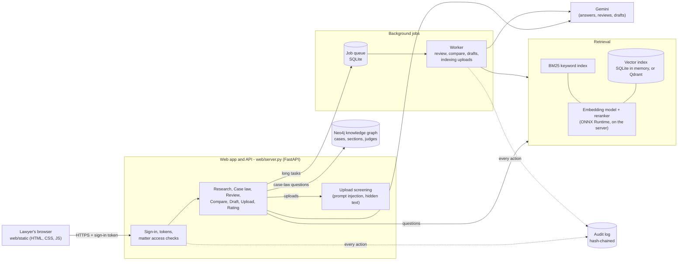
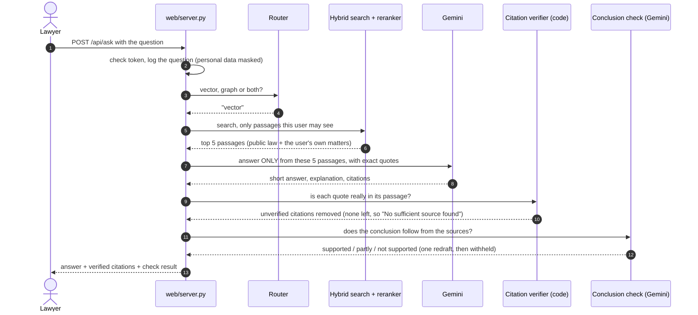
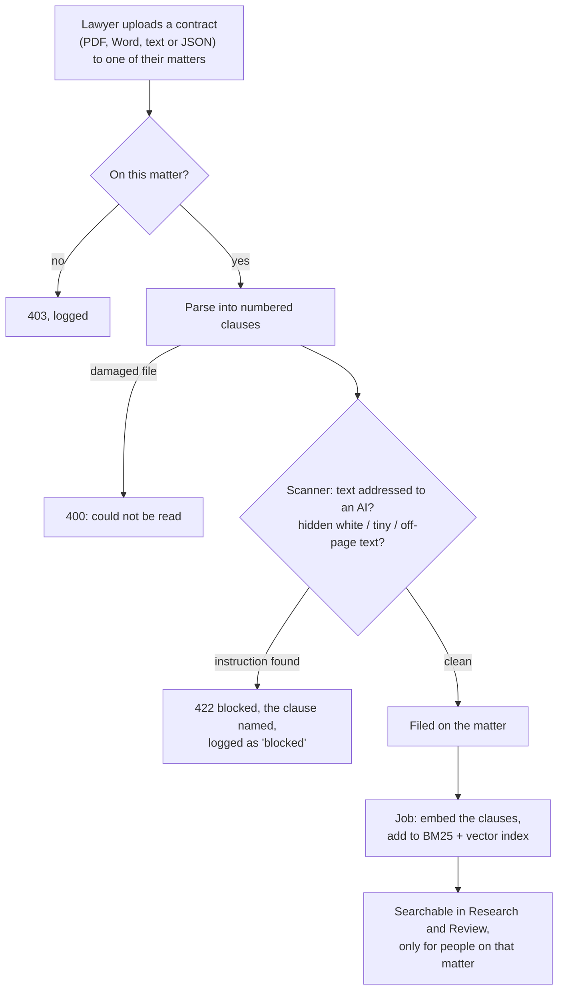
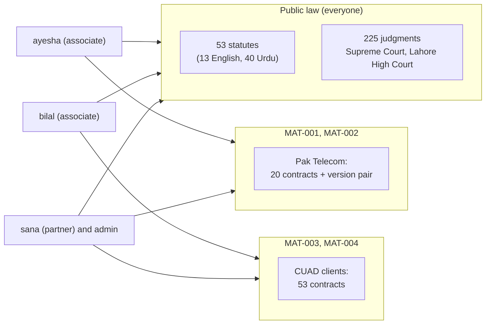
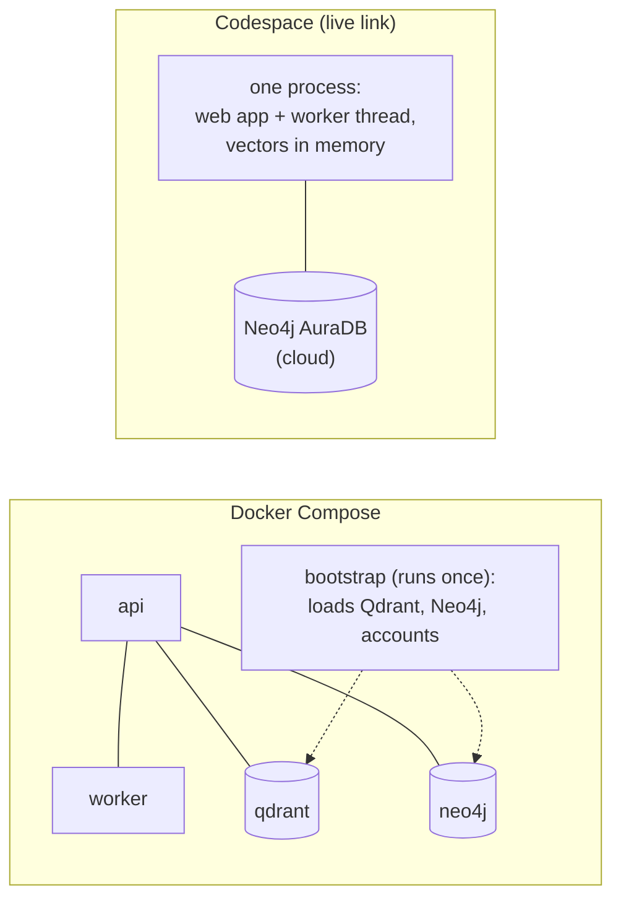

# Architecture

The AI Legal Assistant answers legal questions from Pakistani statutes and judgments with checked citations,
explores case law as a knowledge graph, and reviews, compares and drafts contracts. This page shows how
the parts fit together. The diagrams are written in Mermaid, which GitHub draws as pictures.

## 1. The system at a glance

**The rule behind the design:** the language model never decides on its own what the law is. Search finds the
sources, Gemini writes from those sources only, and plain code then checks every citation against the
source text before anything reaches the lawyer.

## 2. What happens when a lawyer asks a question

Case-law questions ("which judges...", "which cases cite...") go to the knowledge graph instead: known question
shapes use ready-made queries, and anything else is translated to a Cypher query by Gemini. That query is
refused unless it is read-only and touches only public node types (Case, Section, Act, Judge, Court, Party).

## 3. What happens when a contract is uploaded

If an instruction slips past the scanner, a second defence remains: in every review and comparison prompt the
contract text sits inside `<contract_text>` tags, and the model is told that text there is data to review,
never instructions. The red team switched the scanner off and sent 12 kinds of injection through real
reviews: none changed a rating (`evaluations/red_team_report.md`).

## 4. Who can see what

The same check (`src/security/access.py`) is applied everywhere a document can come out: search results,
reviews, comparisons, Word downloads, job results, the contract lists and graph queries. A document on
another matter gives "404 not found", so a user cannot even learn that it exists.

## 5. Two ways to deploy

Both run the same code; switches are environment variables (`WORKER_MODE`, `VECTOR_BACKEND`, `NEO4J_URI`).
Search results are identical on Qdrant and in memory (same top passage on 25/25 test questions). Details:
`docs/deployment.md`.

## 6. Components and where they live

| Part | What it does | Code |
|---|---|---|
| Web app | Pages, sign-in, all endpoints | `web/server.py`, `web/static/` |
| Security | Tokens, passwords, matter access, PII masking, audit log, injection scanner | `src/security/` |
| Jobs | Queue (SQLite), worker, the job handlers | `src/jobs/` |
| Ingestion | Collect PDFs, OCR Urdu scans, parse | `src/ingestion/`, `src/extraction/` |
| Chunking + indexing | Section-level chunks, BM25, vector store, Qdrant sync, ONNX models | `src/chunking/`, `src/indexing/` |
| Research | Retrieval configurations, answer generation, citation verifier, conclusion check, router | `src/rag/` |
| Knowledge graph | Extraction of cases, sections, judges and their links; loading Neo4j; GraphRAG | `src/graph/` |
| Contracts | Clause classification, playbook review, version comparison, drafting | `src/contracts/` |
| Operations | First-start bootstrap, health checks | `src/ops/`, `web/server.py` |
| Evaluation | Every report and the scripts that produce them | `evaluations/` |
| Deployment | Dockerfile, docker-compose.yml, Codespace setup, CI | `Dockerfile`, `deploy/`, `../../.devcontainer/legal-assistant/`, `../../.github/workflows/` |

## 7. Data

| Data | Size | Where |
|---|---|---|
| Statutes, judgments, contracts as structured JSON | 351 files | `data/structured/` (in git) |
| Search index: 11,232 passages, BM25 + 384-number vectors | ~270 MB | `data/indices/` (not in git; built with `python main.py --index`) |
| Knowledge graph: 1,649 cases, sections, judges and links | CSV files | `data/graph/` (in git), loaded into Neo4j |
| Saved Gemini answers (so repeated questions cost nothing) | cache | `data/llm_cache/` (not in git) |
| Accounts (password hashes), matters, audit log, uploads, jobs | small | `data/security/`, `data/web_outputs/`, `data/jobs/` (never in git) |

## 8. Main design decisions

| Decision | Why |
|---|---|
| Section-level chunks (one legal provision per passage) | A citation then points to exactly one section; Day 1 compared three chunking strategies. |
| Hybrid search (BM25 + vectors) + a multilingual reranker | Keyword search finds exact section numbers, vectors find meaning across English, Urdu and Roman Urdu; the reranker puts the best passage first (Day 2 comparison of 8 configurations). |
| Citations checked by code, not by the model | A quote is accepted only if it is really in the cited passage; the answer is refused when nothing survives. |
| A second model call checks the conclusion | A correct quote can still be stretched into a wrong conclusion; the check catches that and redrafts once. |
| Graph for case-law relationships | "Which cases cite X" is a path question that vector search answers poorly (Day 3: vector vs graph vs hybrid). |
| Long tasks as background jobs | A review takes 20-60 s; the page stays responsive and a separate worker container can do the work. |
| ONNX Runtime instead of PyTorch on servers | Same vectors and rankings, 2.68 GB image instead of 4.41 GB, 1.7 GB memory instead of 2.5 GB. |
| Refuse by default | "No sufficient source found" is a correct answer; inventing law is the worst failure for a law firm. |
