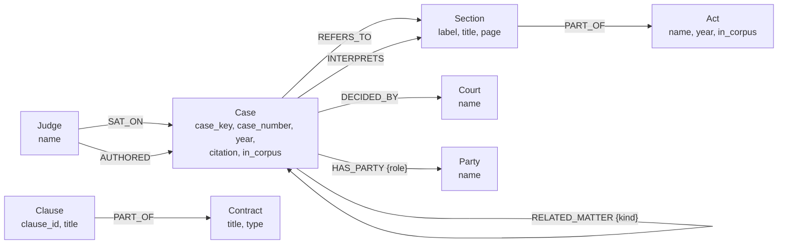

# Legal knowledge graph: schema (Day 3, Task 1)

The graph links the documents of the corpus so that multi-hop questions can be answered,
e.g. *"Which Supreme Court judgments interpreted Section 23 of the Contract Act, and was any of
them later overruled?"*. Nodes are legal entities; relationships record how judgments use
statutes and each other.

## Nodes

| Label | Key | Properties | Source |
|---|---|---|---|
| `Act` | `act_id` (corpus id, or normalised name) | `name`, `year`, `in_corpus` | inventory + statute references in judgments |
| `Section` | `section_id` = `act_id` + label | `label` ("Section 23", "Article 199", "Order V Rule 20"), `title`, `page` | structured statutes; sections cited but not extracted get `in_corpus=false` |
| `Case` | `case_key` (see below) | `case_number`, `court`, `year`, `citations`, `document_id`, `in_corpus` | 225 judgments; cases they cite become `in_corpus=false` nodes |
| `Court` | `name` | | judgment header |
| `Judge` | normalised name | `name` | bench / author line |
| `Party` | normalised name | `name` | parties around "Versus" |
| `Contract`, `Clause` | document id, clause id | `title`, `type` | CUAD contracts (used on Day 4) |

## Relationships

| Type | From → To | Meaning | How it is found |
|---|---|---|---|
| `PART_OF` | Section → Act | section belongs to the Act | structure extraction |
| `DECIDED_BY` | Case → Court | court that decided the case | header |
| `SAT_ON`, `AUTHORED` | Judge → Case | bench member / judge who wrote the judgment | bench, author line |
| `HAS_PARTY {role}` | Case → Party | petitioner/appellant or respondent | header |
| `REFERS_TO` | Case → Section | the judgment mentions the provision | statute references (regex) |
| `INTERPRETS` | Case → Section | the judgment explains the meaning/scope of the provision | cue words near the reference ("interpret", "construed", "meaning of", "scope of"); confirmed by LLM |
| `CITES` | Case → Case | the judgment cites the other case | reporter citations (PLD, SCMR, CLC …), neutral citations, case numbers |
| `FOLLOWS` | Case → Case | relies on / follows the cited case | cue words in the citing sentence ("relied upon", "followed", "approved") |
| `DISTINGUISHES` | Case → Case | holds the cited case does not apply | "distinguished", "distinguishable" |
| `RELATED_MATTER {kind}` | Case → Case | same litigation: the order under appeal (`appeal_history`) or connected petitions (`mentioned`) | a bare case number ("W.P. No. 9563/2010"); precedents are cited by reporter or neutral citation instead |
| `OVERRULES` | Case → Case | declares the cited case wrong law | "overruled", "per incuriam", "not good law"; direction and meaning confirmed by LLM |

## Entity resolution

The same entity is written in many ways; each is mapped to one key.

* **Cases**: reporter citations are normalised (`PLD 2016 Supreme Court 358` = `PLD 2016 SC 358`,
  `PLD 2010 Lahore 5` = `PLD 2010 Lah. 5`); case numbers to `TYPE-NUMBER-YEAR`
  (`Civil Petition No. 624 of 2023` = `C.P. 624/2023` → `CP-624-2023`); LHC neutral citations
  (`2026 LHC 8304`) to the corpus document. A mention is linked to a corpus judgment only when
  exactly one judgment matches.
* **Sections**: Act aliases (`PPC`, `P.P.C.`, `Pakistan Penal Code` → Pakistan Penal Code, 1860;
  `CPC`, `C.P.C.` → Code of Civil Procedure; `Constitution` → Constitution of 1973) and labels
  (`s. 302(b)`, `section 302` → `Section 302`; clause numbers dropped).
* **Judges / parties**: case-folded, titles ("Mr. Justice", "Mst.") and punctuation removed.

Regex gives candidate relationships with high recall; on Day 3 an LLM step checks the direction
and meaning of `INTERPRETS`, `FOLLOWS`, `DISTINGUISHES` and `OVERRULES`, and precision / recall are
measured on 20 hand-checked judgments.
