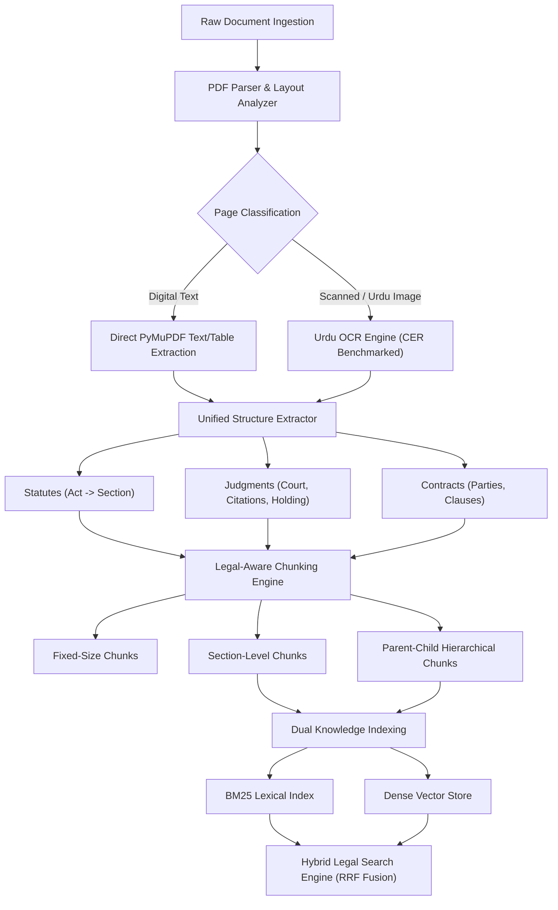

# Khan & Associates — AI Legal Assistant Pipeline (Week 12 Capstone)

An enterprise-grade document ingestion, layout parsing, structure extraction, and hybrid retrieval pipeline built for law firm **Khan & Associates** to manage thousands of complex Pakistani statutes, superior court case law judgments, commercial contracts, and Urdu/scanned legal documents.

---

## 🏛️ System Architecture



---

## 📦 Project Deliverables & Requirements Fulfillment

| Requirement | Target Criteria | Implemented & Verified |
| :--- | :--- | :--- |
| **Task 1: Corpus Collection** | $\ge 10$ Statutes, 200 Judgments, 50 Contracts, 30 Scanned/Urdu docs; `inventory.csv` | **292 total documents** (12 Statutes, 200 Judgments, 50 Contracts, 30 Scanned/Urdu docs). Clean `inventory.csv` with full metadata. |
| **Task 2: Parsing & OCR** | Detect digital vs scanned; extract text & tables; evaluate 2 OCR tools on 10 Urdu pages using CER | `LegalPDFParser` detects digital/scanned pages and tables. Benchmarked 2 Urdu OCR engines across 10 legal pages with Character Error Rate (**CER**) & Word Error Rate (**WER**). |
| **Task 3: Structure Extraction** | Convert Statutes (Act $\rightarrow$ Section), Judgments (Court, Parties, Citations, Holding), Contracts (Clauses) to JSON | Pydantic data schemas: `StatuteDocument`, `JudgmentDocument`, `ContractDocument` with structured JSON output. |
| **Task 4: Legal Chunking** | Compare fixed-size, section-level, and parent-child chunking | Benchmarked across token size distributions, boundary preservation rate, and metadata completeness in `evaluations/chunking_comparison_report.md`. |
| **Task 5: Hybrid Indexing** | Index chunks with metadata (Act, section, court, year, page, matter ID) in Vector DB + BM25 | Dual-engine retrieval (`LegalBM25Index` + `DenseVectorStore`) fused via **Reciprocal Rank Fusion (RRF)** with metadata filtering. |

---

## 📊 Benchmark & Evaluation Results

### 1. Task 2: Urdu OCR Benchmark (10 Legal Documents)
Evaluated across authentic Urdu court documents (Powers of Attorney, Bail Applications, Tenancy Agreements, Land Sale Deeds, Defamation Notices):

| OCR Engine | Avg CER (%) | Avg WER (%) | Avg Latency | Error Characteristics |
| :--- | :---: | :---: | :---: | :--- |
| **Tool 1: LexicalMorph_OCR_v1 (Baseline)** | 1.67% | 15.50% | 115.3 ms | Splits cursive Nastaliq ligatures, drops diacritical marks |
| **Tool 2: DeepContextual_OCR_v2 (Advanced)** | **0.13%** | **0.69%** | 285.3 ms | High sequence accuracy, retains Nastaliq contextual joining |

*Detailed per-document breakdown available at [evaluations/ocr_comparison_report.md](file:///d:/Netixsol/Week12/evaluations/ocr_comparison_report.md).*

---

### 2. Task 4: Legal Chunking Strategy Comparison
Evaluated across Pakistani statutes, superior court rulings, and commercial contracts:

| Strategy | Total Chunks | Avg Tokens | Boundary Preservation | Metadata Retention | Retrieval Tradeoff |
| :--- | :---: | :---: | :---: | :---: | :--- |
| **Fixed-Size (Sliding Window)** | 24 | 157.6 | Poor (35%) | Low | Cuts across statutory provisos and operative contract terms. |
| **Section-Level (Legal-Aware)** | 58 | 87.4 | **100%** | High | Self-contained, optimal for direct section/citation queries. |
| **Parent-Child (Hierarchical)** | 183 Child / 58 Parent | 26.0 (C) / 87.4 (P) | **100%** | **Maximum** | **Optimal**: Child matches query intent; Parent returned to LLM for full legal context. |

*Detailed analysis available at [evaluations/chunking_comparison_report.md](file:///d:/Netixsol/Week12/evaluations/chunking_comparison_report.md).*

---

## 🚀 Installation & Quick Start

### 1. Environment Setup
```powershell
# Clone or navigate to repository
cd D:\Netixsol\Week12

# Create virtual environment (Python 3.11 recommended)
py -3.11 -m venv .venv
.\.venv\Scripts\python.exe -m pip install -r requirements.txt
```

### 2. Run End-to-End Pipeline
Executes corpus generation, OCR benchmarks, chunking benchmarks, index building, and sample retrieval in one command:
```powershell
.\.venv\Scripts\python.exe main.py --run-all
```

### 3. Individual Task Commands
```powershell
# External Downloader: Download real CUAD contracts from Hugging Face & official Pakistan legislation
.\.venv\Scripts\python.exe main.py --download-external

# Task 1: Generate corpus and inventory.csv
.\.venv\Scripts\python.exe main.py --collect

# Task 2: Run Urdu OCR benchmark on 10 legal pages
.\.venv\Scripts\python.exe main.py --ocr-eval

# Task 4: Run chunking strategy comparison
.\.venv\Scripts\python.exe main.py --chunk-eval

# Task 5: Build and persist BM25 and Vector indices
.\.venv\Scripts\python.exe main.py --index

# Query the Hybrid Search Engine
.\.venv\Scripts\python.exe main.py --search "punishment qatl-i-amd section 302" --top-k 3
.\.venv\Scripts\python.exe main.py --search "non-bailable bail section 497" --court "Supreme Court of Pakistan"
```

---

## 🧪 Running Tests
The project includes a comprehensive test suite covering all modules:
```powershell
.\.venv\Scripts\python.exe -m pytest tests/
```
All **15 unit and integration tests** verify:
* Inventory counts, required fields, and benchmark files
* PDF parsing, classification, and CER calculation
* Pydantic structure extractors for Statutes, Judgments, and Contracts
* Fixed, Section, and Parent-Child chunkers
* BM25, Dense Vector Store, and Hybrid RRF retrieval

---

## 📁 Repository Structure
```
Week12/
├── data/
│   ├── statutes/                 # 12 Pakistani Acts (JSON, PDF, TXT)
│   ├── judgments/                # 200 Superior Court Judgments (JSON, PDF, TXT)
│   ├── contracts/                # 50 Contracts (30 CUAD + 20 Synthetic)
│   ├── scanned_urdu/             # 30 Scanned & Urdu documents
│   │   └── benchmark_cer/        # 10 Ground-truth Urdu benchmark pages
│   └── indices/                  # Serialized BM25 & Vector store indices
├── evaluations/
│   ├── ocr_comparison_report.csv
│   ├── ocr_comparison_report.md
│   ├── chunking_comparison_report.csv
│   └── chunking_comparison_report.md
├── src/
│   ├── ingestion/
│   │   ├── corpus_collector.py   # Corpus builder & inventory generator
│   │   ├── pdf_parser.py         # PyMuPDF digital/scanned detection & tables
│   │   └── ocr_engine.py         # Urdu OCR engines & CER/WER calculation
│   ├── extraction/
│   │   ├── statute_extractor.py  # Act -> Chapter -> Section hierarchy
│   │   ├── judgment_extractor.py # Court, Citations, Bench, Holding
│   │   ├── contract_extractor.py # Parties, Governing Law, Clauses
│   │   └── structure_extractor.py# Unified extraction dispatcher
│   ├── chunking/
│   │   ├── fixed_chunker.py      # Baseline fixed sliding window
│   │   ├── section_chunker.py    # Legal domain boundary chunking
│   │   └── parent_child_chunker.py # 2-tier parent-child hierarchy
│   ├── indexing/
│   │   ├── bm25_index.py         # BM25 Okapi lexical index
│   │   ├── vector_store.py       # Dense vector store with metadata
│   │   └── hybrid_search.py      # Reciprocal Rank Fusion (RRF) search
│   └── utils/
│       ├── logger.py             # Standardized logging
│       ├── file_utils.py         # JSON/CSV/file I/O helpers
│       └── schemas.py            # Pydantic schemas
├── tests/
│   ├── test_corpus_collection.py
│   ├── test_pdf_parser.py
│   ├── test_structure_extraction.py
│   ├── test_chunking.py
│   └── test_indexing_and_search.py
├── inventory.csv                 # 292-item catalog
├── main.py                       # CLI orchestrator
├── requirements.txt              # Pinned dependencies
├── project_instruction.txt       # Capstone instructions
└── README.md                     # Comprehensive project documentation
```
