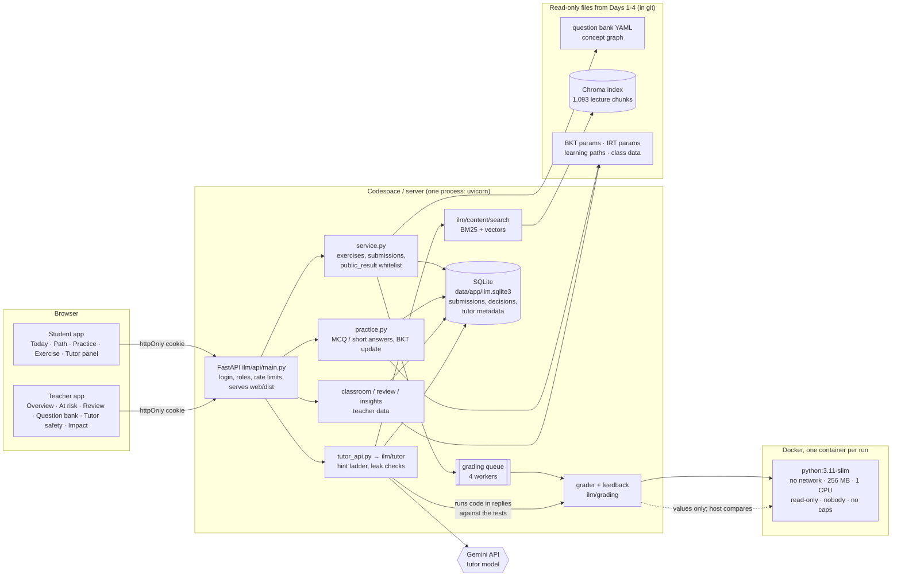
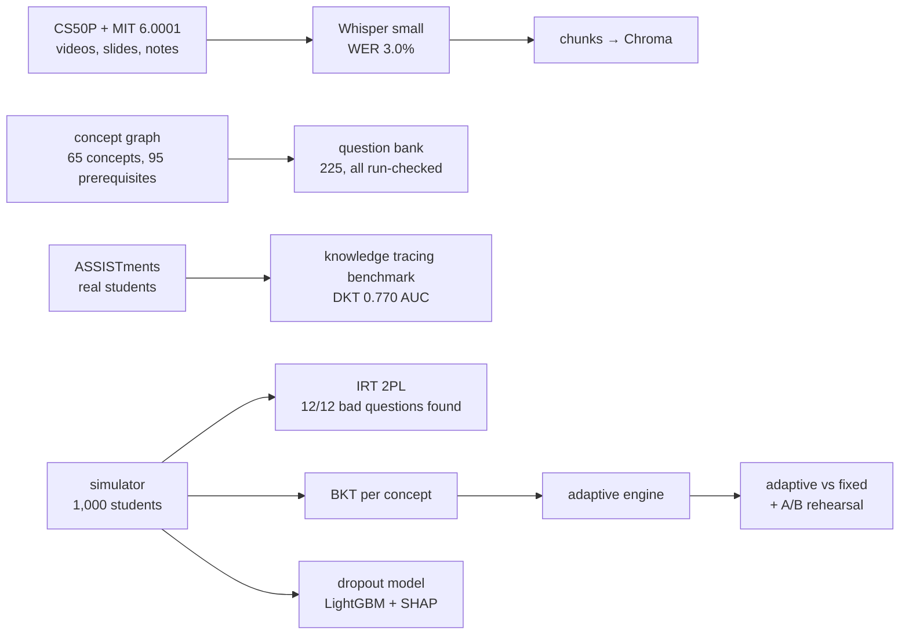

# Architecture

Ilm Academy is a single address. One FastAPI server serves the React app and the API. Student
code runs in throw-away Docker containers next to it. The heavy research work (transcription,
knowledge-tracing training, the simulator) ran offline on Days 1-3. The server only reads the
results, which are in git.

## The live system

## How a code submission flows

1. The student presses **Run tests**. `POST /api/submissions` checks:
   - the role (students only);
   - the exercise exists;
   - the code is under 20,000 characters;
   - the rate limit (12 a minute).

   It stores the submission as `queued` and returns an id at once.
2. One of 4 worker threads takes it. The static quality checks (Ruff, Pylint, radon) start in
   parallel. The grader starts a fresh container for each test set: bank tests plus edge tests,
   each test with its own time limit, the speed check last.
3. **The container never sees the expected answers.** It prints each call's return value behind
   a random per-run tag. The host decodes those values and compares them with the answers. A
   forged "all passed" line still gets 0 (`reports/sandbox/README.md`).
4. The grader adds the AST rule checks (for example "without `max()`"), then the feedback:
   - every visible failure in full;
   - hidden failures as a count and a kind only;
   - one improvement, chosen by priority;
   - a link to the lesson.
5. `public_result()` (a whitelist) writes the result. The browser polls
   `GET /api/submissions/{id}` until it shows `done`.

Measured: a median of 1.8 s from pressing the button to seeing the result, at 500 submissions in
10 minutes on 2 cores (`reports/load_test/report.md`).

## How a tutor hint flows

1. `POST /api/tutor/hint` with the exercise, the student's code and the rung (1-4). Per-student
   limits: 8 a minute, 80 a day.
2. The tutor searches the lectures: the LLM rewrites the question, then BM25 and vector search
   run and their results are merged. It builds a prompt with numbered sources, the rung's rules
   and the student's mastery level.
3. **Every draft is checked before the student sees it:**
   - code in the reply is run against the exercise's tests;
   - the near-copy check compares token shapes with the solution;
   - the other-exercise check;
   - rung 3 must contain a blank.

   A leaking draft gets one retry, told why it leaked. After that the tutor drops to rung 2,
   and only then gives the fixed safe message.
4. Links to lessons are built by the server from the source numbers the model cites, so a link
   cannot be invented. Only metadata is logged: kind, rung, language, whether a leak was blocked.
   The student's text is not logged.

## Where the numbers come from (offline, Days 1-4)

## Trust boundaries

| boundary | what crosses it | what protects it |
|---|---|---|
| browser → API | everything a user sends | JWT in an httpOnly cookie (Secure in prod); role check per endpoint; size limits; rate limits; responses built from whitelists |
| API → sandbox | student code only | no network, no host folders, no environment variables (no API key), resource limits; the verdict is computed on the host |
| API → LLM | course sources, the exercise, the student's code and message | the key stays on the server; replies are checked by code before the student sees them |
| teacher decisions | copying, tampering, low marks, question retire/relabel | stored with the teacher's name; never applied automatically |
| secrets | `LLM_API_KEY`, `ILM_DEMO_PASSWORD`, `ILM_JWT_SECRET` | codespace secrets or `.env` (not in git); prod refuses to start without them |

## Deployment

The deployment runs on GitHub Codespaces: 2 cores, port 8010, public link. See
`docs/deployment.md`. `setup.sh` builds once; `start.sh` runs on every start with `ILM_ENV=prod`.

**Not deployed:** the research pipelines (Whisper, ASSISTments training, the simulator). The
server only reads their outputs.

## Known limits, and what a paid launch would change

- **One process, SQLite, 4 workers.** It is enough for the load test, with little spare. Next:
  Postgres, and a separate worker pool (Redis queue) on more cores.
- **The sandbox is a container, not a VM.** Next: gVisor or Firecracker, and pin the image by
  digest.
- **The tutor depends on the free Gemini quota.** Next: a paid key or a self-hosted model; the
  per-student limits stay.
