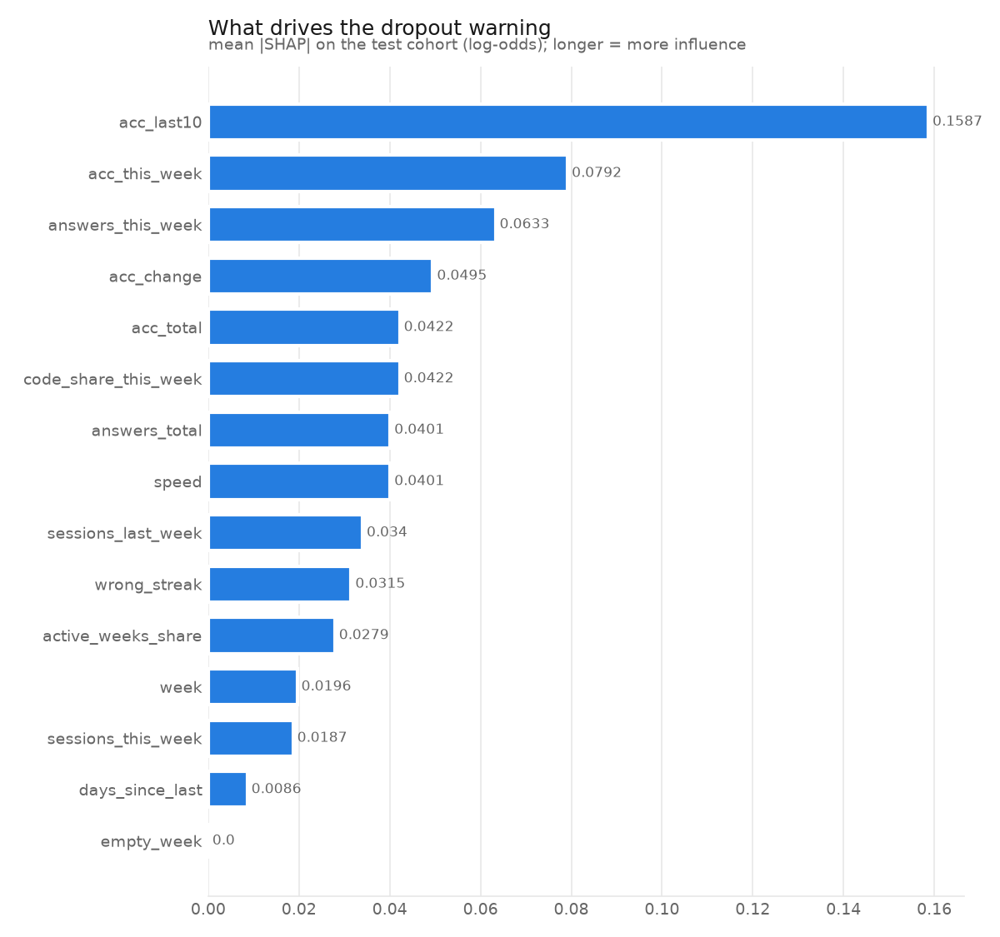

# Dropout early warning (test cohort, scored once)

| model | PR-AUC | ROC-AUC | Brier | base rate |
|---|---|---|---|---|
| baseline (logistic, 3 signals) | 0.324 | 0.645 | 0.149 | 0.195 |
| LightGBM | 0.317 | 0.626 | 0.150 | 0.195 |
| *ceiling: the simulator's own rule, observable part* | 0.307 | | | |
| *ceiling: the rule incl. hidden motivation (impossible)* | 0.386 | | | |

Both models reach the best PR-AUC possible from what a platform can see: the rest of this simulated dropout is chance (by design) or hidden motivation. LightGBM cannot beat the logistic baseline here because the simulator's rule IS a logistic formula of the baseline's signals.

## Risk levels (cut-offs set on validation)

| level | students | dropouts | dropout rate | share of all dropouts | action |
|---|---|---|---|---|---|
| high | 427 | 165 | 38.6% | 22.9% | mentor calls within 24 hours (plus the reason action) |
| medium | 814 | 172 | 21.1% | 23.9% | personalised UrduLish nudge in the app / WhatsApp (plus the reason action) |
| low | 2450 | 384 | 15.7% | 53.3% | no extra action: the normal weekly progress summary |

## Reason actions (from each flagged student's biggest SHAP push)

- **activity** (23% of flagged): reminder at the student's usual study time + a 10-minute 'quick win' session
- **struggling** (74% of flagged): switch to easier ZPD questions and offer the Socratic tutor on the last mistake
- **pace** (3% of flagged): shorter sessions; split code exercises into smaller steps
- **other** (1% of flagged): check in: ask what is getting in the way

*Simulated students; the dropout rule is ours, so SHAP recovering it validates the pipeline.*
