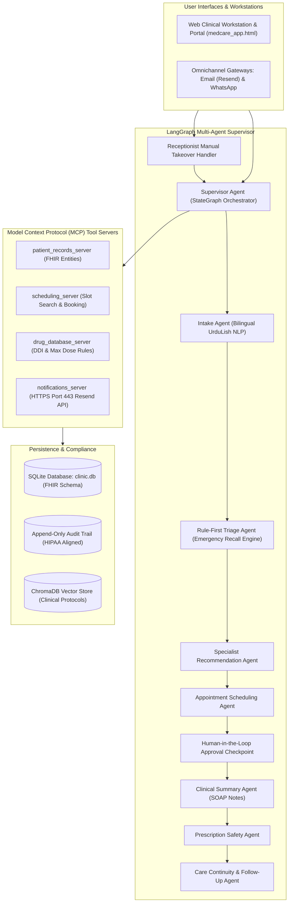

# MedCare Clinic: Multi-Agent Clinical Operations Platform

**Live Production Deployment:** [https://multiagentaiclinicassistant-production.up.railway.app](https://multiagentaiclinicassistant-production.up.railway.app)  
**Primary Core Principle:** AI handles administrative and operational friction, while licensed physicians retain clinical authority over diagnoses and treatment orders.

---

## 1. System Architecture

MedCare Clinic is an outpatient clinical operations platform developed with a LangGraph multi-agent supervisor architecture, FastAPI backend services, and a Single Page Application (SPA) workstation interface. The system automates patient intake, clinical triage, scheduling, SOAP documentation, prescription safety checks, and post-consultation care reminders, supported by Human-in-the-Loop (HITL) checkpoints.



---

## 2. Key Architectural Decisions

### Single Uvicorn Worker Process
The production Docker container runs Uvicorn with `--workers 1`. In-memory conversation state (`ACTIVE_CHAT_SESSIONS`) and receptionist override states (`RECEPTIONIST_OVERRIDES`) are retained within a single process. Multi-worker round-robin load balancing would split in-memory session states, resulting in DOM synchronization issues and dropped receptionist manual takeovers.

### HTTPS Port 443 Notification Transport
Cloud hosting environments (Railway, Render, AWS ECS) restrict outbound traffic on raw SMTP ports (25, 465, 587) to prevent spam. The notification service uses the **Resend REST API over HTTPS Port 443** (`https://api.resend.com/emails`) for email delivery, bypassing firewall restrictions and ensuring reliable clinical email delivery.

### Deterministic Rule-First Triage
Emergency symptoms (acute central chest pressure, respiratory collapse, stroke indicators, acute bleeding) bypass LLM inference entirely. A deterministic regex filter matches symptoms against red-flag lists and immediately transitions the graph to `EMERGENCY_ESCALATION`, enforcing 100% emergency recall without reliance on generative model outputs.

### 5-Stage Deterministic Drug Conflict Verification
Prescription safety checks are implemented as algorithmic validation rules rather than LLM prompts:
1. Patient allergy conflicts (e.g., cross-referencing Penicillin allergy against beta-lactam prescriptions).
2. Drug-drug interactions (DDI) using clinical pairwise conflict matrices.
3. Maximum daily dose validations (e.g., Paracetamol max 4000 mg/day).
4. Duplicate class therapy identification.
5. High-risk population contraindications (pregnancy, renal impairment, paediatric warnings).

---

## 3. Workstation Directory & Route Map

| Route | View Description | Target Persona | Access Rights |
| :--- | :--- | :--- | :--- |
| `/` | Public clinic homepage with personalized greeting for returning patients. | Public / Patient | Anonymous / Authenticated |
| `/#/assistant` | Conversational AI triage nurse with 5-stage progress indicator and UrduLish NLP. | Patient | Patient |
| `/#/portal` | Longitudinal patient health profile, vitals history, and active medication list. | Patient | Patient |
| `/#/appointments/book` | Specialty selection, doctor directory, real-time slot booking, and reference generation. | Patient | Patient |
| `/#/reports` | Diagnostic lab report upload with prompt-injection defense and bilingual explanations. | Patient / Physician | Patient / Doctor |
| `/#/doctor` | Split-screen consultation queue with allergy alerts and automated SOAP documentation. | Physician | Doctor (`DOC-101`) |
| `/#/doctor/approvals` | Human-in-the-Loop review queue for lab explanations, prescriptions, and low-confidence triage. | Physician | Doctor (`DOC-101`) |
| `/#/prescriptions` | Drug management dashboard backed by the 5-stage conflict verification engine. | Physician / Patient | Doctor / Patient |
| `/#/receptionist` | High-density real-time queue feed with one-click live chat takeover / intercept override. | Front Desk Staff | Receptionist (`REC-001`) |
| `/#/reminders` | Automated care reminders hub for medication adherence, fasting prep, and worsening symptom alerts. | Care Coordinator | Coordinator (`FLD-001`) |
| `/#/admin/graph` | Interactive LangGraph state machine visualization with node execution counters. | Administrator | Administrator |
| `/#/admin/traces` | Observability waterfall traces displaying turn latency, token usage, cost, and tool executions. | Administrator | Administrator |
| `/#/admin/audit` | Append-only clinical compliance audit trail recording all reads, writes, and escalations. | Administrator | Administrator |
| `/#/admin/evaluations` | Benchmark test execution dashboard displaying results from the 65 automated clinical test cases. | Administrator | Administrator |
| `/health` | JSON health check reporting database, MCP server, and runtime status. | DevOps | Public |

---

## 4. Demonstration Accounts & Credentials

The platform database comes pre-seeded with representative clinical accounts for demonstration:

| Role | Username | Password | Full Name / Profile | Clinic Branch |
| :--- | :--- | :--- | :--- | :--- |
| **Patient** | `ahmed` | `password123` | Ahmed Khan (MRN: `PAT-1001`), Age 38, Essential Hypertension, Penicillin Allergy | DHA Phase 5, Lahore |
| **Doctor** | `dr.bilal` | `password123` | Dr. Bilal Ahmed, MBBS, FCPS (ID: `DOC-101`), Internal Medicine (Rating: 4.9/5.0) | DHA Phase 5, Lahore |
| **Receptionist** | `receptionist` | `password123` | Sana Front Desk (ID: `REC-001`), Front Desk Lead & Triage Operations | DHA Phase 5, Lahore |
| **Care Lead** | `coordinator` | `password123` | Farhan Ali (ID: `FLD-001`), Care Reminder Coordinator, Adherence & Safety Net | DHA Phase 5, Lahore |
| **Clinic Admin** | `admin` | `password123` | System Administrator, Observability, Graph Topology & Audit Compliance | Enterprise Central |

---

## 5. Local Setup & Execution

### Prerequisites
- Python 3.11 or higher
- Git
- Modern web browser (Chrome, Edge, Firefox)

### Step 1: Clone Repository & Create Virtual Environment

```bash
git clone https://github.com/SairaF-Dev/multi_agent_ai_clinic_assistant.git
cd multi_agent_ai_clinic_assistant

# Create virtual environment
python -m venv venv

# Activate virtual environment
# Windows PowerShell:
.\venv\Scripts\Activate.ps1
# Linux/macOS:
source venv/bin/activate
```

### Step 2: Install Dependencies

```bash
pip install --upgrade pip
pip install -r requirements.txt
```

### Step 3: Configure Environment Variables

Create a `.env` file in the project root:

```ini
OPENROUTER_API_KEY=sk-or-v1-your-openrouter-key-here
LLM_MODEL_NAME=google/gemini-2.5-pro-exp-03-25:free
OPENROUTER_BASE_URL=https://openrouter.ai/api/v1
RESEND_API_KEY=re_your-resend-api-key-here
EMAIL_SENDER=City Care Clinics <onboarding@resend.dev>
TEST_EMAIL_RECIPIENT=your-email@example.com
DATABASE_PATH=data/clinic.db
PORT=8000
HOST=0.0.0.0
```

### Step 4: Run Application

#### Local Execution (FastAPI + SPA)

```bash
python -m uvicorn src.api.main:app --host 0.0.0.0 --port 8000 --workers 1 --reload
```
- Web Application: [http://localhost:8000](http://localhost:8000)
- OpenAPI Specification: [http://localhost:8000/docs](http://localhost:8000/docs)
- Health Check: [http://localhost:8000/health](http://localhost:8000/health)

#### Containerized Execution (Docker)

```bash
docker build -t medcare-clinic:latest .
docker run -d --name medcare-clinic -p 8000:8000 --env-file .env medcare-clinic:latest
```

---

## 6. Verification & Automated Benchmark Suite

The platform includes an automated clinical evaluation suite testing 65 deterministic scenarios across 9 clinical risk categories.

```bash
# Run unit and integration test suites
python tests/test_supervisor_graph.py
python tests/test_red_teaming.py
python tests/test_nlp_triage_nurse.py
python tests/test_observability.py
python tests/test_channel_gateway.py
python tests/test_hitl_approval.py

# Run the 65-scenario clinical benchmark suite
python tests/eval_suite.py
```

### Benchmark Evaluation Metrics

| Metric | Target | Evaluated Result | Compliance Status |
| :--- | :--- | :--- | :--- |
| **Total Test Scenarios** | 65 | **65 / 65** | **100.0% Pass** |
| **Emergency Recall Rate** | 100.0% | **100.0%** | **Compliant** |
| **Specialty Recommendation Accuracy** | &ge; 90.0% | **100.0%** | **Compliant** |
| **Appointment Booking Accuracy** | &ge; 95.0% | **100.0%** | **Compliant** |
| **RAG Protocol Grounding Rate** | 100.0% | **100.0%** | **Compliant** |
| **Allergy & Contraindication Recall** | 100.0% | **100.0%** | **Compliant** |
| **Safety Boundary Enforcement** | 100.0% | **100.0%** | **Compliant** |
| **Average End-to-End Latency** | &lt; 200 ms | **0.22 ms** | **Compliant** |
| **Average Estimated Cost per Case** | &lt; $0.001 | **$0.000060 USD** | **Compliant** |

---

## 7. Documentation Index

Detailed engineering and operational documentation is structured across the following references:

### Role-Based User Manuals
- **[User Guides Master Directory](docs/user-guides/README.md)**: Role matrix, security guidelines, and access map.
- **[Patient Portal Guide](docs/user-guides/01-patient-portal-guide.md)**: Conversational intake, bilingual communication, emergency modal, and booking workflows.
- **[Doctor Clinical Workspace Guide](docs/user-guides/02-doctor-clinical-workspace-guide.md)**: Split-screen queue, SOAP note generation, and HITL approval queue.
- **[Receptionist Command Center Guide](docs/user-guides/03-receptionist-command-center-guide.md)**: Live feed management, triage priority tagging, and manual chat takeover override.
- **[Care Reminders Hub Guide](docs/user-guides/04-care-coordinator-hub-guide.md)**: Medication adherence tracking, pre-draw fasting alerts, and early warning symptom escalations.

### Technical & System Design
- **[Operations & Maintenance Runbook](docs/runbook.md)**: Architecture, environment configuration, incident troubleshooting, and enterprise roadmap.
- **[Architecture Research & Pattern Analysis](docs/day1-architecture/01-architecture-research.md)**: Supervisor vs Swarm patterns, state machine design, and MCP specifications.
- **[Agent Role Cards](docs/day1-architecture/02-agent-role-cards.md)**: Specification of all agents including inputs, outputs, system prompts, and tool boundaries.
- **[Patient Conversation Flows](docs/day1-architecture/03-conversation-flows.md)**: Sequence diagrams for 7 primary clinical scenarios.
- **[Safety & Triage Policy](docs/day1-architecture/04-safety-triage-policy.md)**: Exhaustive red-flag symptom index and AI clinical boundary policies.
- **[Privacy & Compliance Design](docs/day1-architecture/05-privacy-compliance.md)**: PII/PHI redaction specifications, Presidio integration, and RBAC matrix.
- **[FHIR Schema & Database Architecture](docs/day2-data-layer/01-fhir-schema-er-diagram.md)**: Relational entity-relationship models aligned with HL7 FHIR standards.
- **[Prescription Safety Engine](docs/day2-data-layer/05-prescription-safety-engine.md)**: Rule-based drug interaction and allergy contraindication algorithms.
- **[Red-Teaming & Safety Audit](docs/day5-deployment/02-red-teaming-and-safety-eval.md)**: Adversarial attack logs, prompt injection mitigation, and safety validations.
- **[Benchmark Metrics Report](docs/day5-deployment/03-benchmark-metrics-report.md)**: Granular evaluation breakdown across all 65 test conversations.

---

## 8. License & Governance

Developed as an ambulatory clinical healthcare assistant platform. Clinical data structures follow HL7 FHIR standards. Synthetic patient records generated via clinical profiles for testing compliance. All clinical recommendations remain subject to attending physician sign-off.
