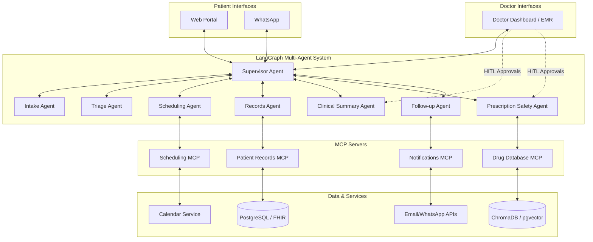
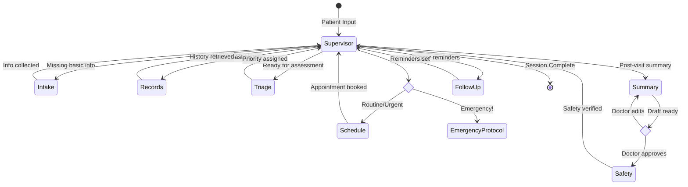

# Multi-Agent Architecture Research: City Care Clinics

This document establishes the architectural foundation for the Multi-Agent AI Clinic Assistant, analyzing design patterns, state management, and critical integration protocols.

## 1. Multi-Agent Patterns Comparison

When designing a multi-agent system, several architectural patterns dictate how agents interact. The primary patterns are Supervisor, Swarm, and Hierarchical.

| Pattern | Description | Pros | Cons | When to Use |
|---------|-------------|------|------|-------------|
| **Supervisor** | A central routing agent delegates tasks to specialized worker agents and synthesizes their outputs. | High predictability; clear separation of concerns; easy to enforce safety policies; single point of state management. | Supervisor can become a bottleneck; rigid structure. | Workflows requiring strict oversight, security boundaries, and predictable routing (e.g., healthcare). |
| **Swarm** | Agents communicate peer-to-peer without centralized control, dynamically organizing to solve problems. | Highly flexible; resilient to single-point failures; scalable for open-ended tasks. | Unpredictable behavior; hard to debug; complex state tracking; risk of loop cycles. | Open-ended research, creative problem-solving, decentralized simulations. |
| **Hierarchical** | Agents are arranged in a tree structure where managers delegate to sub-managers and workers. | Scalable for massive systems; clear chain of command; localized context per branch. | Complex to implement; communication latency across tree branches. | Very large enterprise systems with multiple distinct departments. |

**Why Supervisor Pattern for City Care Clinics?**
Healthcare systems demand strict safety, predictability, and auditing. The Supervisor pattern ensures that all patient interactions are routed through a controlled central node. This central agent can enforce Human-in-the-Loop (HITL) checkpoints before critical actions (like displaying a medical summary) and ensures no worker agent bypasses the clinic's safety rules (e.g., preventing the Triage Agent from directly prescribing medicine).

## 2. One Agent vs. Many Agents

A common question in AI architecture is whether to use a single large agent with many tools or multiple specialized agents.

**Decision Criteria:**
- **Complexity of Tools:** If an agent has too many tools, the LLM struggles to pick the correct one (tool hallucination).
- **System Prompts:** A single agent needs a massive system prompt covering all scenarios, leading to prompt bloat and loss of focus ("lost in the middle" phenomenon).
- **Safety & Permissions:** It is safer to give an isolated "Records Agent" access to patient history without giving it the ability to "book appointments".

**Why Multiple Agents for this Project:**
1. **Separation of Concerns:** Each agent handles a specific domain (Intake, Triage, Scheduling, Clinical Summary, Prescription Safety).
2. **Safety Boundaries:** The Prescription Safety Agent enforces rules strictly without being distracted by conversational pleasantries.
3. **Testability:** We can unit-test the Triage Agent's ability to catch red flags independently of the Scheduling Agent's ability to manage calendars.
4. **Focused Context:** The Clinical Summary Agent only receives the data it needs to write a SOAP note, improving output quality.

## 3. Communication: Shared State vs. Message Passing

Agents need a mechanism to share information and coordinate.

*   **Message Passing (Actor Model):** Agents send explicit messages to each other. Agent A sends a request to Agent B, and B responds. Context is passed in the payload.
*   **Shared State (Graph Model):** All agents operate on a central, shared memory structure (the "State"). As each agent runs, it reads the current state and returns updates to be merged into the state.

**Why LangGraph's Shared State Works Here:**
In our clinical assistant, the *Patient Context* (symptoms, history, triage status) must be universally accessible.
1. The Intake Agent populates symptoms.
2. The Triage Agent reads those symptoms and adds a priority level.
3. The Clinical Summary Agent reads both symptoms and priority to draft the note.
Using LangGraph's shared state (a global Python dictionary/Pydantic model) ensures all agents have the single source of truth without complex message brokering. State updates are automatically tracked, making auditing easy.

## 4. MCP (Model Context Protocol)

**What it is:** MCP is an open standard that standardizes how AI models access external data sources and tools. Instead of writing custom API integration code for every agent, MCP provides a universal interface.

**Why it matters:** It decouples our agent logic from our backend services. We can build MCP servers for our databases, and any agent (with permission) can securely query them.

**MCP Server Structure for City Care Clinics:**
1.  **`patient-records` (MCP Server):** Connects to PostgreSQL (FHIR). Provides tools like `get_patient_history`, `get_lab_results`. Used by the Records Agent.
2.  **`scheduling` (MCP Server):** Connects to Calendar APIs. Provides `check_availability`, `book_appointment`. Used by the Scheduling Agent.
3.  **`drug-database` (MCP Server):** Connects to a vector database (ChromaDB/pgvector). Provides `check_interactions`, `verify_dosage`. Used by the Prescription Safety Agent.
4.  **`notifications` (MCP Server):** Connects to WhatsApp/Email APIs. Provides `send_reminder`, `send_booking_confirmation`. Used by the Follow-up Agent.

## 5. Human-in-the-Loop (HITL) Patterns

Healthcare AI cannot operate fully autonomously when patient safety is involved. LangGraph supports robust HITL patterns.

*   **Interrupt / Approval:** Execution pauses at a specific node. A human reviews the state, approves/rejects, and execution resumes.
*   **Edit:** Execution pauses, and the human modifies the agent's proposed action or state before resuming.

**HITL Checkpoints in Our System:**
1.  **Clinical Summary Approval:** The Clinical Summary Agent drafts the SOAP note, but execution pauses. The *Doctor* must review, optionally edit, and approve the note before it is saved to the official record.
2.  **Prescription Approval:** The Prescription Safety Agent checks interactions, but the final prescription must be explicitly approved/signed by the Doctor.
3.  **Emergency Override:** If the Triage Agent flags an emergency, a human admin might be alerted to immediately take over the chat.

## 6. System Architecture Diagrams

### 6.1 Comprehensive System Architecture

### 6.2 LangGraph State Machine Workflow

