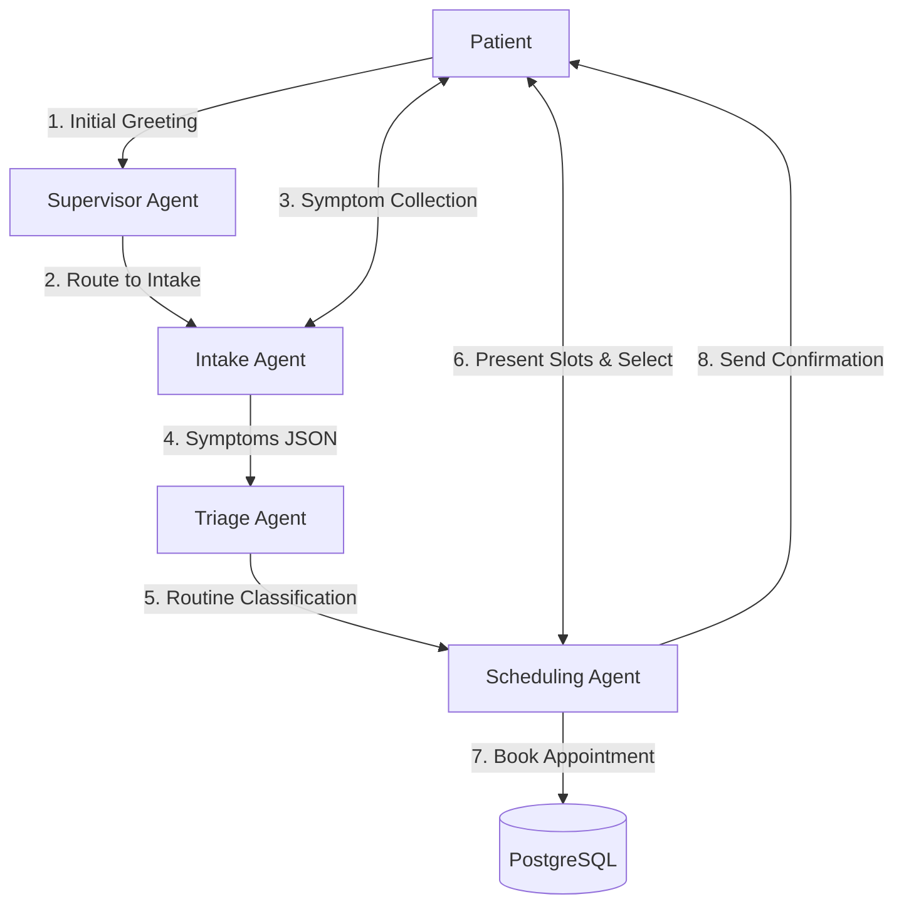
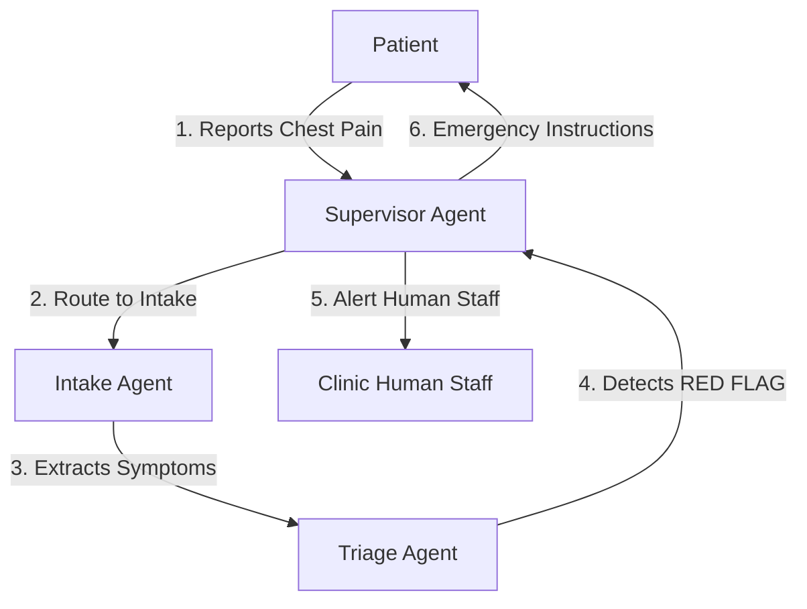
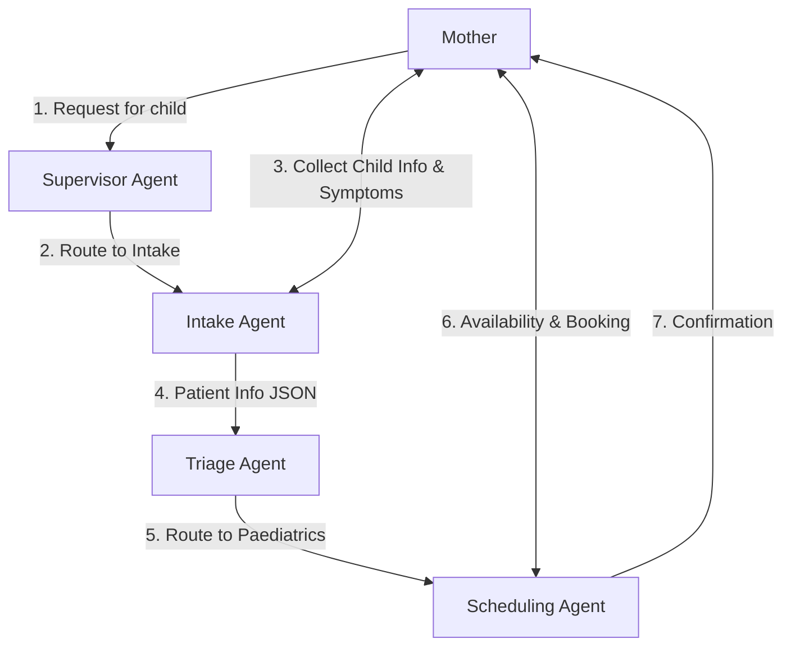
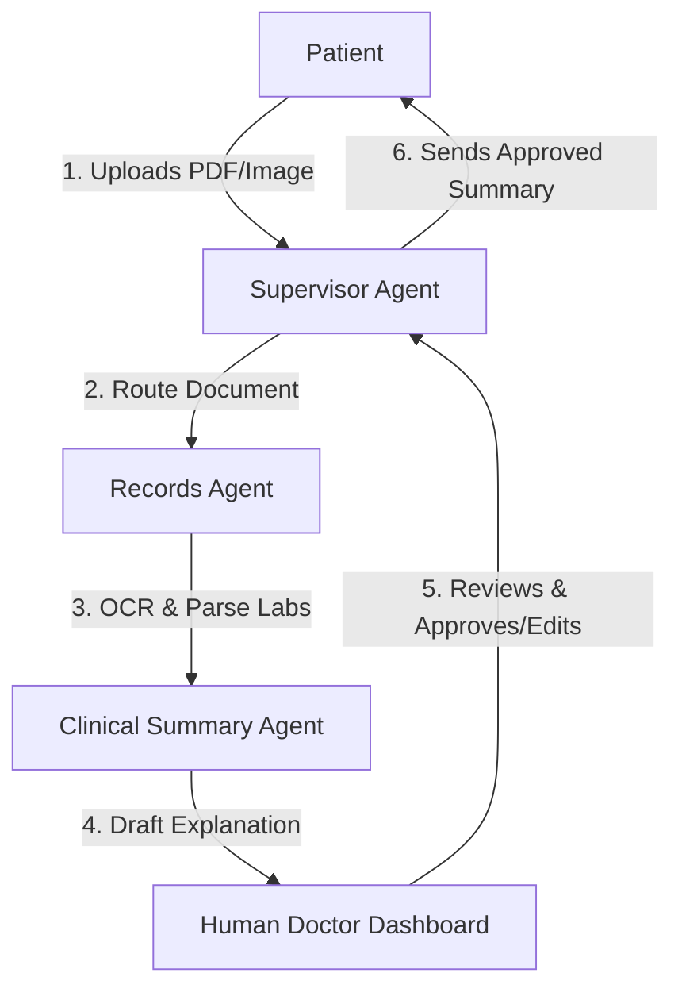
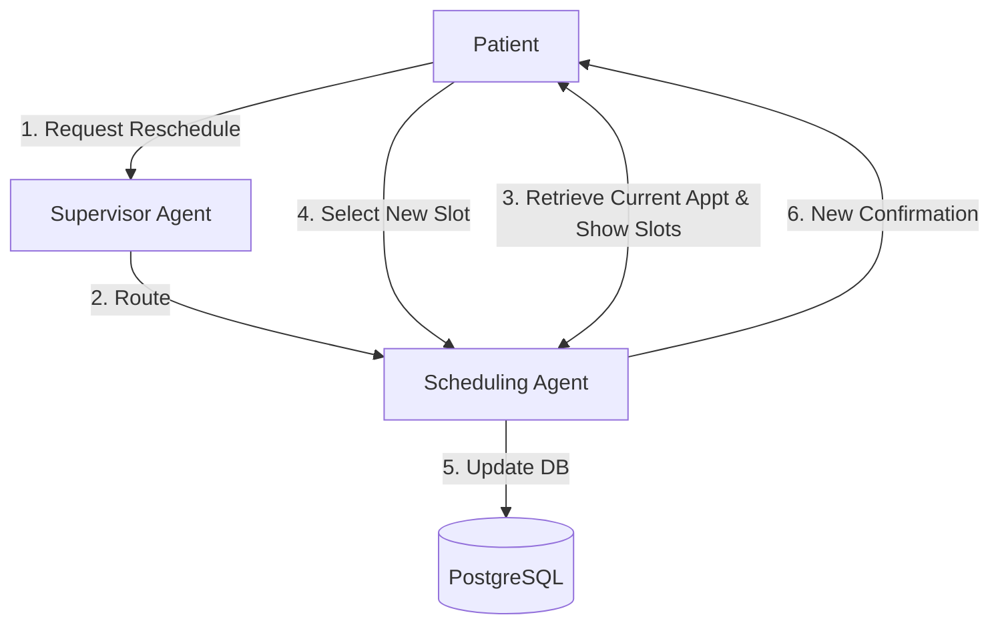
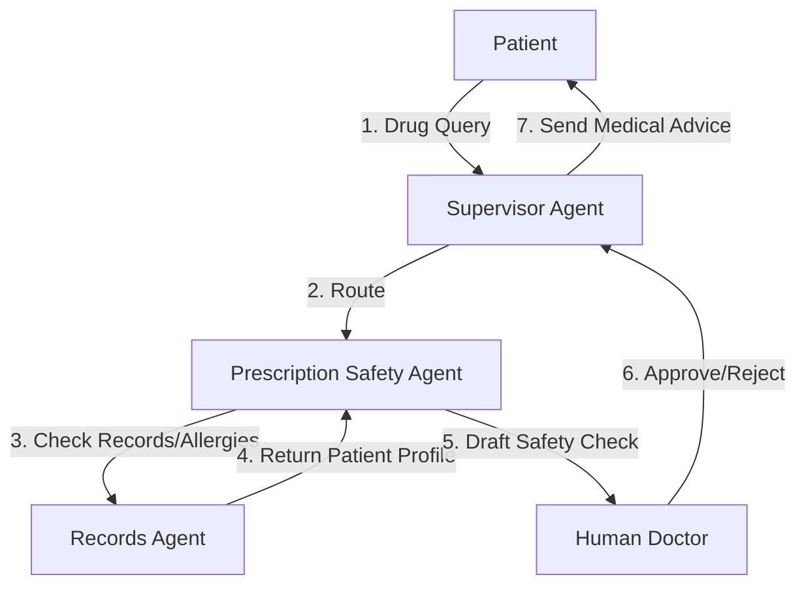
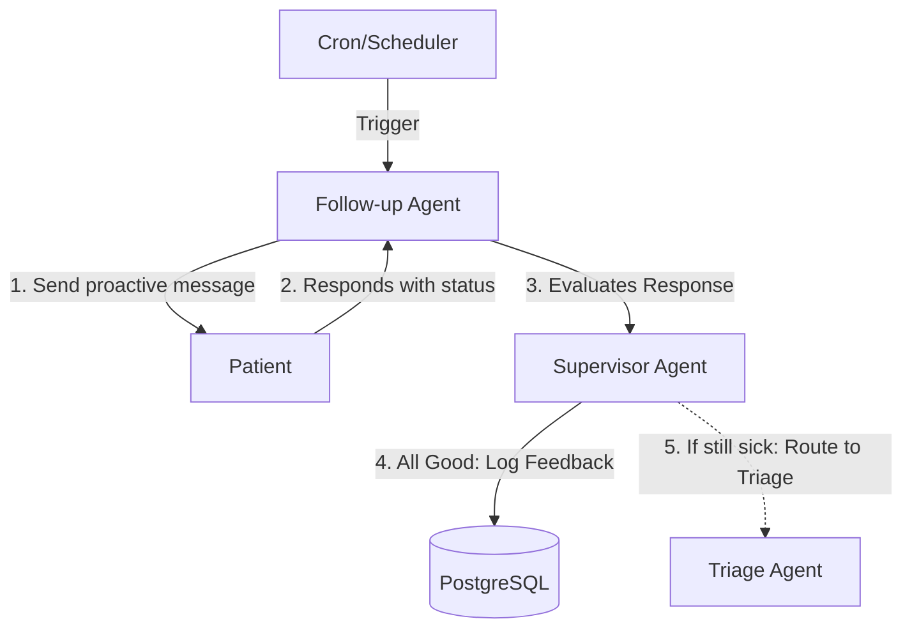

# Patient Conversation Flows

This document outlines the detailed conversation flows for 7 key patient scenarios handled by the Multi-Agent AI Clinic Assistant at City Care Clinics. The system leverages an 8-agent architecture, strict human-in-the-loop (HITL) policies for medical advice, and communicates naturally in UrduLish (Roman Urdu + English).

---

## Scenario 1: New Patient with Fever and Cough (Routine)

**Description:** A standard routine flow where a new patient presents with mild symptoms, goes through intake, is classified as routine, and schedules an appointment.

### Flowchart

### UrduLish Conversation
* **AI:** "Assalam-o-Alaikum! Welcome to City Care Clinics. Main aaj aap ki kya madad kar sakta hoon?"
* **Patient:** "Mujhe kal raat se bukhar aur khansi hai."
* **AI:** "Mujhe sun kar afsos hua. Intake details ke liye, kya aap ka bukhar tez hai aur kya koi aur symptoms hain jaise sar dard ya saans lene mein masla?"
* **Patient:** "Bukhar around 100 hai, bas khansi hai aur thori weakness. Saans theek hai."
* **AI:** "Theek hai, main ne aap ki details note kar li hain. Yeh routine checkup case hai. General Medicine department mein Dr. Ahmed aaj shaam 5:00 PM ya kal subah 10:00 AM available hain. Aap ke liye konsa time behtar rahe ga?"
* **Patient:** "Aaj shaam 5 baje theek hai."
* **AI:** "Perfect. Aap ki appointment Dr. Ahmed ke sath aaj shaam 5:00 PM ke liye confirm ho gayi hai. Clinic pohnch kar reception par apna naam batayiye ga. Allah Hafiz!"

### Scenario Details
* **Agents Involved:** Supervisor → Intake → Triage → Scheduling
* **Human-in-the-Loop:** None required (purely administrative/scheduling).
* **Data Flow:** `user_input` → `Intake` generates `{"symptoms": ["fever", "cough", "weakness"], "vitals": {"temp": "100"}}` → `Triage` sets `{"triage_level": "Routine", "specialty": "General Medicine"}` → `Scheduling` reads specialty and books, returning `{"appointment_id": "12345", "status": "confirmed"}`.

---

## Scenario 2: Patient with Chest Pain (EMERGENCY)

**Description:** A critical scenario demonstrating the 100% emergency recall requirement. Normal scheduling is bypassed, and the user is directed to immediate emergency care with staff alerts.

### Flowchart

### UrduLish Conversation
* **AI:** "Assalam-o-Alaikum! City Care Clinics mein aap ka swagat hai. Kahiye, kya help karun?"
* **Patient:** "Mujhe achanak se bohat tez chest pain ho raha hai aur pasinay aa rahe hain."
* **AI:** "⚠️ **EMERGENCY ALERT:** Aap ke symptoms serious lag rahe hain. Please foran qareebi hospital ki emergency mein jayen ya ambulance (1122) ko call karein. City Care Clinics mein humari emergency team ko main ne alert kar diya hai."
* **Patient:** "Okay, main foran nikal raha hoon."
* **AI:** "Jee, bilkul delay mat karein. Humari team aapse thori der mein follow-up call kare gi. Take care!"

### Scenario Details
* **Agents Involved:** Supervisor → Intake → Triage → Supervisor
* **Human-in-the-Loop:** Immediate hand-off to Clinic Staff/Emergency Response Desk.
* **Data Flow:** `Intake` parses `{"symptoms": ["chest pain", "sweating"]}` → `Triage` flags `{"triage_level": "EMERGENCY", "red_flags": true}` → `Supervisor` intercepts, sends webhook alert to staff dashboard, and outputs emergency template to patient.

---

## Scenario 3: Mother Booking for a Child

**Description:** An intake variation where the primary user is booking for a dependent, requiring specific routing to Paediatrics.

### Flowchart

### UrduLish Conversation
* **AI:** "Assalam-o-Alaikum! City Care Clinics ki taraf se main aap ki kya khidmat kar sakta hoon?"
* **Patient:** "Mera 4 saal ka beta hai, uske pait mein dard hai aur ultiyan ho rahi hain kal se."
* **AI:** "Oh, bache ke liye sun kar pareshani hui. Intake ke liye, bache ka naam kya hai aur kya usay bukhar bhi hai?"
* **Patient:** "Uska naam Ali hai. Nahi bukhar nahi hai, bas ulti aur pait dard."
* **AI:** "Noted. Ali ke liye main Paediatrics (Child Specialist) department mein checkup book kar deta hoon. Dr. Fatima aaj 3:00 PM available hain. Kya main yeh time Ali ke liye book kar doon?"
* **Patient:** "Jee 3 baje book kar dein."
* **AI:** "Bohot khoob. Ali ki appointment Dr. Fatima ke paas 3:00 PM confirm ho gayi hai. Please usay pani pilate rahein (hydration). Mulaqat tak apna khayal rakhein."

### Scenario Details
* **Agents Involved:** Supervisor → Intake → Triage → Scheduling
* **Human-in-the-Loop:** None required.
* **Data Flow:** `Intake` notes `{"patient_profile": {"type": "dependent", "name": "Ali", "age": 4, "relation": "son"}, "symptoms": ["stomach ache", "vomiting"]}` → `Triage` sets `{"specialty": "Paediatrics", "triage_level": "Urgent"}` → `Scheduling` filters available doctors by specialty.

---

## Scenario 4: Returning Patient Asking About a Lab Report

**Description:** The patient uploads a lab report. The Records agent interprets it, drafts a summary, but a human Doctor MUST approve it before the patient receives clinical feedback.

### Flowchart

### UrduLish Conversation
* **Patient:** *(Uploads CBC_Report.pdf)* "Assalam-o-Alaikum. Yeh meri blood report aayi hai, kya isme sab theek hai?"
* **AI:** "Walaikum Assalam. Main ne aap ki report receive kar li hai. Main ise system mein process kar raha hoon. As per our policy, koi bhi report final taur par doctor sahab check karte hain. Please thori der wait karein..."
* *(System processes, drafts summary, Doctor clicks 'Approve' on dashboard)*
* **AI:** "Shukriya intezar karne ka! Dr. Ahmed ne aap ki report review kar li hai. Unhone bataya hai ke aap ka Hemoglobin thora low hai (Anaemia). Baqi tests normal hain. Doctor ne iron supplements likh di hain jo aap ko email kar di gayi hain. Koi aur sawal?"
* **Patient:** "Nahi shukriya, bas yahi poochna tha."
* **AI:** "You're welcome! Apna khayal rakhiye."

### Scenario Details
* **Agents Involved:** Supervisor → Records → Clinical Summary → Supervisor
* **Human-in-the-Loop:** **CRITICAL**. Doctor MUST review the Clinical Summary Agent's interpretation before the Supervisor replies to the patient.
* **Data Flow:** PDF → `Records Agent` extracts text/tables → `Clinical Summary Agent` creates `{"draft_explanation": "Low Hb...", "status": "pending_approval"}` → HITL updates status to `approved` → `Supervisor` formats and sends message.

---

## Scenario 5: Reschedule / Cancel Appointment

**Description:** Patient wants to modify an existing booking. Direct routing to the Scheduling agent to handle administrative state changes.

### Flowchart

### UrduLish Conversation
* **Patient:** "Mujhe apni kal subah 10 baje wali appointment cancel ya aagay karni hai."
* **AI:** "No problem. Main check karta hoon. Aap ki appointment Dr. Ali (General Medicine) ke sath kal 10:00 AM ki hai. Kya aap isay cancel karna chahte hain ya reschedule?"
* **Patient:** "Parson sham ki koi timing de dein."
* **AI:** "Zaroor. Parson (Wednesday) Dr. Ali sham 4:00 PM aur 6:00 PM available hain. Kon sa time lock karun?"
* **Patient:** "6 PM kar dein please."
* **AI:** "Done! Aap ki previous appointment cancel kar ke nayi appointment Wednesday shaam 6:00 PM ke liye set kar di gayi hai. Aap ko confirmation SMS mil jaye ga."

### Scenario Details
* **Agents Involved:** Supervisor → Scheduling
* **Human-in-the-Loop:** None required.
* **Data Flow:** NLP intent `reschedule` → `Scheduling` queries DB `{"patient_id": "XY", "action": "find_appointments"}` → Updates DB `{"action": "reschedule", "old_id": "1", "new_time": "18:00"}`.

---

## Scenario 6: Patient Asking "Kya main yeh dawai le sakta hoon?"

**Description:** Patient asks about medication safety. The Prescription Safety agent cross-references past records (allergies), but a doctor must approve the final advice.

### Flowchart

### UrduLish Conversation
* **Patient:** "Mera gala kharab hai. Ghar mein Augmentin rakhi hai, kya main yeh dawai le sakta hoon?"
* **AI:** "Aap ke sawaal ka shukriya. Main aap ki file check kar raha hoon. Note karein ke AI direct dawai prescribe ya allow nahi kar sakti. Main aap ka case doctor ke paas bhej raha hoon..."
* *(Prescription Safety Agent checks file: Penicillin Allergy = True. Drafts alert: DO NOT TAKE. Doctor approves.)*
* **AI:** "Dr. Ahmed ne aap ka record check kiya hai. Aap ke past record ke mutabiq aap ko Penicillin se allergy hai, aur Augmentin ussi family ki dawai hai. **Please yeh dawai bilkul NA lein.** Doctor ne aap ke liye ek safe alternative (Azithromycin) ka e-prescription bhej diya hai. Check kar lein."
* **Patient:** "Oh shukriya, mujhe allergy wali baat bhool gayi thi. Main nayi wali le leta hoon."

### Scenario Details
* **Agents Involved:** Supervisor → Records (to get allergies) → Prescription Safety → Supervisor
* **Human-in-the-Loop:** **CRITICAL**. A doctor must explicitly approve the "Do not take" or "Safe to take" directive.
* **Data Flow:** `user_query` → `Records` fetches `{"allergies": ["Penicillin"]}` → `Prescription Safety` checks drug class, flags `interaction_detected: true`, generates draft warning → HITL Approval → `Supervisor` responds.

---

## Scenario 7: Follow-up After a Visit

**Description:** The Follow-up agent initiates contact a few days after an appointment to monitor recovery and collect feedback.

### Flowchart

### UrduLish Conversation
* **AI (Follow-up):** "Assalam-o-Alaikum! 2 din pehle aap ka checkup Dr. Ahmed ke paas tha. Umeed hai aap behtar honge. Ab aap ki tabiyat kaisi hai? Dawai time par le rahe hain?"
* **Patient:** "Walaikum Assalam. Jee, dawai le raha hoon aur bukhar ab nahi hai. Bas khansi thori si baqi hai."
* **AI:** "Yeh sun kar acha laga ke bukhar theek hai. Khansi mein mukammal aaram aane mein 4-5 din lag sakte hain. Agar khansi badh jaye ya saans mein masla ho to please dobara raabta karein. Aap ka overall clinic experience kaisa raha? Koi feedback?"
* **Patient:** "Doctor bohot ache the, wait time bhi kam tha. 5 stars!"
* **AI:** "Bohot shukriya aap ke feedback ka! City Care Clinics par bharosa karne ka shukriya. Allah Hafiz."

### Scenario Details
* **Agents Involved:** Follow-up Agent → Supervisor (to log data)
* **Human-in-the-Loop:** Only required if the patient reports worsening symptoms (which would route back to Triage -> Doctor).
* **Data Flow:** System triggers `Follow-up` based on `{"appointment_date": "T-2 days"}` → Collects `{"status": "recovering", "feedback": "5 stars", "resolved": true}` → Saved to Patient Record.
