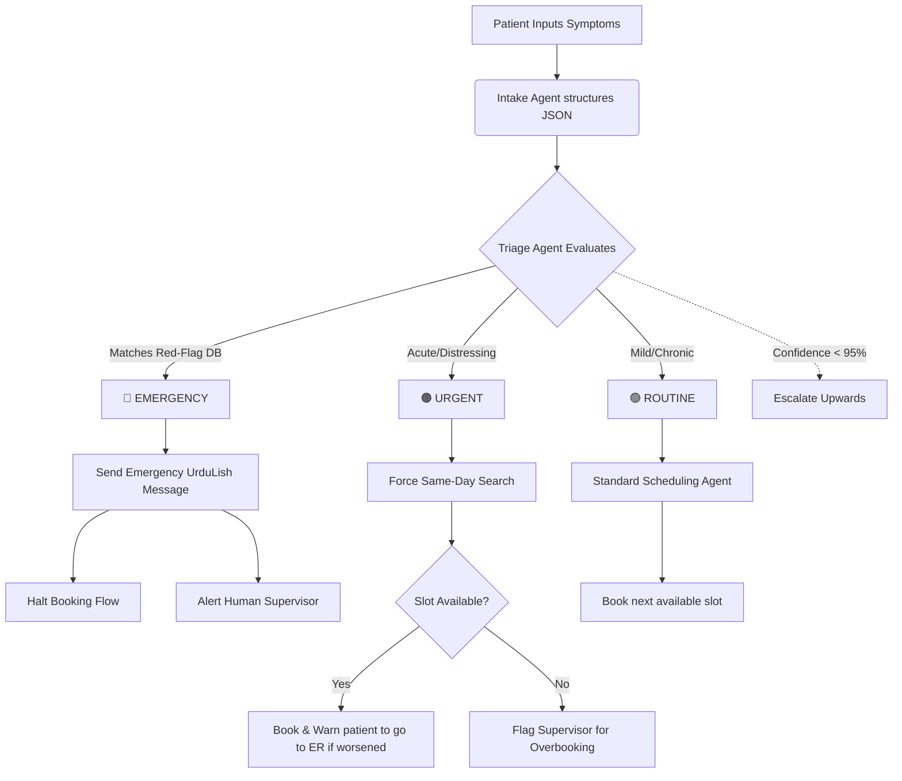

# Safety & Triage Policy

This document defines the strict safety rules, escalation protocols, and triage criteria for the City Care Clinics Multi-Agent AI Assistant. Our guiding principle is patient safety first. **The AI must NEVER diagnose, prescribe, or provide medical advice.**

---

## 1. Red-Flag Symptoms (Immediate Escalation)

The Triage Agent evaluates all reported symptoms against this exhaustive list of red flags. Any match triggers an **EMERGENCY** escalation, bypassing standard scheduling. Emergency recall must be 100%.

| Category | English Symptom | UrduLish Expression (Patient phrasing) |
| :--- | :--- | :--- |
| **Cardiac** | Chest pain / pressure | "Seene mein shadeed dard", "Dil ghabra raha hai", "Chhati par bojh" |
| | Severe Palpitations | "Dil ki dharkan bohat tez hai", "Dil bahar aa raha hai" |
| **Respiratory** | Difficulty breathing | "Saans lene mein masla", "Saans phool raha hai", "Saans nahi aa raha" |
| | Choking | "Gala ghut raha hai", "Kuch phans gaya hai" |
| **Neurological** | Stroke signs (FAST) | "Jism ka ek hissa sun ho gaya", "Zaban lar-khara rahi hai", "Munh tera ho gaya" |
| | Seizures / Convulsions | "Douray parh rahay hain", "Jhatkay lag rahay hain" |
| | Sudden severe headache | "Achanak shadeed sar dard", "Sar phat raha hai" |
| **Bleeding** | Heavy / Uncontrolled bleeding | "Khoon nahi ruk raha", "Bohat ziada bleeding ho rahi hai" |
| | Coughing/Vomiting blood | "Khooni ulti", "Khansi mein khoon" |
| **Consciousness**| Loss of consciousness | "Behosh ho gaye", "Gash aagaya" |
| | Severe confusion | "Baat samajh nahi aa rahi", "Behki behki baatein kar rahay hain" |
| **Mental Health**| Suicidal thoughts | "Khud-kushi ka khayal", "Zindagi khatam karne ka dil chahta hai" |
| | Intent for self-harm | "Khud ko nuqsan pohanchane ka irada" |
| **Paediatric** | High fever in infant (<3mo) | "Chotay bache ko bohat tez bukhar hai" |
| | Not feeding / lethargic | "Bacha doodh nahi pi raha", "Bacha nidhal hai" |
| | Paediatric seizures | "Bache ko jhatke lag rahay hain" |
| **Obstetric** | Heavy bleeding in pregnancy | "Pregnancy mein bleeding ho rahi hai" |
| | Severe abdominal pain | "Pait mein shadeed dard hai (pregnancy mein)" |
| | Signs of eclampsia | "Pregnancy mein blur vision aur shadeed sar dard" |
| **Trauma/Poison**| Major trauma/accidents | "Accident ho gaya hai", "Haddi toot gayi hai" |
| | Suspected poisoning | "Zeher pee liya hai", "Ghalat dawai kha li hai" |
| **Allergic** | Anaphylaxis | "Allergy se gala band ho raha hai", "Jism par shadeed daanay aur saans ruk rahi hai" |

---

## 2. Urgency Levels

Every patient interaction is classified by the Triage Agent into one of three urgency levels:

### 🔴 Emergency
*   **Criteria:** Presence of any Red-Flag symptom (see Section 1). High risk to life, limb, or pregnancy.
*   **Action:** Immediate referral to 1122 or the nearest hospital Emergency Room (ER). Stop booking flow.
*   **Example:** Patient says "Mere seene mein shadeed bojh aur dard hai."

### 🟠 Urgent
*   **Criteria:** Acute symptoms that are distressing but not immediately life-threatening. Patient requires attention within 12-24 hours.
*   **Action:** System forces a same-day appointment. If no slots are available, flags a human supervisor/clinic manager to double-book or fit them in.
*   **Example:** Patient says "Bache ko kal raat se tez bukhar hai aur utar nahi raha" or "Kaan mein shadeed dard hai."

### 🟢 Routine
*   **Criteria:** Chronic issues, medication refills, mild symptoms, follow-ups, general consultations.
*   **Action:** Normal scheduling process based on doctor availability.
*   **Example:** Patient says "Mujhe apni sugar check karwani hai" or "Chehray par daano (acne) ke liye doctor ko dikhana hai."

---

## 3. Escalation Protocol

When an Emergency or Urgent case is detected, the AI must follow exact protocols.

### UrduLish Escalation Messages
*   **Emergency Escalation:** "Aap ki alamaat sun kar lagta hai ke aap ko foran Emergency Room (ER) jana chahiye. Please foran 1122 par call karein ya qareebi hospital jayen. Hum yahan appointment book nahi kar rahay kyunke aap ko fori tibbi madad ki zaroorat hai."
*   **Urgent Escalation:** "Aap ki condition dekhte hue aap ko aaj hi doctor ko dikhana chahiye. Main aaj ki sab se pehli available appointment book kar raha/rahi hoon. Agar tabiyat zyada kharab ho to foran hospital jayen."

### Technical Implementation (LangGraph)
*   **Interrupt Before:** For Emergency routing, LangGraph will trigger an `interrupt_before` node. The workflow halts.
*   **Notification:** An immediate WebSocket/webhook alert is sent to the Clinic Supervisor's dashboard.
*   **State Update:** The patient state is marked as `status: EMERGENCY_REFERRED`. No appointments are committed to the DB for emergency cases without manual override.

### Fallback Mechanism
*   **Rule:** If the system is unsure (confidence < 95% on triage classification), **always escalate UP**.
*   (e.g., Unsure if routine or urgent -> Make it Urgent. Unsure if urgent or emergency -> Make it Emergency).

---

## 4. AI Boundaries: Allowed vs. Forbidden

The AI is an assistant, not a doctor. It strictly collects information and routes the patient.

| What AI CAN Say (Data Collection & Empathy) | What AI CANNOT Say (Diagnosis & Prescription) |
| :--- | :--- |
| "Aap ki alamaat sun kar lagta hai aap ko doctor se milna chahiye." (It sounds like you need to see a doctor) | "Aap ko dengue ya malaria ho sakta hai." (You might have dengue or malaria) |
| "Main yeh saari details doctor saab ke liye note kar raha/rahi hoon." (I am noting these details down for the doctor) | "Aap tab tak Panadol kha lein." (Take a Panadol until then) |
| "Kiya aap ko bukhar ke sath sardi lag rahi hai?" (Are you feeling chills with the fever?) | "Yeh shayad infection ki wajah se hai, fikar na karein." (This is probably just an infection, don't worry) |
| "Hum aap ki gynaecologist ke sath appointment book kar dete hain." (We'll book an appointment with a gynaecologist) | "Aap ki pregnancy mein yeh bleeding normal hai." (This bleeding is normal during pregnancy) |

---

## 5. Disclaimers

These disclaimers must be embedded in the AI's interaction flow to legally and ethically protect both the patient and City Care Clinics.

*   **Standard Welcome Disclaimer:** "Hi! I am the City Care Clinics AI Assistant. I can help you book appointments and collect your symptoms for the doctor. I am an AI, not a human doctor."
*   **UrduLish Welcome Disclaimer:** "Assalam o Alaikum! Main City Care Clinics ka AI Assistant hoon. Main aap ki appointment book karne aur aap ki alamaat doctor tak pohanchane mein madad karunga. Yaad rakhein, main AI hoon, doctor nahi."
*   **Before Any Health Summary:** "Disclaimer: The following summary is AI-generated based on patient inputs and has not yet been reviewed by a doctor."

---

## 6. Triage Decision Tree

---

## 7. Edge Cases & Mitigation

1.  **Patient Downplaying Symptoms:**
    *   *Scenario:* Patient says "Thora sa dard hai pait mein" but reveals they are 8 months pregnant and also bleeding slightly.
    *   *Mitigation:* Triage Agent uses keyword matching on the secondary symptom ("bleeding") coupled with the context ("pregnant") to instantly override the "thora sa dard" modifier and classify as Emergency.
2.  **Patient Refusing ER:**
    *   *Scenario:* AI recommends ER, patient replies "Nahi mujhe clinic hi aana hai aaj."
    *   *Mitigation:* AI responds: "Aap ki condition emergency hai. Clinic mein fori emergency sahoolat nahi hai. Baraye meharbani qareebi bara hospital jayen." Automatically alerts the clinic human supervisor to call the patient.
3.  **Low Confidence Triage:**
    *   *Scenario:* Patient describes a vague set of overlapping symptoms in a very colloquial dialect that NLP struggles with.
    *   *Mitigation:* AI asks ONE clarifying question. If still unsure, it escalates to Urgent (forces same day) and alerts a human.
4.  **Multiple Symptoms Spanning Levels:**
    *   *Scenario:* "Baal gir rahay hain" (Routine) AND "Seene mein ajeeb si thakan aur dard hai" (Emergency).
    *   *Mitigation:* The highest severity level ALWAYS wins. The system will classify this as Emergency based on chest pain, ignoring hair loss for the immediate routing decision.
