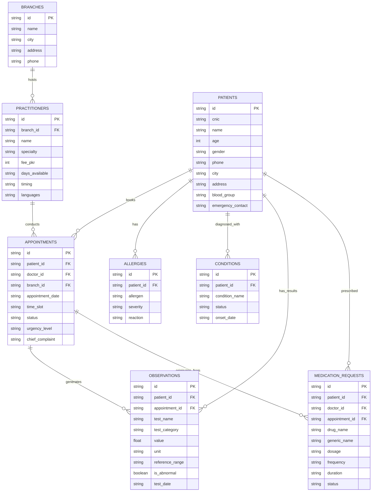

# 🗄️ FHIR-Inspired Database Schema & ER Diagram

This document details the database architecture for City Care Clinics, modeled after HL7 FHIR (Fast Healthcare Interoperability Resources) standards adapted for relational storage.

---

## 📐 Entity Relationship Diagram

---

## 📑 Schema Field Mapping (FHIR Standard)

| Relational Table | Corresponding FHIR Resource | Description |
|------------------|-----------------------------|-------------|
| `BRANCHES` | `Location` | Physical clinic locations in Lahore and Islamabad |
| `PRACTITIONERS` | `Practitioner` | Doctor profile, specialty, fees, and schedule |
| `PATIENTS` | `Patient` | Patient demographic info (Pakistani format) |
| `ALLERGIES` | `AllergyIntolerance` | Adverse drug reactions and environmental allergies |
| `CONDITIONS` | `Condition` | Active and past medical history |
| `APPOINTMENTS` | `Appointment` | Scheduled, completed, or cancelled visit records |
| `OBSERVATIONS` | `Observation` | Diagnostic test results and vital signs |
| `MEDICATION_REQUESTS` | `MedicationRequest` | Prescriptions issued by doctors |

