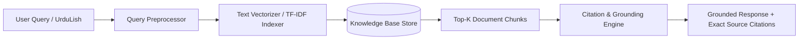

# 📚 Medical Knowledge RAG Architecture & Evaluation Design

This document describes the Retrieval-Augmented Generation (RAG) system for City Care Clinics, focusing on document chunking, citation enforcement, and evaluation metrics.

---

## 1. RAG Architecture Overview



---

## 2. Document Collections & Metadata Schema

The RAG knowledge base indexes 4 medical & operational collections:
1. `clinic_faqs.md`: Locations, timings, consultation fees, rescheduling policy.
2. `lab_test_instructions.md`: Pre-test fasting rules and preparation guidelines.
3. `patient_education.md`: Disease leaflets (Dengue, Diabetes, Hypertension, Pediatric fever).
4. `symptom_specialty_mapping.md`: Clinical routing rules matching symptoms to 6 specialties.

### Chunk Metadata Structure:
```json
{
  "chunk_id": "KB-FAQ-002",
  "document_name": "clinic_faqs.md",
  "title": "Doctor Consultation Fee Structure",
  "category": "Operational",
  "source_citation": "[Source: Clinic FAQ - Consultation Fee Structure]"
}
```

---

## 3. Strict Citation & Safety Protocol

1. **Mandatory Source Citation**: Every response generated by the RAG system MUST append `[Source: Document Title - Section]` for every factual statement made.
2. **Zero Hallucination Rule**: If a user query cannot be answered by the retrieved context (e.g. asking for unapproved surgical advice or non-existent clinic branches), the system MUST return:
   > *"I cannot find this information in the clinic guidelines. Please contact the front desk at +92-42-35690001."*
3. **Medical Safety Boundary**: RAG system answers informational questions only. It NEVER generates personal diagnoses or prescribes medicines.

---

## 4. Evaluation Suite & Metrics

The RAG pipeline is evaluated against **25 ground-truth benchmark questions** measuring two primary metrics:

1. **Grounding Rate (%)**: Percentage of returned statements directly backed by retrieved context chunks.
   $$\text{Grounding Rate} = \frac{\text{Correctly Grounded Answers}}{\text{Total Test Questions}} \times 100$$
   *Target: 100%*

2. **Hallucination Rate (%)**: Percentage of returned statements containing unsupported or fabricated claims.
   $$\text{Hallucination Rate} = \frac{\text{Hallucinated Answers}}{\text{Total Test Questions}} \times 100$$
   *Target: 0%*

