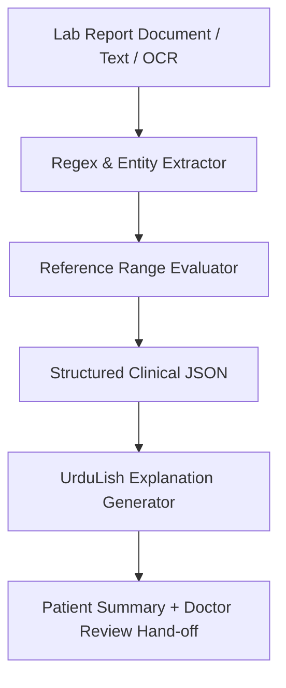

# 🔬 Lab Report Understanding Pipeline Architecture

This document describes the design, extraction workflow, abnormality detection logic, and patient communication guardrails for the Lab Report Understanding module.

---

## 1. Pipeline Workflow



---

## 2. Extraction & Abnormality Logic

The parser extracts tabular rows matching:
`{TEST_NAME} {VALUE} {UNIT} {REFERENCE_RANGE_MIN} - {REFERENCE_RANGE_MAX}`

### Abnormality Rules:
- If `value < reference_range_min`: `is_abnormal = True`, `flag = "LOW"`
- If `value > reference_range_max`: `is_abnormal = True`, `flag = "HIGH"`
- Otherwise: `is_abnormal = False`, `flag = "NORMAL"`

---

## 3. Medical Safety Guardrail for Patient Communication

> [!IMPORTANT]
> **Safety Rule:** The Lab Report Understanding module NEVER makes clinical diagnoses (e.g., it will NEVER tell a patient *"You have Chronic Kidney Disease"* or *"You have Anaemia"*). It only states factual range comparisons in simple UrduLish and notifies the patient that the doctor will conduct the official review.

### Example Output JSON:
```json
{
  "patient_id": "PAT-0042",
  "patient_name": "Ayesha Khan",
  "panel_name": "Complete Blood Count (CBC)",
  "extracted_tests": [
    {
      "test_name": "Hemoglobin",
      "value": 9.5,
      "unit": "g/dL",
      "reference_range": "13.5 - 17.5",
      "is_abnormal": true,
      "flag": "LOW"
    }
  ],
  "urdulish_explanation": "Aap ki CBC report mein Hemoglobin 9.5 g/dL hai jo normal range (13.5 - 17.5 g/dL) se kam hai. Baqi tests normal hain. Main ne yeh summary Dr. Ahmed ko review ke liye bhej di hai."
}
```

