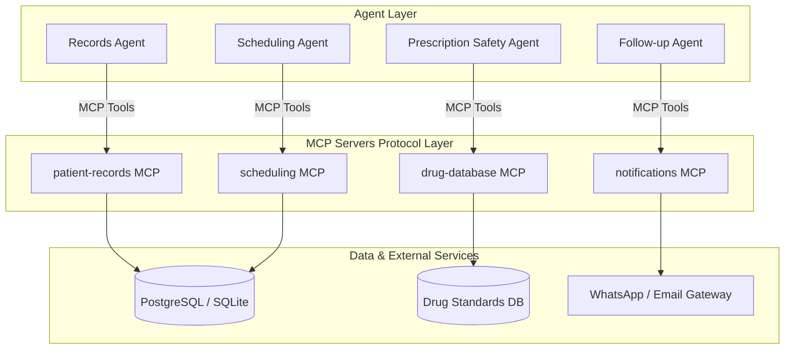

# 🔌 Model Context Protocol (MCP) Servers Architecture

This document defines the architecture, endpoints, and tool schemas for the 4 MCP servers that decouple backend databases and APIs from the agent layer.

---

## 1. Overview of MCP Servers

---

## 2. Server Specifications & Tools

### Server 1: `patient-records`
- **`get_patient_profile(patient_id: str)`**: Returns demographic data (CNIC, name, age, gender, phone, city).
- **`get_patient_allergies(patient_id: str)`**: Returns list of recorded allergen intolerances.
- **`get_patient_history(patient_id: str)`**: Returns chronic conditions and active diagnoses.
- **`get_patient_labs(patient_id: str)`**: Returns recent laboratory observation results.

### Server 2: `scheduling`
- **`find_doctors(specialty: str, branch_id: str = None)`**: Returns active practitioners matching specialty.
- **`check_available_slots(doctor_id: str, date_str: str)`**: Returns available 30-min time slots.
- **`book_appointment(patient_id, doctor_id, branch_id, date_str, time_slot, urgency, chief_complaint)`**: Creates a confirmed appointment.
- **`cancel_appointment(appointment_id: str)`**: Cancels an active appointment.

### Server 3: `drug-database`
- **`lookup_drug(drug_name: str)`**: Returns drug info, generic name, default dosage, and daily max limit.
- **`check_allergy_conflict(allergies: list, drug_name: str)`**: Compares proposed drug against known allergies.
- **`check_drug_interaction(drug_a: str, drug_b: str)`**: Checks interaction risks between two medications.

### Server 4: `notifications`
- **`send_whatsapp_message(phone: str, message: str)`**: Sends or logs WhatsApp notification via HTTPS API.
- **`send_email_confirmation(email: str, subject: str, body: str)`**: Sends email confirmation using HTTP REST API over HTTPS (Port 443) (Resend / SendGrid API) to bypass raw SMTP port 25/587 blocking on Render and Railway.
- **`schedule_reminder(appointment_id: str, days_offset: int)`**: Enqueues automated follow-up reminder.

