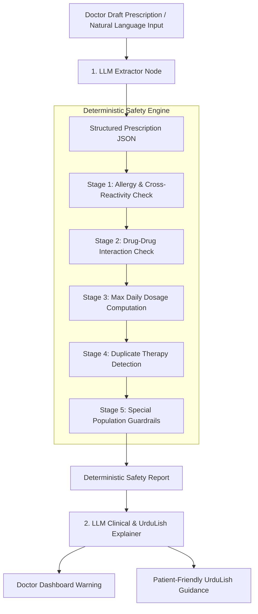

# 💊 Prescription Safety Engine Architecture & Safety Rationale

This document details the design of the Prescription Safety Engine at City Care Clinics, explaining the hybrid division between deterministic rule-based checks and LLM-based natural language translation.

---

## 1. Hybrid Safety Architecture

---

## 2. Why Deterministic Rules for Safety Logic?

1. **Zero Tolerance for Hallucinations**: In healthcare, an LLM miscalculating a maximum dosage ($4000\text{ mg}$ vs $6000\text{ mg}$) or missing a Penicillin-Amoxicillin cross-reactivity can be fatal.
2. **100% Reproducibility**: Rule-based evaluation guarantees that the exact same prescription against the exact same patient history will ALWAYS trigger the exact same safety flag.
3. **Auditability**: Every triggered rule links directly to standard medical reference databases (e.g. DrugBank / openFDA rules).

---

## 3. The 5 Deterministic Safety Stages

| Stage | Rule Evaluated | Action if Breached |
|-------|────────────────|────────────────────|
| **1. Allergy & Cross-Reactivity** | Checks exact generic name & drug class against patient's `allergies` table. | Sets `CONTRAINDICATED`, flags allergen family. |
| **2. Drug-Drug Interactions** | Checks pairs of proposed + current drugs against known adverse interaction matrix. | Sets `WARNING` / `CONTRAINDICATED` with risk description. |
| **3. Max Daily Dosage** | Computes $\text{dose\_mg} \times \text{frequency\_per\_day}$ against max daily limit catalog. | Sets `WARNING` if limit exceeded. |
| **4. Duplicate Therapy** | Detects multiple drugs sharing the same generic ingredient or class. | Sets `WARNING` for redundant therapy. |
| **5. Special Populations** | Checks age limits (pediatric/geriatric) and pregnancy contraindications. | Sets `WARNING` / `CONTRAINDICATED`. |

---

## 4. LLM Role Specifications

### 1. Extractor Role
- Input: *"Panadol 2 tablets 4 times a day for 5 days"*
- Output: `{"drug_name": "Panadol", "dose_mg": 1000, "frequency_per_day": 4, "duration_days": 5}`

### 2. Clinical Explainer Role (Doctor Dashboard)
- Input: `{"status": "CONTRAINDICATED", "flag": "ALLERGY", "allergen": "Penicillin", "drug": "Augmentin"}`
- Output: *"⚠️ CONTRAINDICATION ALERT: Patient Ahmed has a recorded severe allergy to Penicillin. Augmentin contains Amoxicillin (beta-lactam class) and is contraindicated. Recommended alternative: Azithromycin 500mg."*

### 3. Patient Communication Role (UrduLish)
- Output: *"Aap ki allergy record check kar ke doctor sahab ne dawa update ki hai taake aap ko koi allergy reaction na ho."*

