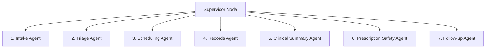

# 🤖 Day 3 Specialist Agents Architecture & Interface Contracts

This document specifies the Python classes, state schemas, tool bindings, and evaluation criteria for the 7 specialist agents in the City Care Clinics system.

---

## 1. Multi-Agent Team Architecture



---

## 2. Agent Interfaces & State Contracts

### 1. Intake Agent (`src/agents/intake_agent.py`)
- **Mission**: Warmly greet patient, collect symptoms, duration, severity, allergies, and current medications.
- **Rule**: Ask **one question at a time**. Never present a long form.
- **State Schema**:
  ```json
  {
    "patient_type": "self | child | parent",
    "chief_complaint": "fever and cough",
    "duration": "3 days",
    "severity": "6/10",
    "associated_symptoms": ["body ache"],
    "allergies": ["Penicillin"],
    "current_medications": ["Panadol"],
    "is_complete": true
  }
  ```

### 2. Triage Agent (`src/agents/triage_agent.py`)
- **Mission**: Classify urgency (`Emergency`, `Urgent`, `Routine`) and map to specialty.
- **Rule**: Rule-based red-flag detection runs **first**. Cannot be overridden by LLM.

### 3. Scheduling Agent (`src/agents/scheduling_agent.py`)
- **Mission**: Match specialty, check doctor slots, book appointments via `scheduling` MCP server.

### 4. Records Agent (`src/agents/records_agent.py`)
- **Mission**: Retrieve past visit notes and lab reports via `patient-records` MCP server.

### 5. Clinical Summary Agent (`src/agents/clinical_summary_agent.py`)
- **Mission**: Synthesize intake + history + labs into a pre-visit SOAP note for doctor review.

### 6. Prescription Safety Agent (`src/agents/prescription_safety_agent.py`)
- **Mission**: Wrap Day 2 safety engine to check doctor draft prescriptions against allergies/interactions.

### 7. Follow-up Agent (`src/agents/followup_agent.py`)
- **Mission**: Send automated medication reminders and post-visit check-ins.

