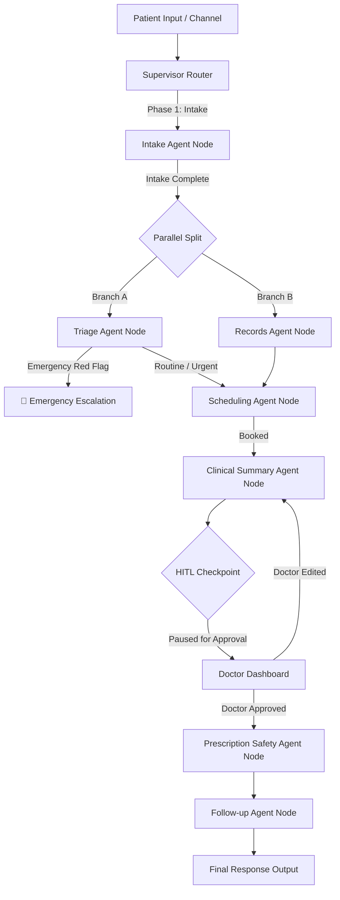

# 🎼 Day 4 Orchestration, Memory & Human-in-the-Loop Architecture

This document details the central LangGraph Supervisor orchestration engine, state structure, dual-tier memory system, and Human-in-the-Loop (HITL) doctor approval workflow for City Care Clinics.

---

## 1. Comprehensive System State & Routing



---

## 2. Shared Graph State (`ClinicState`)

```python
class ClinicState:
    patient_id: str
    messages: List[Dict[str, str]]
    intake_form: Dict[str, Any]
    triage_result: Dict[str, Any]
    records_data: Dict[str, Any]
    appointment_data: Dict[str, Any]
    soap_summary: Dict[str, Any]
    safety_report: Dict[str, Any]
    followup_plan: Dict[str, Any]
    hitl_status: str               # "NONE" | "PAUSED_FOR_DOCTOR" | "APPROVED"
    current_node: str
    transition_logs: List[str]
    error_count: int
```

---

## 3. Human-in-the-Loop Interrupt Rules

1. **Lab Result Explanations**: Any lab report summary generated for a patient MUST pause at `PAUSED_FOR_DOCTOR` until the doctor reviews the interpretation.
2. **Prescription Warnings**: Any draft prescription containing allergy or dosage warnings MUST be signed off by the doctor on the dashboard.
3. **Low-Confidence Triage**: Triage decisions with confidence $< 0.85$ are flagged for human nurse review.

