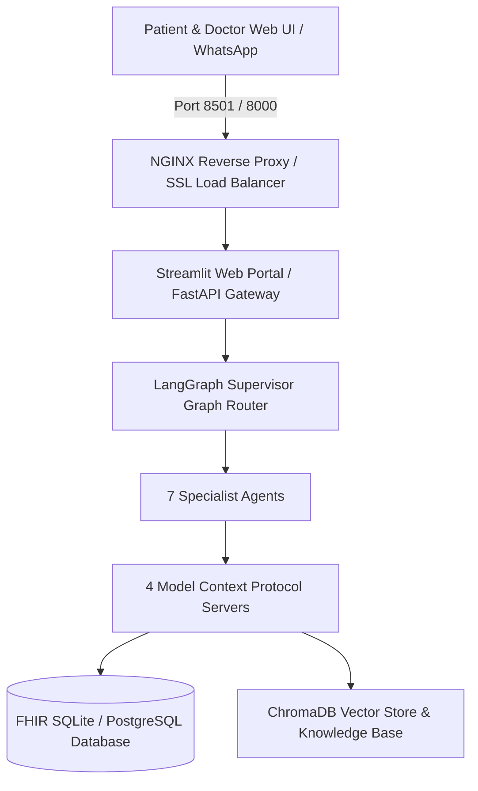

# 🚀 Production Deployment & Architecture Guide
**City Care Clinics — Multi-Agent AI Outpatient Clinic Assistant**

---

## 1. Overview & Deployment Strategy

The **City Care Clinics Assistant** is engineered for containerized, high-availability deployment across cloud infrastructure (AWS/GCP/Azure) or local clinic server environments. The system uses a micro-service topology combining Streamlit (web portal), FastAPI (REST API gateway), MCP Server suite, and SQLite/PostgreSQL database storage.



---

## 2. Containerization Specification

### Docker Configuration
The application is fully containerized using Python 3.11-slim.

#### `Dockerfile`
- **Base Image**: `python:3.11-slim`
- **System Dependencies**: `build-essential`, `sqlite3`, `curl`
- **Port**: `8501` (Streamlit frontend) / `8000` (FastAPI backend)
- **Healthcheck**: HTTP GET `/stcore/health` every 30 seconds

#### `docker-compose.yml`
```yaml
version: '3.8'

services:
  ai-clinic-app:
    build:
      context: .
      dockerfile: Dockerfile
    container_name: city_care_clinic_app
    ports:
      - "8501:8501"
      - "8000:8000"
    environment:
      - PYTHONUNBUFFERED=1
      - CLINIC_DB_PATH=/app/data/synthetic/clinic.db
    volumes:
      - clinic-data:/app/data
    restart: unless-stopped
    healthcheck:
      test: ["CMD", "curl", "-f", "http://localhost:8501/_stcore/health"]
      interval: 30s
      timeout: 10s
      retries: 3

volumes:
  clinic-data:
    driver: local
```

---

## 3. Environment Variables & Security Configuration

| Variable Name | Required | Default Value | Description |
|---------------|----------|---------------|-------------|
| `CLINIC_DB_PATH` | Yes | `data/synthetic/clinic.db` | Path to SQLite/PostgreSQL clinic database |
| `RAG_VECTOR_STORE_PATH` | Yes | `data/knowledge_base/` | Directory path containing vector index & RAG docs |
| `PRESCRIPTION_SAFETY_MODE` | Yes | `STRICT` | Enforcement level for prescription safety engine |
| `OBSERVABILITY_LOG_LEVEL` | No | `INFO` | Tracing & telemetry detail level |

---

## 4. CI/CD Automated Testing Pipeline

The CI/CD workflow (GitHub Actions / GitLab CI) executes unit tests, RAG evaluation, safety engine checks, and the 65-scenario benchmark suite before approving production deployment:

```bash
# 1. Run Unit & Red-Teaming Suites
py -m unittest discover -s tests -p "test_*.py"

# 2. Run Comprehensive Benchmark Suite (65 Scenarios)
py tests/eval_suite.py
```

---

## 5. Health Monitoring & Reliability

- **Health Check Endpoint**: `GET /health` returns DB connectivity, RAG index status, and MCP server health.
- **Failover & Emergency Escalation**: If any sub-agent fails or encounters an unhandled state, the Supervisor Graph immediately routes the conversation to human receptionists with an emergency fallback notice.

