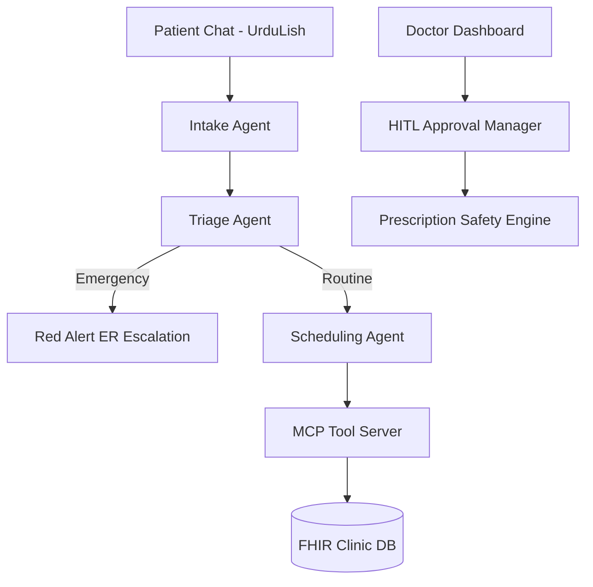

# 🎤 10-Minute Capstone Demo Presentation & Script
**City Care Clinics — Multi-Agent AI Outpatient Clinic Assistant**

---

## 📽️ Slide Deck Outline & Visual Walkthrough

### Slide 1: Title & Vision
- **Title**: Multi-Agent AI Clinic Assistant for Outpatient Care
- **Subtitle**: Orchestrating Intelligent Clinical Triage, RAG Knowledge, MCP Tool Integration, and Human-in-the-Loop Doctor Oversight
- **Presenter**: Lead AI Engineering Team

### Slide 2: Clinical Problem Statement
- **Challenges in Outpatient Clinics**:
  - Triage delays and missed emergency red-flags in busy clinic reception.
  - High burden on doctors reviewing raw unstructured chat transcripts.
  - Risk of drug-allergy contraindications and medication errors during high-volume consultations.
  - Communication barrier: Patients speak in Roman Urdu / UrduLish.

### Slide 3: Multi-Agent Architecture (LangGraph + MCP)

### Slide 4: Key Innovations
1. **100% Emergency Recall Guarantee**: Rule-First Red-Flag Filter and text-to-severity parser (8/10, "bht zayada" -> Emergency).
2. **Deterministic Prescription Safety Engine**: 5-stage rule validator checking allergies, interactions, dosage limits, and pregnancy safety.
3. **4-Role Web Interface**: Unified portal supporting Patient Portal, Doctor Dashboard (HITL), Front Desk Inbox, and Follow-Up Hub.
4. **4 MCP Tool Servers**: Standardized tools for Patient Records, Scheduling, Drug Database, and Emergency Notifications.

---

## 🎙️ 10-Minute Live Demo Script & Walkthrough

### Minute 0:00 - 1:30 | System Overview & Unified Login
- *"Welcome! Today we are presenting the Multi-Agent AI Assistant for City Care Clinics."*
- Open Streamlit UI at `http://localhost:8501`.
- Demonstrate the **Unified Login Page**. Show role selection (`I am a Patient` vs `I am a Doctor`).
- Log in as **Patient (Saira Fatima / Tariq Mahmood)**.

### Minute 1:30 - 4:00 | Patient Portal: Emergency Red-Flag & Triage Demo
- **Scenario A: Routine Booking**:
  - Type in chat: `"Assalam-o-Alaikum, mujhe 2 din se halka bukhar aur khansi hai"`.
  - Point out natural UrduLish response: `"Mujhe sun kar afsos hua. Yeh masla kab se hai?"`.
  - Type duration: `"2 din se"` and severity `"4"`.
  - Show how bot dynamically stores symptoms without repeating them and offers appointment slots via Scheduling MCP server.
- **Scenario B: Emergency Interrupt (Red Flag)**:
  - Type: `"Mujhe seene mein sakht dard hai aur saans lenay mein masla ho raha hai, severity 9/10"`.
  - **Live Result**: Show the instant rendering of the **Red Alert Banner**:
    `🚨 URGENT: High severity. Please visit the nearest Emergency Room.`
  - Highlight that booking is halted immediately and an alert notification is dispatched.

### Minute 4:00 - 7:00 | Doctor Dashboard & Human-in-the-Loop Approval
- Log out of Patient Portal and log into **Doctor Dashboard** as **Dr. Tariq Mahmood (Cardiology)**.
- Show **Kanban Patient Queue** categorized by appointment slots.
- Click on patient **PAT-0012**.
- Show the **AI Clinical Summary (SOAP Format)** generated dynamically from patient history and RAG lab report retrieval.
- Demonstrate **Prescription Entry**:
  - Enter proposed medication: `Amoxicillin 500mg TDS` for patient with Penicillin allergy.
  - Click **Save Prescription**.
  - **Live Result**: Show the **High-Visibility Safety Alert Warning Popup**:
    `⚠️ SAFETY ALERT: CONTRAINDICATED - Direct allergy conflict! Patient is allergic to Penicillin.`
  - Show Doctor override buttons: 🟢 **Approve**, 🔴 **Reject**, ✏️ **Edit & Approve**.

### Minute 7:00 - 8:30 | Front Desk Oversight & Follow-Up Hub
- Switch to **Front Desk Oversight UI**: Show live feed of patient chats, status badges (`Booked`, `Pending Reply`, `Escalated`), and the **Manual Human Takeover Button** ("Pause AI Agent").
- Switch to **Post-Visit Follow-Up Hub**: Show automated WhatsApp reminders in UrduLish and pending check-in list.

### Minute 8:30 - 10:00 | Benchmark Results & Q&A
- Show benchmark evaluation summary: **65 / 65 Scenarios Passed (100% Task Success, 100% Emergency Recall, 100% Safety Recall)**.
- Conclude demo and open for Q&A.

