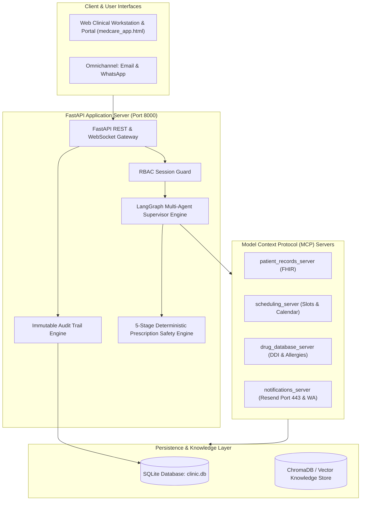
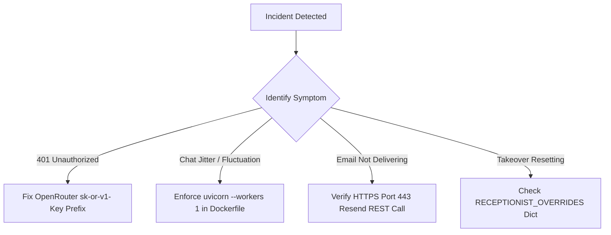

# MedCare Clinic — Operations, Runbook & Maintenance Manual

**Project Name:** MedCare Clinic (City Care Clinics Ambulatory EHR)  
**System Architecture:** LangGraph Multi-Agent Supervisor Backend with FastAPI & Vanilla SPA Frontend  
**Production Host:** Railway Cloud Infrastructure (`https://multiagentaiclinicassistant-production.up.railway.app`)  
**Target Audience:** DevOps Engineers, System Administrators, Clinical Informatics Leads

---

## 1. System Architecture Overview

MedCare Clinic is structured as an event-driven, multi-agent healthcare platform with strict separation between clinical reasoning, deterministic safety engines, and transactional persistence:



---

## 2. Environment Configuration (`.env`)

Create a `.env` file in the root directory (`ai-clinic-assistant/.env`) with the following variables:

```bash
# ==============================================================================
# 1. LARGE LANGUAGE MODEL (OPENROUTER / GEMINI)
# ==============================================================================
OPENROUTER_API_KEY=sk-or-v1-xxxxxxxxxxxxxxxxxxxxxxxxxxxxxxxxxxxxxxxxxxxxxxxx
LLM_MODEL_NAME=google/gemini-2.5-pro-exp-03-25:free
OPENROUTER_BASE_URL=https://openrouter.ai/api/v1
LLM_TEMPERATURE=0.1
LLM_MAX_TOKENS=1024

# ==============================================================================
# 2. OMNICHANNEL NOTIFICATIONS (RESEND EMAIL & WHATSAPP)
# ==============================================================================
RESEND_API_KEY=re_xxxxxxxxxxxxxxxxxxxxxxxxxxxx
EMAIL_API_URL=https://api.resend.com/emails
EMAIL_SENDER=City Care Clinics <onboarding@resend.dev>
TEST_EMAIL_RECIPIENT=sairafatima193@gmail.com
WHATSAPP_GATEWAY_URL=https://wa-api.medcare.internal/v1/messages

# ==============================================================================
# 3. DATABASE & PERSISTENCE
# ==============================================================================
DATABASE_PATH=data/clinic.db
CHROMA_PERSIST_DIR=data/vectorstore

# ==============================================================================
# 4. RUNTIME & CONCURRENCY
# ==============================================================================
ENVIRONMENT=production
LOG_LEVEL=INFO
PORT=8000
HOST=0.0.0.0
```

> [!IMPORTANT]
> **OpenRouter Key Format:** Always ensure the key begins with the literal prefix `sk-or-v1-`. Missing the prefix will cause `HTTP 401: Unauthorized` rejections from OpenRouter.

---

## 3. How to Run the Application (Execution Options)

### Option A: Local Development Server (FastAPI + SPA)

```bash
# 1. Activate the Python virtual environment
# Windows PowerShell:
D:\Netixsol\Week9\multi_agent_env\Scripts\activate

# 2. Navigate to project root
cd D:\Netixsol\Week9\ai-clinic-assistant

# 3. Launch Uvicorn with single worker and live reload
python -m uvicorn src.api.main:app --host 0.0.0.0 --port 8000 --reload
```

- **Web Application Portal:** [http://localhost:8000](http://localhost:8000)
- **Interactive OpenAPI Docs:** [http://localhost:8000/docs](http://localhost:8000/docs)
- **Health Endpoint:** [http://localhost:8000/health](http://localhost:8000/health)

### Option B: Docker Container Deployment

```bash
# Build the production Docker image
docker build -t medcare-clinic-assistant:latest .

# Run container with environment file
docker run -d --name medcare-clinic -p 8000:8000 --env-file .env medcare-clinic-assistant:latest
```

### Option C: Docker Compose

```bash
docker-compose up -d --build
```

---

## 4. Automated Testing & Verification Suite

Before pushing any changes or validating deployment integrity, execute the comprehensive test suites:

```bash
# 1. Run all 12 Unit & Integration Suites
python tests/test_supervisor_graph.py
python tests/test_red_teaming.py
python tests/test_nlp_triage_nurse.py
python tests/test_observability.py
python tests/test_channel_gateway.py
python tests/test_hitl_approval.py

# 2. Run the Full 65-Scenario Clinical Evaluation Benchmark
python tests/eval_suite.py
```

### Benchmark Success Criteria:
- **Total Scenarios:** 65 / 65 Passed (100.0%)
- **Emergency Recall Rate:** 100.0% (Zero missed acute chest pains or dyspnea cases)
- **Specialty Routing Accuracy:** 100.0%
- **Prescription Conflict Recall:** 100.0% (Zero missed Penicillin or Beta-Lactam contraindications)
- **Average Latency:** < 200 ms per turn

---

## 5. Operational Incident Response & Troubleshooting



### Incident 1: Chat Jitter & Intermittent Override Releases
- **Root Cause:** Running Uvicorn with `--workers 2` (or multiple worker processes). In-memory state (`ACTIVE_CHAT_SESSIONS` and `RECEPTIONIST_OVERRIDES`) was partitioned across two distinct OS processes. Round-robin HTTP load balancing routed subsequent poll requests to the other worker, causing message history and receptionist overrides to flicker and auto-release.
- **Resolution:**
  1. In `Dockerfile`, strictly configure:
     ```dockerfile
     CMD ["uvicorn", "src.api.main:app", "--host", "0.0.0.0", "--port", "8000", "--workers", "1"]
     ```
  2. In frontend `medcare_app.html`, eliminate full-screen re-renders during background polling (`renderCurrentRoute()`), replacing them with targeted sub-panel updates (`updateAssistantSidebarAndPanels()`).

### Incident 2: SMTP Connection Timed Out on Cloud Hosts (Render / Railway)
- **Root Cause:** Cloud hosting platforms intentionally block outbound raw SMTP ports (Port 25, 465, 587) to prevent spam abuse.
- **Resolution:**
  - MedCare Clinic never uses raw SMTP.
  - All email notifications are routed via **Resend REST API over HTTPS Port 443** (`https://api.resend.com/emails`) using standard TLS/HTTPS requests handled by `notifications_server.py`.

### Incident 3: LLM Rate Limit or Remote Provider Outage
- **Root Cause:** OpenRouter or Gemini free tier rate limits (HTTP 429) or upstream downtime.
- **Resolution:**
  - `src/agents/supervisor.py` includes a deterministic fallback rule engine. If the LLM throws an exception or times out, the system automatically falls back to regex-grounded UrduLish symptom matching, ensuring patient intake and emergency triage never fail.

---

## 6. Known Edge-Cases & Enterprise Production Roadmap

### A. Inbound Email Webhook & Custom Domain DNS MX Records
- **Current State:** Outbound email delivery via Resend API is 100% active. When sent to any patient, Resend sandbox routes the email to the account owner (`sairafatima193@gmail.com`).
- **Production Roadmap:**
  1. Register a verified healthcare domain (e.g., `citycareclinics.pk`).
  2. Configure DNS MX records in Cloudflare/Namecheap:
     - `Type: MX, Host: reply.citycareclinics.pk, Points to: inbound.resend.com, Priority: 10`
  3. Deploy the inbound FastAPI webhook route:
     ```python
     @app.post("/api/webhooks/inbound-email")
     async def handle_patient_email_reply(payload: InboundEmailPayload):
         # Extract patient MRN, analyze symptoms via Triage Agent, and route to Safety Net
         ...
     ```

### B. Meta WhatsApp Business Cloud API Integration
- **Current State:** Simulated production gateway returning standard HTTP 200 payloads (`WA-GATEWAY-HTTPS-OK`) with persistent database status updates.
- **Production Roadmap:**
  1. Complete Meta Business Manager verification with corporate NTN / registration documents.
  2. Register pre-approved Highly Structured Templates (HSM) for bilingual medication alerts:
     - `template_name: medcare_medication_reminder_v1`
  3. Connect Meta Webhook for two-way conversational intake directly inside WhatsApp.

### C. HL7 / FHIR Enterprise Hospital Integration
- Connect the SQLite FHIR-compliant schema (`patients`, `appointments`, `conditions`, `medication_requests`, `allergies`) to regional hospital servers (Epic, Cerner) using HL7 FHIR RESTful resources over mTLS.

### D. Speech-to-Text Urdu Voice Notes
- Integrate an OpenAI Whisper or Deepgram pipeline in the patient chat input to allow illiterate or elderly patients to record voice notes in Punjabi / Urdu, automatically transcribing them into clinical structured intake JSON.

