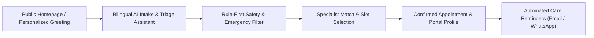

# MedCare Clinic — Patient Portal & Conversational AI User Guide

**Target Persona:** Patients, Family Members & Primary Care Seekers  
**Representative Profile:** Ahmed Khan (MRN: `PAT-1001`), Saira Fatima (MRN: `PAT-8915`)  
**Portal Routes:** `/`, `/#/assistant`, `/#/portal`, `/#/appointments/book`, `/#/reports`  
**Languages Supported:** Bilingual (English, Roman Urdu / UrduLish, Nastaliq Urdu)

---

## 1. Overview & First Impressions

MedCare Clinic’s Patient Portal provides a friction-free, empathetic digital front door for outpatient care. Whether booking a routine consultation, asking follow-up questions in natural UrduLish, reviewing prescribed medications, or uploading diagnostic lab reports, patients experience continuous, intelligent care continuity.



---

## 2. Access & Personalized Greeting

1. **Accessing the Portal:**
   - Navigate to the public homepage: `https://multiagentaiclinicassistant-production.up.railway.app/`
2. **Returning Patient Experience:**
   - The platform recognizes returning patients. If logged in as **Ahmed Khan**, a personalized greeting card appears:
     > *"Khushamdeed wapis, Ahmed Khan sahib! Aap ki pichli visit Dr. Bilal Ahmed ke sath thi (Hypertension Follow-up)."*
   - Fast 1-click action buttons allow patients to directly re-book with their preferred doctor or check active prescription regimens.

---

## 3. Conversational AI Assistant (`/#/assistant`)

The AI Assistant acts as a digital triage nurse available 24/7. It communicates naturally in **UrduLish** (everyday Pakistani conversational language mixing Urdu and English).

### 5-Step Visual Progress Indicator
At the top of the chat workstation, patients can track their intake progress in real-time:
1. **Greeting & Identification:** Verifies identity or collects new patient demographics.
2. **Symptoms Intake:** Gathers the chief complaint, duration, severity, and associated symptoms.
3. **Clinical Triage:** Evaluates urgency without diagnostic speculation.
4. **Doctor Selection:** Recommends the appropriate clinical specialty.
5. **Confirmation:** Confirms date, slot, and issues an appointment booking reference.

### Natural Conversational Flow Example

```
Patient: "Assalam-o-Alaikum, mujhe 3 din se bukhar hai aur gala bohot kharab hai."
AI Assistant: "Wa Alaikum Assalam! Yeh sun kar afsos hua. Bukhar kitna tez hai aur kya nigalne mein takleef ho rahi hai?"

Patient: "Haan nigalne mein dard hai, taqreeban 101 F bukhar hai."
AI Assistant: "Samajh gaya. Kya aap ko saans lene mein koi dushwari ya seene mein dard mehsoos ho raha hai?"
```

### Interactive Quick Response Chips
To reduce typing effort for unwell patients, interactive suggestion chips appear below AI questions:
- `3 din se` • `1 hafta se` • `Tez bukhar (102°F)` • `Halka bukhar` • `Koi allergy nahi`

---

## 4. Safety First: Emergency & Red-Flag Escalations

The AI Assistant is bounded by strict clinical safety policies. If a patient mentions acute red-flag symptoms (such as severe chest pain, breathing collapse, facial drooping, or heavy bleeding), the assistant **immediately halts normal intake** and triggers the Emergency Bypass protocol:

1. **Emergency Pop-up Modal:**
   - Overlays the screen with clear red clinical alert banners.
   - Highlights ambulance emergency hotlines: **1122** and Clinic Helpline **+92-42-111-CARE (2273)**.
2. **Urgent UrduLish Safety Guidance:**
   > *"⚠️ [EMERGENCY ALERT] Yeh alamaat fori emergency tavajjoh ki mutaqazi hain. Baraye meherbani intezar mat karein aur qareebi Emergency Room (ER) tashreef le jayein ya 1122 par call karein."*

---

## 5. Booking Appointments (`/#/appointments/book`)

1. **Select Specialty:** General Medicine, Cardiology, Paediatrics, Dermatology, Orthopaedics, or Gynecology.
2. **Select Doctor:** View doctor profiles, qualifications, patient ratings (e.g., Dr. Bilal Ahmed, Rating: 4.9/5.0), and consultation fees.
3. **Select Date & Available Slot:**
   - Real-time slot availability (e.g., 04:30 PM, 05:00 PM, 06:30 PM).
   - Instant double-booking prevention engine.
4. **Confirmation & Reference ID:**
   - Displays a verified Reference ID (e.g., `APT-25F176`).
   - Dispatches instant automated confirmation email and SMS/WhatsApp notification.

---

## 6. Patient Profile & Medical Records (`/#/portal`)

Patients have full visibility over their longitudinal health record:
- **Demographics & Vitals:** Age, blood group, recorded blood pressure, weight, BMI.
- **Documented Allergies:** Critical allergy tags (e.g., `Penicillin (Severe Rash/Anaphylaxis risk)`).
- **Active Conditions:** Chronic medical diagnoses under management (e.g., Essential Hypertension, Type 2 Diabetes).
- **Active Prescription Regimen:** Dosages, frequencies (e.g., *Augmentin 625mg — 1 tablet after dinner*), and duration countdowns.

---

## 7. Diagnostic Lab Reports Workflow (`/#/reports`)

Patients can upload PDF lab reports or high-resolution photos of test slips:
1. **Drag-and-Drop Upload:** Accepts CBC, Blood Sugar, Lipid Profile, LFTs, and RFTs.
2. **Prompt-Injection Defense:** All uploaded documents undergo sanitization to neutralize malicious embedded prompts.
3. **Bilingual Clinical Interpretation:**
   - The system extracts out-of-range parameters (e.g., elevated Fasting Blood Glucose).
   - Generates an empathetic explanation in UrduLish:
     > *"Aap ka Fasting Blood Sugar 142 mg/dL aya hai jo normal range (70-100) se zyada hai. Ghabrane ki baat nahi, Dr. Bilal iska jaiza le rahe hain."*
4. **Doctor Verification Banner:** Explanations clearly state they are subject to attending physician sign-off before finalized care decisions.

