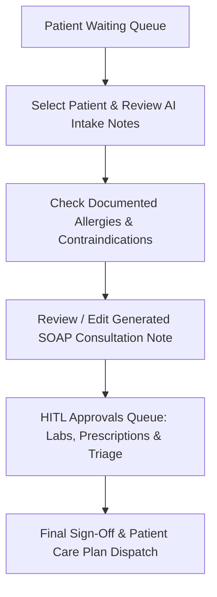
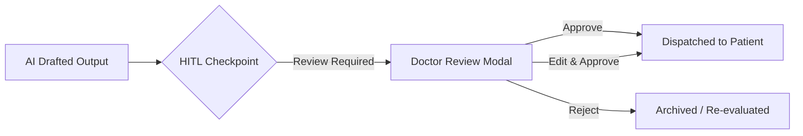

# MedCare Clinic — Doctor Clinical Workspace & HITL Approvals Manual

**Target Persona:** Attending Physicians & Medical Specialists  
**Representative Profile:** Dr. Bilal Ahmed, MBBS, FCPS (Internal Medicine • ID: `DOC-101`)  
**Clinical Workstation Routes:** `/#/doctor`, `/#/doctor/approvals`, `/#/prescriptions`  
**Core Safety Philosophy:** *"AI accelerates documentation and surfaces safety risks, but physicians retain absolute clinical authority."*

---

## 1. Overview & Physician Identity

The Doctor Clinical Workspace is designed for rapid outpatient consultations. It eliminates administrative burden by pre-synthesizing patient intake data into structured clinical notes while maintaining rigorous Human-in-the-Loop (HITL) checkpoints for all treatment orders.

---

## 2. Split-Screen Patient Consultation Queue (`/#/doctor`)

### Left Panel: Active Queue & Triage Priority
- Displays all scheduled and walk-in patients for the current clinic session.
- **Priority Sorting:** Patients are prioritized based on triage urgency:
  - 🔴 **URGENT:** High clinical priority (e.g., severe flare-up, high fever with breathlessness).
  - 🟢 **ROUTINE:** Standard follow-up or scheduled consultation.
- **Patient Card Metadata:** Name, MRN, Age, Gender, Scheduled Slot, and Chief Complaint preview.

### Right Panel: Comprehensive Consultation Workspace
Selecting a patient loads their active clinical context immediately:
1. **Patient Banner:** High-visibility demographic header with blood group and contact info.
2. **Safety Alert Banner (Contraindication Sentinel):**
   - If the patient has documented allergies (e.g. *Ahmed Khan — Penicillin Allergy: Severe Rash/Anaphylaxis*), a bold amber/red alert banner appears at the very top:
     > ⚠️ **CLINICAL CONTRAINDICATION ALERT:** *Patient is allergic to Penicillin. Do NOT prescribe beta-lactam antibiotics (Augmentin, Amoxicillin, Ampicillin).*
3. **Structured Intake Form:**
   - Chief complaint, duration, severity scale (e.g., 7/10), associated symptoms, and current home medications captured by the AI triage agent.

---

## 3. Automated SOAP Note Generation

During or immediately following consultation, the system generates a draft **SOAP Note** following international clinical documentation standards:

| SOAP Component | Content & Source | Doctor Role |
| :--- | :--- | :--- |
| **S — Subjective** | Chief complaint, history of presenting illness (HPI), patient-reported symptom timeline. | Review & adjust phrasing. |
| **O — Objective** | Recorded vital signs (BP: 135/85 mmHg, Pulse: 78 bpm, Temp: 98.6°F) and physical examination findings. | Enter physical exam findings. |
| **A — Assessment** | Working clinical impression, differential diagnoses (e.g., *Essential Hypertension — Stage 1, well-controlled*). | Finalize medical diagnosis. |
| **P — Plan** | Pharmacotherapy, lifestyle recommendations, diagnostic orders, and follow-up interval. | Approve prescriptions & orders. |

Doctors can edit any section inline before clicking **"Save & Finalize Consultation Note"**.

---

## 4. Human-in-the-Loop (HITL) Approvals Queue (`/#/doctor/approvals`)

The HITL Approvals dashboard ensures that no AI-generated medical advice or prescription reaches a patient without direct physician review.

### The 3 Mandatory HITL Categories:
1. **Bilingual Lab Explanations:**
   - Review AI draft explanations of diagnostic test results before they appear in the patient portal.
   - Ensures clinical nuance and reassuring tone for elevated markers.
2. **Prescription Safety Verification:**
   - Any new medication order is checked against the patient's allergy profile and active drug list before the doctor signs off.
3. **Low-Confidence Triage Escalations:**
   - Cases where the patient's symptoms do not cleanly map to a single specialty or border on urgency require doctor sign-off.

### Action Controls on Approval Cards:
- **Approve (Green Button):** One-click sign-off; instantly dispatches instructions to patient and writes an immutable audit record.
- **Edit & Approve:** Allows modifying dosage, duration, or wording before sending.
- **Reject (Red Button):** Withholds delivery and logs clinical reason for withholding.

---

## 5. 5-Stage Deterministic Prescription Safety Engine

When prescribing medications, the system evaluates all orders against a rule-based safety engine:
1. **Patient Allergy Conflict:** Matches drug class against recorded allergens (e.g., Penicillin, Sulfa, NSAIDs).
2. **Drug-Drug Interactions (DDI):** Cross-checks active medications (e.g., ACE inhibitors + Potassium supplements).
3. **Maximum Daily Dose Limits:** Flags toxic or off-guideline dosages (e.g., Paracetamol > 4000mg/day).
4. **Duplicate Therapy Detection:** Flags overlapping classes (e.g., prescribing two simultaneous NSAIDs).
5. **Special Population Warnings:** Renal impairment, pregnancy, paediatric, or geriatric precautions.

