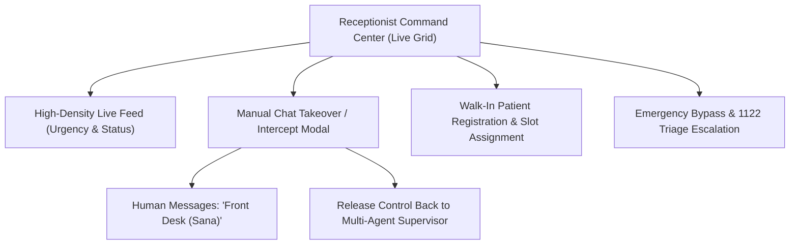

# MedCare Clinic — Receptionist Command Center & Front Desk Operations Manual

**Target Persona:** Front Desk Lead & Clinic Operations Staff  
**Representative Profile:** Sana Front Desk (Staff ID: `REC-001`)  
**Command Center Route:** `/#/receptionist`  
**Primary Mission:** Maintain clinic throughput, triage incoming patient volume, and intervene instantly via Human-in-the-Loop chat takeover.

---

## 1. Overview & Front Desk Mission

The Receptionist Command Center is the operational nerve center of MedCare Clinic. Front desk staff monitor real-time patient movement from the waiting lobby to consultation suites, register walk-in patients, manage queue bottlenecks, and exercise live manual overrides whenever an AI conversation requires human empathy or administrative intervention.

---

## 2. High-Density Patient Live Feed Grid

The live feed displays all patients currently interacting with the clinic or physically present in the clinic lobby:

### Status Columns & Badges:
1. **Patient Info:** Full Name, MRN (e.g., `PAT-1001`), Age, and City.
2. **Urgency Classification:**
   - 🔴 **EMERGENCY:** Red flag detected; requires immediate transfer to ER.
   - 🟡 **URGENT:** High fever, acute pain, or paediatric cases requiring same-day slots.
   - 🟢 **ROUTINE:** Standard follow-up or planned elective visit.
3. **Workflow Status:**
   - `INTAKE_IN_PROGRESS`: Patient is actively chatting with the AI Assistant.
   - `TRIAGED`: Intake complete; waiting for slot assignment.
   - `WAITING_FOR_DOCTOR`: Checked in at the clinic; waiting in lobby.
   - `WITH_DOCTOR`: Actively in consultation suite with the physician.
   - `DISCHARGED`: Consultation complete, care plan issued.
4. **Assigned Doctor & Time Slot:** Details of attending physician and slot.
5. **Action Buttons:** Quick actions including **"Takeover Chat"**, **"Call Patient"**, and **"Check-In"**.

---

## 3. Manual Chat Intercept & Takeover (HITL Super-Power)

The standout capability of the Receptionist Command Center is **Live Human Takeover**. Front desk staff can seamlessly pause AI processing and take over the conversation directly from their terminal.

### When Should the Receptionist Intervene?
- The patient expresses frustration, confusion, or asks non-clinical administrative questions (e.g. *"Payment cash mein ho sakti hai ya card lazmi hai?"*).
- The patient is elderly or struggling to use interactive chips.
- An urgent scheduling adjustment or clinic branch change is requested.

### Step-by-Step Takeover Workflow:
1. **Click "Intercept / Takeover":**
   - Click the blue takeover button next to the patient's record in the live grid.
2. **Review Live History in Modal:**
   - The `#receptionistChatModal` opens, displaying the complete chronological transcript of the conversation between the patient and the AI.
3. **Type and Send Staff Response:**
   - Enter your message in the input box and click **"Send as Front Desk"**.
   - The patient receives the message labeled:
     > **👩‍💼 Front Desk (Sana):** *"Assalam-o-Alaikum Ahmed sahib! Main front desk se Sana baat kar rahi hoon. Aap fikar na karein, main aap ko Dr. Bilal ke sath 05:00 PM ka slot manually allocate kar rahi hoon."*
4. **Releasing Control Back to AI:**
   - Once the query is resolved, click the **"Release Override (AI Resume)"** button.
   - The LangGraph supervisor resumes automated orchestration without losing conversational context or restarting the intake session.

---

## 4. Walk-In Registration & Fast Check-In

For patients arriving directly at the clinic without pre-booking:
1. Click **"Register Walk-In Patient"** at the top right of the command center.
2. Enter demographics (Name, CNIC, Phone, Gender, Age).
3. Select presenting complaint and assign appropriate specialty.
4. The system assigns a unique MRN and inserts the patient into the physician's active queue with a `WALK_IN` tag.

---

## 5. Emergency Protocol & Ambulance Coordination

If a walk-in patient presents with severe chest pain, acute respiratory distress, or trauma:
1. Front desk staff can click **"EMERGENCY BYPASS (1122)"**.
2. This immediately alerts the triage nurse station, activates the clinic's crash cart protocol, and logs an emergency escalation event in the permanent audit trail.

