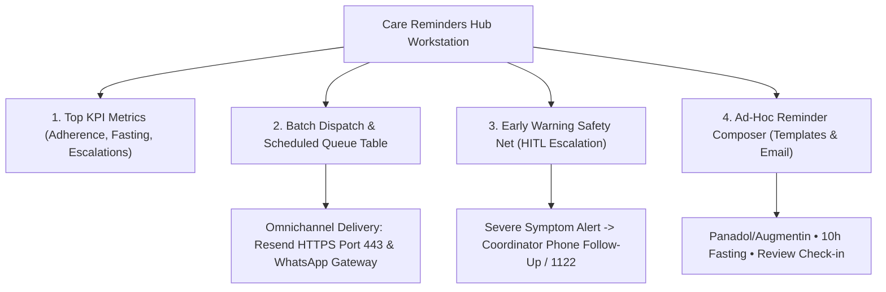

# MedCare Clinic — Care Reminders Hub & Continuity Operations Manual

**Target Persona:** Care Reminder Coordinator & Community Health Lead  
**Representative Profile:** Farhan Ali (Care Coordinator • Staff ID: `FLD-001`)  
**Workstation Route:** `/#/reminders`  
**Primary Mission:** Ensure post-consultation care continuity, verify medication adherence, prevent incomplete antibiotic courses, and monitor early warning symptom escalations.

---

## 1. Overview & Care Continuity Mission

The Care Reminders Hub is the proactive clinical safety net of MedCare Clinic. Clinical responsibility does not end when a patient leaves the doctor's office. This workstation automates bilingual patient reminders (in natural UrduLish & English) for medication schedules, diagnostic lab fasting rules, and post-consultation recovery check-ins.

---

## 2. Top Surveillance KPI Cards

At the top of the workstation, four live metric cards provide continuous situational awareness:

1. **Enqueued Care Plans:**
   - Tracks total pending (`SCHEDULED`) vs delivered (`SENT`) reminders.
   - Shows omnichannel engine readiness.
2. **Medication Adherence:**
   - Tracks active antibiotic and chronic regimens (e.g. *Panadol 500mg, Augmentin 625mg, Hydryllin syrup*).
   - Prevents patients from discontinuing antibiotic courses early, minimizing bacterial resistance and relapse risk.
3. **Diagnostic Lab Fasting:**
   - Tracks patients scheduled for fasting blood draws (e.g. Fasting Blood Sugar, Lipid Profile, LFTs).
   - Automated alerts dispatched 10–12 hours prior to lab visits instruct patients: *"Kal subha 8 baje test ke liye 8 ghante ka fast (pani pi sakte hain) lazmi hai."*
4. **Safety Net Escalations:**
   - Live counter of critical symptom alerts flagged by AI from patient recovery feedback.

---

## 3. Reminders Queue & Batch Dispatch Engine

The centralized queue lists all automated patient reminders:

### Queue Table Details:
- **Patient Information:** Full Name, MRN (e.g. `PAT-8915`), City, Blood Group, Phone, and Email.
- **Type & Channel:** 💊 Medication, 🧪 Fasting, 🩺 Check-in, or 📅 Pre-Visit delivered via WhatsApp or Email.
- **Schedule Time & Status:** Indicates whether the reminder is `SCHEDULED` for future delivery or `SENT` (with verified timestamp).
- **Clinical Message Preview:** Actual bilingual UrduLish message dispatched to the patient.
- **"Send Now" Action Button:** Allows the coordinator to manually expedite any scheduled reminder ahead of time.

### Batch Dispatching Pending Reminders:
Clicking the **"Batch Dispatch Pending Reminders"** button immediately processes all pending care plans:
- **Email Channel Delivery:** Dispatches live HTML-formatted clinical care reminders via the **Resend REST API (over HTTPS Port 443)** directly to registered patient email addresses.
- **WhatsApp Channel Delivery:** Dispatches via the production-ready WhatsApp Gateway protocol (`WA-GATEWAY-HTTPS-OK`).
- **Database & Audit Trail Update:** All dispatched rows transition from `SCHEDULED` to `SENT` in SQLite `clinic.db`, and an immutable event is logged in the clinical audit trail.

---

## 4. Early Warning Safety Net (HITL Escalations)

The Safety Net is a real-time AI triage sentinel that monitors patient responses to post-consultation inquiries.

### How It Works:
When a patient replies to a check-in reminder reporting their current health status:
- **Case 1: Severe Deterioration (Tariq Mahmood • PAT-0012)**
  - Patient reports: *"Tabiyat pehle se kharab ho rahi hai, seene mein sakht dard hai aur ultiyan aa rahi hain."*
  - **AI Sentinel Classification:** Flags immediately as **URGENT ATTENTION** (Red Flag).
  - **Coordinator Action:** Coordinator clicks **"Acknowledge & Call Patient Now"**, initiates direct phone outreach, and puts 1122 ambulance services on standby.
- **Case 2: Minor Side Effect (Ahmed Khan • PAT-1001)**
  - Patient reports: *"Khansi theek hai lekin dawai se thora pet kharab lag raha hai."*
  - **AI Sentinel Classification:** Non-emergency side-effect.
  - **Resolution:** Clinical note logged: *"Advised taking tablet strictly after full meals"*, and marked as **RESOLVED**.

---

## 5. Ad-Hoc Reminder Composer

For individualized follow-up instructions, the coordinator can compose customized reminders on the fly:
1. **Target Patient:** Select patient from the dropdown (e.g., Saira Fatima • `PAT-8915`).
2. **Category & Channel:** Choose Category (Medication, Lab Fasting, Post-Consult Check-in) and Channel (Email or WhatsApp).
3. **Quick Clinical Copy Templates:** 1-click buttons auto-fill clinically sound UrduLish copy:
   - **Panadol / Augmentin:** *"Assalam-o-Alaikum! Dawai ka waqt: Tab Panadol 500mg nashte ke baad lein."*
   - **10h Fasting Prep:** *"Fasting Reminder: Kal subha blood test ke liye 10 ghante ka fast lazmi hai."*
   - **Review Check-in:** *"Assalam-o-Alaikum! Clinic review ke baad tabiyat kaisi hai?"*
4. **Schedule & Dispatch:** Submits the reminder, saves it to SQLite, and immediately delivers the message.

